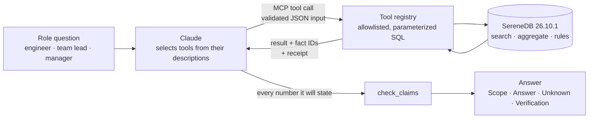
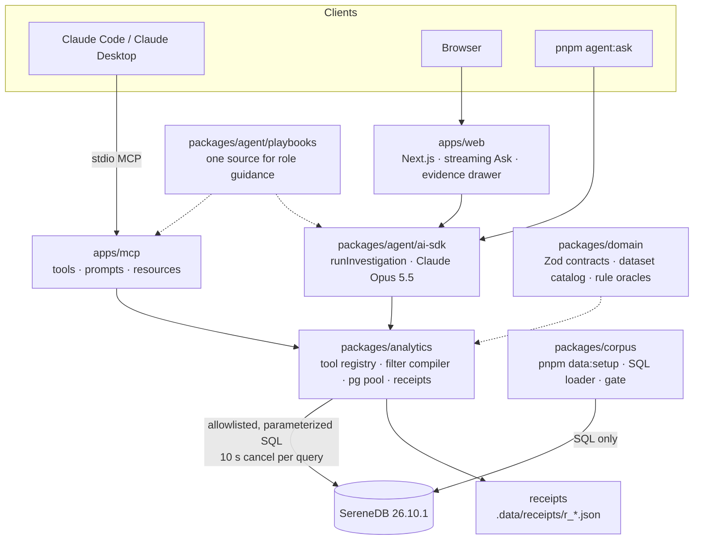

# Log Insights

**Question → evidence → recommendation for engineers, team leads and managers,
computed in SereneDB and explained by Claude.**

Team Burrito · National AI Hackathon 2026 · SereneDB challenge *Making Sense of
Logs: The Right Insights for the Right People*

Log Insights gives Claude a small set of tools over the BGL and OpenStack log
corpus. SereneDB does the searching, counting, trending, episode detection,
precursor analysis, percentiles and ranking rules. Claude picks the tools,
explains the returned evidence and recommends the next step for one of three
roles. Every query writes a **receipt** with the exact SQL, bound parameters,
scope, result and a fact ID for each number. Before Claude answers, it submits
every number it is about to state to `check_claims`. That check confirms the
cited fact exists and matches the stated value, metric and group.

| | |
|---|---|
| **Database** | SereneDB 26.10.1. Raw log lines are parsed, pattern-mined, indexed and analysed in SQL. There is no Python or TypeScript parser and no computation outside the engine |
| **Agent** | Claude (`claude-opus-5-5`, the jury's model) via MCP (Claude Code or Claude Desktop), a streaming web chat or a CLI |
| **Tools** | 8 read-only, parameterized tools with Zod contracts, bounded results and correction hints |
| **Evidence** | 50+ complete, unchanged receipts from real full-corpus runs under [`submission/evidence`](submission/evidence/) |
| **Run it** | `cp .env.jury.example .env` then `docker compose up`. One command starts SereneDB, downloads and verifies the corpus, loads it and serves the app |

## Contents

- [Where to find each required item](#where-to-find-each-required-item)
- [How it works](#how-it-works)
- [Getting started](#getting-started)
- [Connect Claude through MCP](#connect-claude-through-mcp)
- [Architecture](#architecture)
- [What SereneDB computes](#what-serenedb-computes)
- [Tools](#tools)
- [Worked investigation](#worked-investigation)
- [Special awards](#special-awards)
- [Data](#data)
- [Known limitations](#known-limitations)
- [Development and tests](#development-and-tests)

## Where to find each required item

| Submission requirement | Where |
|---|---|
| Working prototype with the search and summary tools the agent selects and calls | [MCP server](apps/mcp/src/server.ts) and [web app](apps/web) over one [tool registry](packages/analytics/src/registry.ts) |
| Run from a clean checkout, connect to SereneDB, load BGL and OpenStack, start the agent | [Getting started](#getting-started), [Connect Claude through MCP](#connect-claude-through-mcp) |
| Dependencies | [Getting started](#getting-started) (Docker only), [local development](#option-b-local-development) |
| Tool descriptions, accepted inputs and returned outputs | [Tools](#tools); canonical schemas in [`packages/domain/src/tools`](packages/domain/src/tools) |
| One worked investigation: questions, tool calls, executed SQL, results, answers for all three roles, scope, filters, truncation, facts versus hypotheses | [Summary below](#worked-investigation), full write-up in [`submission/worked-investigation.md`](submission/worked-investigation.md) |
| Real Claude answers for Engineer, Team Lead and Manager | [`submission/agent-examples`](submission/agent-examples/README.md) |
| Known limitations | [Known limitations](#known-limitations) |
| Best MCP Server | [Connect Claude through MCP](#connect-claude-through-mcp), [MCP design](#best-mcp-server) |
| Working with Huge Datasets | [Data queried, query times and costs](#working-with-huge-datasets) |
| Slides and walkthrough video | [Slides (PDF)](presentation/worked-investigation.pdf), [154-second walkthrough (MP4)](presentation/log-insights-walkthrough.mp4), [script](submission/demo-script.md) |

## How it works



1. **Orient.** `describe_corpus` returns the loaded datasets, their time spans,
   field meanings, the fictional team ownership and the role guidance.
2. **Retrieve.** `search_logs` finds original log lines with BM25 ranking,
   phrase or fuzzy matching and time filters. `get_log_context` returns the
   events right before and after one line, or a precursor analysis across all
   episode starts.
3. **Measure.** `count_events`, `event_trend`, `recurring_patterns` and
   `latency_stats` compute frequencies over the full stated scope, never from
   search hits.
4. **Verify.** Claude submits every number it is about to state to
   `check_claims`. The answer ends with the check summary, for example
   `30 claims checked · 0 mismatch · 0 unresolved`.

The three roles share the same tools, data and answer frame (Scope, Answer,
Unknown, Verification). What changes is the question, the evidence, the check
before recommending and the kind of next step:

| Role | Asks | Evidence the playbook requires | Check before recommending | Next step |
|---|---|---|---|---|
| Engineer | What failed, where, and what happened just before and after? | Original lines, nearby events, node/rack breadth, precursors | A discriminating check per hypothesis (local versus spread, precursor versus base rate) | The next diagnostic check |
| Team Lead | Which problems recur, how often, and which teams are involved? | Episodes, active days, breadth, weekly trend, team comparison | Recurring versus one burst; whether the prior period is covered by data | What the team investigates first |
| Manager | What deserves attention first? | Technical investigation order by episodes and breadth, trade-offs between criteria | Whether one candidate dominates or there is a trade-off | A bounded decision with explicit unknowns |

The [role playbooks](packages/agent/src/playbooks) exist once and feed the MCP
prompts, the MCP server instructions, `describe_corpus.answer_guidance` and the
web system prompt. A client that selects no prompt still gets role routing.

## Getting started

### Option A: Docker (recommended for the jury)

**Requirements:** Git, and Docker with Compose v2. Give Docker at least 4 GB of
RAM (8 GB recommended) and a few GB of disk. Node and pnpm run inside the image.
The first start needs internet access to download the corpus from Zenodo.

```bash
git clone --recurse-submodules https://github.com/M0ttii/log-insights-monorepo-2.git
cd log-insights-monorepo-2
cp .env.jury.example .env
```

Edit `.env`:

- `SERENEDB_PASSWORD`: choose any password, for example the output of
  `openssl rand -hex 16`. It initializes the database on the first start.
- `ANTHROPIC_API_KEY`: needed only for the web chat (**Ask**). Without a key,
  the overview, log search, corpus pages and receipts still work, and MCP
  clients bring their own model.

Then start everything:

```bash
docker compose up
```

Compose builds the app image and starts SereneDB. It then downloads `BGL.zip`
and `OpenStack.tar.gz` from [Zenodo](https://zenodo.org/records/8196385)
(about 63 MB, about 810 MB unpacked) and checks each file against a pinned
SHA-256. The loader runs in SQL and verifies the line counts against the brief.
Only then does the web server start. Open [http://localhost:3000](http://localhost:3000)
once the log shows `Corpus ready` and Next.js reports `Ready`. The first build
and load take several minutes. Later starts reuse the verified files, and the
load is idempotent, so it yields the same data version.

| Variable in `.env` | Meaning |
|---|---|
| `SERENEDB_PASSWORD` | **Required.** Seeds the database role on the first start. |
| `ANTHROPIC_API_KEY` | Enables the web chat. Only the web container receives it, at runtime; it is never a build argument. |
| `LOG_INSIGHTS_MODEL` | Default `claude-opus-5-5`. |
| `SERENEDB_IMAGE` | The verified SereneDB 26.10.1 image; see the Apple Silicon note below. |
| `WEB_PORT` | Default `3000`, published on `127.0.0.1` only. |
| `LOG_INSIGHTS_DATASETS` | Empty loads BGL and OpenStack. `all` adds five full Loghub extensions (HDFS_v1, OpenSSH, Apache, Linux, ZooKeeper); a comma-separated subset also works. |
| `LOG_INSIGHTS_DATA_MODE` | Default `corpus`. For a fast smoke test, use `samples` with `SERENEDB_DATABASE=log_insights_samples` (Loghub 2k samples, not full-corpus numbers). |

Stop with Ctrl-C or `docker compose down`. After changing `.env` or pulling new
code, run `docker compose down` and then `docker compose up --build`. Inspect
failures with `docker compose logs web` or `docker compose logs serenedb`. If a
download or check fails, the web server stays stopped instead of serving a
partial corpus. `docker compose down --volumes` deletes this stack's database,
cached raw files and receipts; a normal restart never needs it.

**Apple Silicon.** SereneDB 26.10.1 is published only as a linux/amd64 image,
pinned here by digest. Under emulation on Apple Silicon it does not start. We
ran an ARM64 build of the same source tag (`v26.10.1`, commit `3d12e1a8`). It
is not published on a registry. Load the archive from the team, then set its
immutable image ID in `.env`:

```bash
docker image load --input /path/to/docker-image.tar.gz
# in .env:
# SERENEDB_IMAGE=sha256:fd1b13533ceff354ffb48901dd63aa36a4b1d3c2b055b872e572bf83f38a7fb0
docker compose up
```

The loader records the image reference, image ID and `SELECT version()` in
`load_manifest`. It rejects mutable tags and never falls back to another
database version.

**Which SereneDB instance.** The brief provides SereneDB, and the SereneDB
*Getting started* guidance has teams run it locally. Compose therefore starts
the pinned 26.10.1 image next to the app and connects through the private
hostname `serenedb:7890`. No database port is published to the host. The tools
can reach any SereneDB 26.10.1 through `SERENEDB_HOST`, `SERENEDB_PORT`,
`SERENEDB_USER`, `SERENEDB_PASSWORD` and `SERENEDB_DATABASE`. The loader also
needs the database to read the raw files from a shared `/data/raw` mount.

### Option B: local development

Requirements: Node.js 24 (`.nvmrc`), pnpm 11.25.0 and Docker with Compose (for
SereneDB only).

```bash
git clone --recurse-submodules https://github.com/M0ttii/log-insights-monorepo-2.git
cd log-insights-monorepo-2
pnpm install --frozen-lockfile
cp .env.example .env      # set SERENEDB_PASSWORD and SERENEDB_IMAGE
pnpm data:setup           # starts SereneDB on 127.0.0.1:7890, downloads, verifies and loads
pnpm dev                  # web app on http://127.0.0.1:3000
```

`pnpm data:setup --samples` loads the Loghub 2k samples into a separate
database for a quick check. `pnpm --silent agent:ask --role engineer "<question>"`
runs one complete agent investigation from the terminal (needs
`ANTHROPIC_API_KEY`). Every script, the compatibility gate and the test suites
are described in [DEVELOPMENT.md](DEVELOPMENT.md).

### First questions to try

These are known development questions with archived answers, not holdouts:

- **Engineer:** *On BGL in June 2005, is the repeated `ciod` control-stream
  read failure confined to one node or spread across the job, and what should I
  check next?*
- **Team Lead:** *Which recurring problems did Workload Runtime have on BGL in
  June 2005, and what should the team investigate first?*
- **Manager:** *What should we investigate first on BGL? At most three
  priorities.*
- **Engineer, OpenStack:** *What happened around the token-validation errors in
  nova-api, and what should I check next?*

Questions about cost, downtime or affected customers get an explicit
"unknown". The logs carry no business mapping, so the answer says so.

## Connect Claude through MCP

The MCP server speaks stdio and exposes the 8 tools, 3 role prompts and 4
resources. stdout carries only protocol messages; logs go to stderr.

**Claude Code, local checkout.** The repository's [`.mcp.json`](.mcp.json)
registers `log-insights`. Open Claude Code in the repository, approve the
server and ask it to call `describe_corpus`. To register the server from
another directory:

```bash
claude mcp add log-insights -- pnpm --dir /absolute/path/to/log-insights-monorepo-2 --silent mcp
```

**Claude Desktop, local checkout.** Run `pnpm --silent mcp:desktop-config` and
add the printed `log-insights` entry to `mcpServers` in your Desktop
configuration. The entry uses absolute paths to Node, tsx, the server and
`.env`, so Desktop needs no shell `PATH`. It contains no credentials. Restart
Desktop and ask it to call `describe_corpus`.

**Docker only (no host Node).** Start the stack once with `docker compose up`
so the corpus is loaded. Then point the client at the `mcp` service through the
absolute path of `compose.jury.yaml`. Compose then reads the `.env` next to it,
whatever directory the client starts in:

```bash
claude mcp add log-insights -- docker compose -f /absolute/path/to/log-insights-monorepo-2/compose.jury.yaml run --rm --no-deps -T mcp
```

For Claude Desktop, add the same command to `mcpServers`:

```json
"log-insights": {
  "command": "docker",
  "args": ["compose", "-f", "/absolute/path/to/log-insights-monorepo-2/compose.jury.yaml",
           "run", "--rm", "--no-deps", "-T", "mcp"]
}
```

Desktop may not inherit your shell `PATH`; if `docker` is not found, use its
absolute path (for example `/usr/local/bin/docker`). The MCP container receives
no model key; the client brings its own model. Stop MCP clients before you
reload data.

| MCP feature | Name |
|---|---|
| Tools | `describe_corpus`, `search_logs`, `get_log_context`, `count_events`, `event_trend`, `recurring_patterns`, `latency_stats`, `check_claims` |
| Prompts (optional arguments `question`, `dataset`, `from`, `to`) | `engineer_investigation`, `team_lead_review`, `manager_priorities`; in Claude Code `/mcp__log-insights__engineer_investigation` and so on |
| Resources | `corpus://overview`, `corpus://schema`, `corpus://ownership`, `receipt://{id}` |

## Architecture



| Workspace | Responsibility |
|---|---|
| [`packages/domain`](packages/domain) | Pure TypeScript: Zod input/output contracts for every tool, the [dataset catalog](packages/domain/src/datasets.ts) (sources, checksums, field meanings, capabilities), fact IDs and the rule functions used as test oracles |
| [`packages/analytics`](packages/analytics) | The only package that executes SQL: lazy `pg` pool (four connections), filter compiler, the eight tools, receipts and re-run |
| [`packages/corpus`](packages/corpus) | `pnpm data:setup`: downloads and verifies the raw files, then loads, parses, pattern-mines and indexes them through [SQL scripts](packages/corpus/sql); the SereneDB [compatibility gate](packages/corpus/gate) |
| [`packages/agent`](packages/agent) | Role [playbooks](packages/agent/src/playbooks) and the AI SDK agent (`runInvestigation`: preflight, investigate, coverage, answer, gate, one revision) |
| [`apps/mcp`](apps/mcp) | stdio MCP server over the shared registry and playbooks |
| [`apps/web`](apps/web) | Web workspace: role-aware Ask chat, corpus overview, log search, event context and a receipt drawer with **Re-run** |
| [`packages/evals`](packages/evals) | Eval runner and archived client probes |

Design decisions that matter for correctness:

- **One registry, three clients.** MCP, the web chat and the CLI call the same
  tool registry. The same normalized input on the same data version returns
  identical numbers, whichever client or role sent it.
- **No model-written SQL.** Claude sends JSON. The registry validates it
  against the Zod schema and assembles SQL from allowlisted columns,
  dimensions and operations. Every value is a bound parameter. Re-running a
  receipt executes the registered tool with the stored input, never the
  stored SQL.
- **Receipts.** Each call writes one JSON file with the validated input and
  resolved defaults, every executed SQL statement and its parameters, scope,
  population, rows, truncation, duration, result, result digest, signature,
  data version and facts. A call whose receipt cannot be stored returns no
  numbers (`receipt_unavailable`).
- **Fact IDs.** Each number gets an ID such as `r_bcd0408f.f12`, meaning
  receipt `r_bcd0408f`, fact 12. An answer cites that ID instead of
  paraphrasing a value.
- **Deterministic results.** Every row-returning query ends its `ORDER BY` with
  a unique key, so result digests are reproducible.
- **Errors are values.** Expected failures form one union (`invalid_input`,
  `not_found`, `query_timeout`, `db_unavailable`, `receipt_unavailable`,
  `limit_exceeded`, `source_changed`). Each carries a safe message and a
  correction hint. Raw database errors and stacks never reach the model.
- **Untrusted text.** Log lines and model output are rendered as text. Log text
  never changes rules or tool access, and the prompt-injection cases are
  tested.

### Rules the tools enforce

| Rule | What it means in practice |
|---|---|
| Separate counting units (R-01) | Log events, OpenStack API accesses and unique request IDs are never mixed. Rates name their numerator and denominator. 4xx means 400–499, 5xx means 500–599. |
| Time | UTC is shown by default. Windows include the start and exclude the end. BGL and OpenStack share no time axis (2005–2006 versus 2017), so trends and comparisons are per dataset. A bucket outside a dataset's span is never reported as zero. |
| Episodes (R-05) | A new episode starts after at least 30 minutes without the pattern. Episodes are computed after all filters are applied. They are not incidents or outages. |
| Comparisons (R-06) | A reference period outside the data span is `determinable: false`, never a baseline of 0. |
| Priorities (R-08, R-09) | Candidates are ordered by episodes, then breadth, increase, events and pattern ID. A criterion missing for any candidate is dropped for all. Dominance is `clear_priority` or `trade_off`, never a composite risk score. |
| Precursors (R-11) | A precursor is a temporal observation with its own base rate, never a cause. |
| Missing values | `null` stays unknown; it is never coerced to 0 or "". |

## What SereneDB computes

The SereneDB developers told us they look at how much of the work happens
inside SereneDB, and whether we use features only SereneDB has. Our rule: every
analytical value and every rule outcome is computed in SereneDB SQL. TypeScript
validates input, assembles allowlisted SQL, assigns fact IDs, writes receipts
and compares submitted claims with stored facts. It never sorts, counts, sums,
ranks or classifies results.

| Task | SereneDB feature | Source |
|---|---|---|
| Read raw log files verbatim, without a parsing script | `read_csv` with a unit-separator delimiter, quoting off, `ignore_errors` and `store_rejects`: each physical line becomes one row, and unreadable lines are kept with their reason | [05_read.sql](packages/corpus/sql/05_read.sql) |
| Parse BGL, OpenStack and the five extensions | `regexp_extract` with named groups, timestamp conversion, `row_number() OVER ()` for exact line numbers | [10_bgl.sql](packages/corpus/sql/10_bgl.sql), [11_openstack.sql](packages/corpus/sql/11_openstack.sql) |
| Mine log templates | Chains of `regexp_replace` macros mask variable values into typed placeholders (`<NODE>`, `<PATH>`, `<IP>`, …): 684 BGL and 106 OpenStack patterns. CI checks on the 2k samples that no pattern merges two Loghub templates | [20_patterns.sql](packages/corpus/sql/20_patterns.sql) |
| Full-text index | A custom analyzer (`split_text_icu \| normalize_tokens`, no stemming, so tokens like `0x00544eb8` and `nova.compute.manager` stay intact) and an inverted index over the message plus 18 filter columns, with `optimize_top_k = 'bm25(1.2, 0.75)'` | [50_index.sql](packages/corpus/sql/50_index.sql) |
| Search | `plainto_tsquery` (all terms), `ts_phrase`, `ts_levenshtein` (fuzzy, bounded expansion), `BM25(...)` ranking, `ts_lexize` for query tokens and `ts_offsets` for highlight ranges taken from the index, not from HTML | [search-logs.ts](packages/analytics/src/tools/search-logs.ts) |
| Episodes and precursor anchors | `MATCH_RECOGNIZE` with `PATTERN (s n*)`, `PREV`, `FIRST`, `CLASSIFIER` and `MATCH_NUMBER`, after the full scope filter | [recurring-patterns.ts](packages/analytics/src/tools/recurring-patterns.ts), [get-log-context.ts](packages/analytics/src/tools/get-log-context.ts) |
| Recurrence status, investigation order and dominance | `CASE`, `count_if`, `row_number` and window aggregates implement R-05 to R-10 | [recurring-pattern-rules.ts](packages/analytics/src/tools/recurring-pattern-rules.ts) |
| Trends with real zeros | `unnest(range(ts, ts, INTERVAL))` builds the half-open UTC bucket grid in SQL, joined to observations, with partial buckets and capture gaps marked | [event-trend.ts](packages/analytics/src/tools/event-trend.ts) |
| Latency percentiles and error rates | `quantile_cont(latency_ms, [0.5, 0.9, 0.95, 0.99])` in one call, `count(*) FILTER`, `count(DISTINCT request_id)` | [latency-stats.ts](packages/analytics/src/tools/latency-stats.ts) |
| Faster facets | Implicit dictionary facets (`TsDict:` in the plan) for unfiltered one-dimension counts over the base corpus; NULL groups and the remainder are preserved | [dictionary-facets.ts](packages/analytics/src/dictionary-facets.ts) |
| Remote Parquet without downloading | `read_parquet` over HTTPS behind a view, an **inverted index over that external view**, `read_blob` to re-check each file's size and Last-Modified before a query | [61_otel_reference.sql](packages/corpus/sql/61_otel_reference.sql), [remote.ts](packages/analytics/src/remote.ts) |
| Live ingestion path | SereneDB's built-in **OTLP/HTTP listener** (`/v1/logs`, configured in [serened.conf](serened.conf)) for a bounded, labelled replay; `VACUUM (REFRESH_TABLE)` makes it visible | [63_otel_replay.sql](packages/corpus/sql/63_otel_replay.sql) |
| Semantic and hybrid search (opt-in) | `ai_embed`, `FLOAT[N]` vectors, an `ivf(metric='cosine')` index, reciprocal rank fusion in SQL; query vectors are pinned in immutable snapshots | [retrieval.ts](packages/analytics/src/retrieval.ts) |
| Performance report over our own audit trail | `read_json` over the receipt files, with `median` and `quantile_cont` per tool and data version | [report-perf.ts](packages/analytics/src/report-perf.ts) |

The [SereneDB function reference](submission/serenedb-functions.md) links each
path to a complete receipt from a real corpus run.

### Engine findings from our compatibility gate

`pnpm gate` runs 14 probes (`G1`–`G14`, [packages/corpus/gate](packages/corpus/gate/probes))
against the running image. Each probe encodes the observed behaviour, so an
image change shows up as a `DIFF`. Probes G11 to G13 also run in CI on the
official amd64 image. The probes found the following on 26.10.1; each finding
led to a workaround in the code:

| Observation | Our workaround |
|---|---|
| `SET statement_timeout` is accepted but not enforced | The pool cancels server-side after 10 s (`pg_cancel_backend`, SQLSTATE `57014` → `query_timeout`) and discards the connection |
| In the extended protocol, an untyped parameter in a result expression (`$1 + 1`) or a JSON function over a parameter makes the result describe as one `unknown` column (OID 705) | Every such parameter is typed (`$1::BIGINT`); the pool rejects any OID-705 result instead of returning mislabelled rows |
| Bound file arguments to `read_json` also describe as OID 705 | A fixed canonical glob; receipt IDs and times are bound as filters |
| Grouped `count(*)` under an `@@` predicate can be planned as `TsDict:` and miscount (reproduced on the OTel reference) | Analytical index groups use `count(ts)` (G13) |
| `CREATE OR REPLACE TABLE` silently drops dependent inverted indexes; it fails when a view depends on the table | The loader drops views first, then recreates table → views → index → `VACUUM (REFRESH_TABLE)` |
| The `TimeZone` startup option is ignored | Each connection runs `SET TimeZone = 'UTC'` |
| `ts_regexp` matches whole analyzed tokens, and an invalid `[` silently matches nothing | Not used for identifier search (G12) |
| Time-range predicates inside the inverted index count correctly on 26.10.1 but change BM25 scores | `ts` and `event_id` stay outside the index; time filters run as exact column filters on the index scan |

## Tools

All tools are read-only, take one strict JSON object (unknown fields are
rejected), write a receipt and return `{ data, facts, receipt, notes }`. A
full result is bounded to 256 KiB. Bounded lists say `truncated` and carry the
remainder in `other`. The text block of every MCP result contains the full JSON,
for clients that only show text to the model.

**Common filters** (most tools): `dataset`, `from`/`to` (UTC, start inclusive,
end exclusive), `components` (1–20), `teams` (1–10), `levels` (1–10),
`only_errors`, `pattern_id`, `text`. BGL adds `node`, `rack`, `alert_label` and
`only_alerts`. OpenStack adds `request_id` and `instance_id`. The extensions add
`block_id`, `host`, `process_id`, `client_ip` and `thread`, each with its
[catalog meaning](packages/domain/src/datasets.ts). A filter that does not apply
to the chosen dataset is `invalid_input` with a hint, never an empty result.

| Tool | Purpose and when to use it | Key inputs | Returns | Limits |
|---|---|---|---|---|
| `describe_corpus` | Call first: what is loaded and how to read it | `{}` | Per dataset: events, time span, field guide, levels, components with their team, labels, capabilities, data version, per-role answer guidance | No list is truncated |
| `search_logs` | Find original log lines (engineer evidence). Hits are examples, never a frequency | `query` (≤ 200 chars), `match`: `terms` (default, all words), `phrase`, `fuzzy` (`max_edits` 1–2), `semantic`/`hybrid` (with `retrieval_snapshot`); `sort`; filters | Exact `total_matches` for the same predicate, hits with event ID, time, fields, message (≤ 400 code points) and `match_ranges`, BM25 score | `limit` 1–50 (default 20) |
| `get_log_context` | `mode: event`: what happened just before and after one line. `mode: aggregate`: which patterns precede or follow every episode start of a pattern or query, against a base rate | `event_id`, `scope` (`same_node`, `same_component`, `same_request`, `dataset`, …), `before`/`after` 0–25, `window_minutes` 1–60; aggregate: `pattern_id` or `query`, `dataset`, `direction`, `top_n` 1–20 | Events with exact `offset_ms`, window counts per side; or per pattern: anchors with an occurrence, anchor share, base-rate windows, base rate and ratio | Base rate and ratio are omitted below five anchors |
| `count_events` | How often, grouped by one or two dimensions; whole-corpus totals; period comparison | `group_by` (1–2 of `dataset`, `team`, `component`, `level`, `alert_label`, `rack`, `node`, `pattern`, `http_status`, `endpoint`, …), `top_n` 1–50, `compare` (`previous_period` or an equal-length window), `contributions`, `entity` (IP, path, request ID, object ID) | Exact `total`, per-group count and share (computed in SQL), `other`, a `null` category for missing values; with `compare`: baseline, delta, percent change and R-06 class, or `determinable: false` | `compare` needs one dataset, `from`, `to` and one dimension; `top_n` ≤ 25 |
| `event_trend` | Events over time for one dataset | `dataset` (required), `bucket` (`second` … `week`), `split_by` (top 5 series plus `other`) | Bucket grid inside the data span with real zeros, `partial` edges and `capture_gap` buckets, `data_span`, `effective_range` | At most 120 buckets; otherwise `limit_exceeded` names the next coarser bucket |
| `recurring_patterns` | Which problems recur, and what to investigate first | `rank`: `episodes` (default), `events`, `increase`, `investigation_order`; `analysis` (`periodicity`, `cooccurrence` with a control pattern); filters | Per pattern: events, first/last seen, episodes, recurring flag, active days and weeks, breadth (BGL nodes and racks, OpenStack instances and requests), change against the previous period, R-10 status. `investigation_order` adds candidates checked, rank basis, leader per criterion and R-09 dominance | `limit` 1–25; `investigation_order` 1–5 |
| `latency_stats` | OpenStack API latency and error rates | `group_by` (`endpoint`, `method`, `status`, `component`, `hour`, `day`), `endpoints`, `http_status: {min, max}`, `outliers` (`p95`/`p99` threshold with a baseline) | API accesses, accesses without a request ID, unique requests, p50/p90/p95/p99/max ms, 5xx and 4xx counts and rates over API accesses | OpenStack only (`bgl` is `invalid_input`); `top_n` 1–20 |
| `check_claims` | Before answering: verify every stated number against its fact | `claims` (1–30): `fact`, `value`, `metric`, `group` (`{}` for ungrouped), optional `unit: "percent"` | Per claim `verified`, `mismatch` (with the differing field), `unknown_fact` or `unknown_receipt`; the summary line "N claims checked · M mismatch · K unresolved" | Reads receipts only, never the corpus; checks numbers, not explanations |

The full descriptions that Claude sees, with units and every field, are in the
[registry](packages/analytics/src/registry.ts) and
[`packages/domain/src/tools`](packages/domain/src/tools). JSON Schema snapshots
are versioned (`CONTRACT_VERSION` 5.0.0).

## Worked investigation

**Case:** control-stream failures during BGL job startup (`ciod: failed to read
message prefix on control stream`, dataset label `APPREAD`).
**Data:** the full base corpus, data version `dv_229e422f86a9fc6e`.
**Scope:** BGL, `[2005-06-01T00:00:00Z, 2005-07-01T00:00:00Z)` UTC. BGL records
start at 2005-06-03T22:42:50.363779Z [`r_45c7a4ec.f50`](submission/evidence/r_45c7a4ec.json),
so the earlier part of the window is unknown, not observed calm. OpenStack is a
separate companion example on its own time axis.

The registered tools ran directly against the loaded corpus; the role views are
analyst-written from those receipts. Real Claude answers for all three roles
are archived separately in [agent-examples](submission/agent-examples/README.md).
The full walkthrough, every receipt hash and the registry re-runs are in
[`submission/worked-investigation.md`](submission/worked-investigation.md) and
its [manifest](submission/worked-investigation/manifest.json).

### Tool calls

Times are database round-trip durations recorded in each receipt.

| # | Tool and input | Result | Truncated | Receipt | DB ms |
|---|---|---|---|---|---:|
| 1 | `describe_corpus {}` | Load balance, spans, fields, ownership | no | [r_45c7a4ec](submission/evidence/r_45c7a4ec.json) | 15.52 |
| 2 | `count_events {group_by: [dataset], dataset: bgl}`, full span | 4,747,945 [`r_8f3bdd12.f4`](submission/evidence/r_8f3bdd12.json) BGL log events | no | [r_8f3bdd12](submission/evidence/r_8f3bdd12.json) | 19.73 |
| 3 | `count_events {group_by: [dataset], dataset: openstack}`, full span | 207,820 [`r_2c4302ad.f4`](submission/evidence/r_2c4302ad.json) OpenStack log events | no | [r_2c4302ad](submission/evidence/r_2c4302ad.json) | 9.77 |
| 4 | `search_logs {query: "failed to read message prefix", match: phrase, dataset: bgl, from, to, limit: 3}` | 5,983 [`r_b63b6c6e.f4`](submission/evidence/r_b63b6c6e.json) matches, 3 examples | **yes** | [r_b63b6c6e](submission/evidence/r_b63b6c6e.json) | 19.18 |
| 5 | `recurring_patterns {dataset: bgl, alert_label: APPREAD, rank: episodes}` | Episodes, active days and breadth | no | [r_bcd0408f](submission/evidence/r_bcd0408f.json) | 38.57 |
| 6 | `get_log_context {mode: event, event_id: 14738, scope: same_component, window_minutes: 10}` | Ordered neighbours with offsets | **yes** | [r_b6ce5f6c](submission/evidence/r_b6ce5f6c.json) | 16.27 |
| 7 | `get_log_context {mode: aggregate, pattern_id: 287312f13c189c4d, direction: before, window_minutes: 10}` | Precursors across all episode starts | no | [r_16d9e58b](submission/evidence/r_16d9e58b.json) | 43.76 |
| 8 | `recurring_patterns {teams: [Workload Runtime], rank: investigation_order}` | Team priority and dominance | **yes** (list) | [r_8207d0e9](submission/evidence/r_8207d0e9.json) | 65.97 |
| 9 | `event_trend {dataset: bgl, bucket: week, teams: [Workload Runtime], split_by: pattern}` | Weekly trend | no | [r_c53dc64f](submission/evidence/r_c53dc64f.json) | 19.82 |
| 10 | `count_events {group_by: [team], teams: [Workload Runtime], compare: previous_period}` | Previous-period check | no | [r_ef9745b3](submission/evidence/r_ef9745b3.json) | 11.27 |
| 11 | `recurring_patterns {dataset: bgl, rank: investigation_order}`, BGL-wide | Wider portfolio | **yes** (list) | [r_7643eff2](submission/evidence/r_7643eff2.json) | 260.38 |
| 12 | `latency_stats {dataset: openstack}`, full span | API accesses, 5xx, percentiles | no | [r_872d82bd](submission/evidence/r_872d82bd.json) | 13.10 |
| 13 | `search_logs` + `get_log_context {scope: same_request}`, OpenStack token validation | Original request sequence | no | [r_08a148f9](submission/evidence/r_08a148f9.json), [r_e9f31ab4](submission/evidence/r_e9f31ab4.json) | 13.35, 15.12 |
| 14 | `check_claims` (three batches) | All cited values verified | no | [r_0f3a6bca](submission/evidence/r_0f3a6bca.json), [r_a2f57065](submission/evidence/r_a2f57065.json), [r_51762d3b](submission/evidence/r_51762d3b.json) | 0 |

Calls 2, 3 and 12 aggregate over each dataset's **full span**, not over
retrieved lines. Calls 4, 5 and 7 to 11 also set `from`/`to` to the June window
(omitted above for brevity). Call 6 uses a 10-minute window on each side of one
event.

### Executed SQL (excerpts)

Every receipt contains the complete SQL and bound parameters. Three excerpts:

The exact count behind the phrase search (call 4). It uses the same predicate
as the hit list, so the total is not estimated from the hits:

```sql
SELECT count(*) AS total FROM log_events_idx
WHERE log_events_idx.message @@ ts_phrase($1)
  AND log_events_idx.dataset = $2
  AND log_events_idx.ts >= $3::TIMESTAMPTZ AND log_events_idx.ts < $4::TIMESTAMPTZ
-- $1 = 'failed to read message prefix', $2 = 'bgl',
-- $3 = '2005-06-01T00:00:00Z', $4 = '2005-07-01T00:00:00Z'
```

Episode starts as precursor anchors (call 7). `MATCH_RECOGNIZE` groups events
of the pattern into episodes after filtering; a gap of 30 minutes or more
starts a new one:

```sql
WITH matched AS (
  SELECT log_events.event_id, log_events.ts, log_events.pattern_id FROM log_events
  WHERE log_events.dataset = $1 AND log_events.ts >= $2::TIMESTAMPTZ
    AND log_events.ts < $3::TIMESTAMPTZ AND log_events.pattern_id = $4),
anchors AS (
  SELECT event_id, ts FROM matched MATCH_RECOGNIZE (
    ORDER BY ts, event_id
    MEASURES FIRST(event_id) AS event_id, FIRST(ts) AS ts
    ONE ROW PER MATCH AFTER MATCH SKIP PAST LAST ROW
    PATTERN (s n*) DEFINE n AS ts - PREV(ts) < $5::INTERVAL))
-- … joins each anchor to the 10 minutes before it, then computes the anchor
-- share, the grid-window base rate and their ratio in SQL
-- $4 = '287312f13c189c4d', $5 = '30 minutes'
```

The weekly grid for the trend (call 9). Empty weeks inside the span become real
zeros, and weeks outside it are never emitted:

```sql
WITH grid AS (SELECT unnest(range(date_trunc('week', $4::TIMESTAMPTZ),
                                  $5::TIMESTAMPTZ, $6::INTERVAL)) AS bucket),
captured AS (SELECT date_trunc('week', log_events.ts) AS bucket FROM log_events
             WHERE log_events.dataset = $1 AND log_events.ts >= $2::TIMESTAMPTZ
               AND log_events.ts < $3::TIMESTAMPTZ GROUP BY 1)
SELECT … g.bucket < $8::TIMESTAMPTZ OR g.bucket + $9::INTERVAL > $10::TIMESTAMPTZ AS partial,
       c.bucket IS NULL AS capture_gap
FROM grid g LEFT JOIN captured c ON g.bucket = c.bucket ORDER BY g.bucket
```

### Results

**Frequency and breadth (call 5):** 5,983 [`r_bcd0408f.f3`](submission/evidence/r_bcd0408f.json)
log events in 7 [`r_bcd0408f.f8`](submission/evidence/r_bcd0408f.json) episodes
on 5 [`r_bcd0408f.f5`](submission/evidence/r_bcd0408f.json) active days,
emitted by 512 [`r_bcd0408f.f12`](submission/evidence/r_bcd0408f.json) nodes in
32 [`r_bcd0408f.f13`](submission/evidence/r_bcd0408f.json) racks.

**Nearby events (call 6, original messages, excerpt of a truncated result):**

| UTC time | Offset, ms | Node | Original message |
|---|---:|---|---|
| 2005-06-04T07:24:31.560279Z [`r_b6ce5f6c.f9`](submission/evidence/r_b6ce5f6c.json) | -838.005 [`r_b6ce5f6c.f8`](submission/evidence/r_b6ce5f6c.json) | `R23-M0-N4-I:J18-U11` | `ciod: LOGIN chdir(/p/gb2/draeger/benchmark/dat32k_060205) failed: No such file or directory` |
| 2005-06-04T07:24:32.398284Z [`r_b6ce5f6c.f1`](submission/evidence/r_b6ce5f6c.json) | anchor | `R23-M1-N8-I:J18-U11` | `ciod: failed to read message prefix on control stream (CioStream socket to 172.16.96.116:33399` |
| 2005-06-04T07:24:32.432192Z [`r_b6ce5f6c.f3`](submission/evidence/r_b6ce5f6c.json) | 33.908 [`r_b6ce5f6c.f2`](submission/evidence/r_b6ce5f6c.json) | `R04-M1-N4-I:J18-U11` | `ciod: failed to read message prefix on control stream (CioStream socket to 172.16.96.116:33569` |

The after-window holds 1,021 [`r_b6ce5f6c.f13`](submission/evidence/r_b6ce5f6c.json)
events; only the requested neighbours are returned.

**Precursor check (call 7):** 6 [`r_16d9e58b.f6`](submission/evidence/r_16d9e58b.json)
of 7 [`r_16d9e58b.f1`](submission/evidence/r_16d9e58b.json) episode starts are
preceded within the window by `LOGIN chdir(<PATH>) failed: No such file or directory`.
That pattern appears in 23 [`r_16d9e58b.f8`](submission/evidence/r_16d9e58b.json)
of 3,896 [`r_16d9e58b.f4`](submission/evidence/r_16d9e58b.json) background grid
windows. The anchor share divided by the background rate is
145.193 [`r_16d9e58b.f9`](submission/evidence/r_16d9e58b.json). SereneDB computed
the shares and the ratio. This is a descriptive temporal baseline, not a
significance test.

**Observed facts versus hypotheses:**

| Hypothesis | Status | Discriminating check |
|---|---|---|
| The symptoms are confined to one node | `contradicted` | 512 [`r_bcd0408f.f12`](submission/evidence/r_bcd0408f.json) emitting nodes. This tests symptom confinement only. |
| Missing-working-directory errors are temporally associated with episode starts | `supported` | 6 of 7 anchors preceded (call 7) and the quoted sequence. A supported association is not causal proof. |
| A network fault, an initiating node or a job-start configuration defect caused the failures | `open` | Breadth and precursor enrichment do not identify the origin. Needed: match job allocation, submission working directory, filesystem/mount availability and transport evidence to the affected control streams. |

### Answers per role

**Engineer.** *Is the control-stream failure confined to a node, and what
distinguishes its origin?* The symptom is spread across nodes; the initiating
origin is open. **Next check:** recover the job submission record and check the
logged working directory, its availability on the involved I/O nodes and the
program image at startup. Compare successful starts with failures before
choosing a filesystem/configuration or network fix. **Unknown:** initiating
component, affected-job boundaries, why the path was unavailable, duration and
customer effect.

**Team Lead.** *Which Workload Runtime problems recur, and what should the team
investigate first?* The team scope holds 8 [`r_a7df3aee.f4`](submission/evidence/r_a7df3aee.json)
patterns. The named candidates (truncated list):

| Pattern | Episodes | Active days | Nodes | Log events |
|---|---:|---:|---:|---:|
| `ciod: Error loading <PATH>: invalid or missing program image, No such file or directory` | 22 [`r_8207d0e9.f16`](submission/evidence/r_8207d0e9.json) | 15 [`r_8207d0e9.f13`](submission/evidence/r_8207d0e9.json) | 512 [`r_8207d0e9.f21`](submission/evidence/r_8207d0e9.json) | 3,384 [`r_8207d0e9.f17`](submission/evidence/r_8207d0e9.json) |
| `ciod: LOGIN chdir(<PATH>) failed: No such file or directory` | 14 [`r_8207d0e9.f27`](submission/evidence/r_8207d0e9.json) | 11 [`r_8207d0e9.f24`](submission/evidence/r_8207d0e9.json) | 480 [`r_8207d0e9.f32`](submission/evidence/r_8207d0e9.json) | 2,178 [`r_8207d0e9.f28`](submission/evidence/r_8207d0e9.json) |
| `ciod: failed to read message prefix on control stream (CioStream socket to <IP>` | 7 [`r_8207d0e9.f38`](submission/evidence/r_8207d0e9.json) | 5 [`r_8207d0e9.f35`](submission/evidence/r_8207d0e9.json) | 512 [`r_8207d0e9.f44`](submission/evidence/r_8207d0e9.json) | 5,983 [`r_8207d0e9.f39`](submission/evidence/r_8207d0e9.json) |

The weekly trend (call 9) covers all 13,409 [`r_ef9745b3.f4`](submission/evidence/r_ef9745b3.json)
team log events. The previous-period comparison is `determinable: false`: its
reference window lies before the BGL data span, so no growth or recovery is
claimed. **Investigate first:** job-start input availability and the recurring
program-image and chdir errors alongside the control-stream symptom. Review
submission-directory and program-image validation, then consider a preflight
check if the review confirms an input defect. **Unknown:** prior-period trend,
cause, business effect.

**Manager.** *Where should investigation effort go first?* SereneDB evaluates
8 [`r_8207d0e9.f4`](submission/evidence/r_8207d0e9.json) team candidates and
returns `clear_priority` for the program-image loading pattern. It leads on
episodes (22 [`r_8207d0e9.f9`](submission/evidence/r_8207d0e9.json)) and shares
the breadth maximum (512 [`r_8207d0e9.f7`](submission/evidence/r_8207d0e9.json)
nodes). The control-stream pattern has the most log lines
(5,983 [`r_8207d0e9.f11`](submission/evidence/r_8207d0e9.json)), so ranking by
line volume alone would point elsewhere. Increase is dropped as a criterion
because the reference period is unavailable. There is no composite risk score.
**Decision:** fund a bounded Workload Runtime investigation into job-start
inputs. The BGL-wide ranking (call 11, led by `rts panic! - stopping execution`
with 34 [`r_7643eff2.f14`](submission/evidence/r_7643eff2.json) episodes) is a
different population and remains a separate allocation choice. **Unknown:**
growth, downtime, cost and customer impact.

**OpenStack companion (calls 12–13):** 2 [`r_872d82bd.f8`](submission/evidence/r_872d82bd.json)
5xx responses out of 98,733 [`r_872d82bd.f6`](submission/evidence/r_872d82bd.json)
API accesses, a rate of 0.0000202567 [`r_872d82bd.f16`](submission/evidence/r_872d82bd.json)
over API accesses; 89,535 [`r_872d82bd.f17`](submission/evidence/r_872d82bd.json)
distinct request IDs (a separate counting unit). Inside one request, the log
shows `Bad response code while validating token: 503`, then
`Unable to validate token: Failed to fetch token data from identity server`,
then an access line with status `503`. These are quoted source lines, not an
inferred cause, and no relation to BGL is claimed.

**Verification:** 30 [`r_0f3a6bca.f1`](submission/evidence/r_0f3a6bca.json),
30 [`r_a2f57065.f1`](submission/evidence/r_a2f57065.json) and
8 [`r_51762d3b.f1`](submission/evidence/r_51762d3b.json) claims checked, each
batch with 0 mismatches and 0 unresolved. The integrity test in `pnpm test`
re-checks receipt bytes, the [claim ledger](submission/worked-investigation/claims.json)
and that every citation resolves.

## Special awards

### Best MCP Server

- **Clear tool selection.** Each description states purpose, when to use the
  tool and when not, inputs with units and limits, outputs and truncation.
  Overlapping needs are parameters on one tool (`compare` on `count_events`,
  `mode: aggregate` on `get_log_context`, `rank: investigation_order` on
  `recurring_patterns`), so the agent picks from 8 tools, not 20.
- **Useful limits.** Every list has a bounded `limit`/`top_n`, an explicit
  `truncated` flag and an `other` remainder. Trends cap at 120 buckets and name
  the next coarser bucket. Each query is cancelled server-side after 10 s.
- **Actionable errors.** `invalid_input` says which field is wrong and what to
  send instead; an unsupported dataset/tool combination says so instead of
  returning 0.
- **Role guidance without client support.** Server instructions, the three
  prompts and `describe_corpus.answer_guidance` come from the same playbooks.
  Every tool result repeats the guidance and carries the full JSON as text,
  because Claude Desktop showed only the summary to the model in an early
  probe.
- **Tested transport.** `pnpm test:mcp` drives real stdio messages in CI:
  schemas, resources, receipts, error hints, a clean stdout, startup from
  another working directory, the generated Desktop command and shutdown on
  stdin end, SIGINT and SIGTERM.

### Working with Huge Datasets

**Five more Loghub datasets** load with `LOG_INSIGHTS_DATASETS=all` (Docker) or
`pnpm data:setup --with all`, from the same catalog, parser SQL and tool stack.
Load balance on 18 October 2026, data version `dv_02dfa8cc8e16e2a2`:

| Dataset | Lines read | Events loaded | Rejected | Patterns |
|---|---:|---:|---:|---:|
| HDFS_v1 | 11,175,629 | 11,175,629 | 0 | 54 |
| OpenSSH | 655,147 | 655,147 | 0 | 104 |
| Apache | 56,482 | 52,004 | 4,478 (continuation lines without time or level) | 37 |
| Linux | 25,567 | 25,547 | 20 (invalid UTF-8) | 765 |
| ZooKeeper | 74,380 | 74,380 | 0 | 124 |

A full reload of all seven datasets from cached raw files took about 60 s on an
Apple M3.

**50 billion OpenTelemetry rows, queried in place.** The brief's
`text_bench/part_000.parquet` through `part_049.parquet` are read over HTTPS and
never downloaded. All 50 file footers are catalogued; that does not mean every
row was analysed. Two bounded access paths keep remote work predictable:

- **Indexed reference window:** an inverted index over a view on
  `read_parquet`, covering `[00:29:14Z, 00:29:34Z)` on 2025-09-23 across
  part_000 and part_001. The rows stay in S3. The loader built the index in
  6,248.6 ms; it takes 464,496 KiB on disk.
- **Direct scan:** counts and trends without text, at most 60 s and two files
  per query. Timestamp filters compare the raw `TIMESTAMPTZ_NS` column, so
  Parquet row groups are pruned.

Single local observations on 18 October 2026 (ARM64 26.10.1, data version
`dv_af94ef4d7bb4e343`, `pnpm otel:measure`, all windows on 2025-09-23 UTC):

| Case | Rows in scope | Row groups read | HTTPFS read | GET / HEAD | Server s | Wall s |
|---|---:|---|---|---|---:|---:|
| 1 s, part_000 | 498,344 | 2 / 1624 | 276.0 KiB | 2 / 1 | 0.315 | 0.590 |
| 10 s, part_000 | 5,769,387 | 10 / 1624 | 12.9 MiB | 20 / 1 | 0.717 | 0.957 |
| 60 s, part_000 | 32,605,195 | 54 / 1624 | 69.8 MiB | 108 / 1 | 1.57 | 1.794 |
| 50 s across the part_000/001 boundary | 29,235,108 | 49 / 3249 | 62.9 MiB | 98 / 2 | 1.59 | 2.746 |
| Indexed phrase count, reference window | 676,555 | not exposed | 0 bytes | 0 / 0 | 0.0102 | 0.016 |
| Indexed phrase, 3 hits | 676,555 | not exposed | 56.3 MiB | 72 / 5 | 2.69 | 2.702 |
| Cold 60 s, part_024 | 33,617,068 | 56 / 1624 | 72.1 MiB | 112 / 1 | 2.41 | 3.612 |
| Warm repeat, part_024 | 33,617,068 | 56 / 1624 | 0 bytes | 0 / 1 | 0.117 | 0.318 |

The indexed count is answered from postings without touching S3; fetching hits
reads remote columns. A 60-second scan over about 33 million rows reads about
70 MiB of the file rather than the whole file. **Costs:** the bucket is public
and we were not billed, so no cloud cost was measured. Each query reports its
GET/HEAD counts and bytes as above. Model token costs were not measured for
these runs.

Before each remote query, `read_blob` re-checks the file's size and
Last-Modified. A changed file returns `source_changed` instead of a stale
result. Receipts name the exact files, window, path and index snapshot. The
bounded OTLP replay (365 records posted once to SereneDB's built-in listener)
shows the ingestion path. It is labelled a replay and never resent, because
SereneDB does not deduplicate. Details, fixtures and the full field mapping are
in [DEVELOPMENT.md](DEVELOPMENT.md#opentelemetry-remote-parquet-and-otlp-replay-log-35).

## Data

The base corpus is [Loghub](https://github.com/logpai/loghub) BGL and OpenStack
from [Zenodo record 8196385](https://zenodo.org/records/8196385) (CC BY 4.0).
Please cite Zhu et al., *Loghub: A Large Collection of System Log Datasets for
AI-driven Log Analytics*, ISSRE 2023; for BGL also Oliner & Stearley, *What
Supercomputers Say*, DSN 2007. Raw files are never committed; the receipts in
`submission/` contain bounded original excerpts with this attribution.

Load balance from `pnpm data:setup`, preserved in a
[complete corpus description](submission/evidence/r_676abcd3.json)
(data version `dv_7ea6fcb2c9eb6882`):

| Dataset | Lines read | Expected (brief) | Events loaded | Rejected |
|---|---:|---:|---:|---:|
| BGL | 4,747,963 | 4,747,963 | 4,747,945 | 18 |
| OpenStack | 207,820 | 207,820 | 207,820 | 0 |

The 18 rejected BGL lines have no node and contain fragments of other messages
or binary bytes. They are kept verbatim in `load_rejects` with their reason.

- **Time.** BGL time comes from its Unix seconds plus the microseconds of the
  text timestamp. OpenStack timestamps carry no zone and are taken as UTC. The
  two datasets share no time axis.
- **Errors.** Levels are counted as logged. BGL error levels are `FATAL`,
  `ERROR`, `SEVERE` and `FAILURE`; OpenStack's are `ERROR` and `CRITICAL`. In
  OpenStack, 98,733 lines carry an HTTP status (API accesses), 9,196 of them
  without a request ID.
- **Labels.** BGL alert categories and the OpenStack anomaly instances are
  dataset annotations, not our findings. The OpenStack labels mark instances,
  not error lines.
- **Ownership is fictional.** The organisation "Serene Platform" exists so
  answers can be grouped by team:

| Team | BGL components | OpenStack components |
|---|---|---|
| Compute Platform | `KERNEL` | `nova-compute` |
| Workload Runtime | `APP` | – |
| Control Plane | `MMCS`, `BGLMASTER`, `CMCS` | `nova-scheduler` |
| Hardware Operations | `HARDWARE`, `LINKCARD`, `MONITOR`, `DISCOVERY` | – |
| API Gateway | – | `nova-api` |
| `unowned` | `SERV_NET` (deliberately unmapped) | – |

The reason for each assignment is stored in the `ownership` table. Extension
ownership and the full stored schema (`log_events`, `api_access`,
`corpus_stats`, `load_report`, `load_manifest`, the index) are described in
[DEVELOPMENT.md](DEVELOPMENT.md#architecture-schema-and-answer-rules).

## Known limitations

- **Answer quality is shown, not benchmarked.** The archived Claude answers are
  selected examples of known questions. A formal baseline comparison, holdout
  questions and independent ratings were deferred. Earlier client probes still
  showed uncited numbers and overly broad causal wording; they remain archived
  in [`packages/evals/results`](packages/evals/results) as failures.
- **`check_claims` verifies numbers, not reasoning.** It confirms value, metric
  and group against the cited fact. It does not validate explanations,
  causality or completeness.
- **No causes, impact or incidents.** The logs cannot establish root causes,
  downtime, cost or customer effect, so answers keep these unknown. Episodes
  and matched lines are not incidents. Precursors are temporal observations.
- **Assumed time zones.** OpenStack and all extensions carry no zone and are
  read as UTC. OpenSSH and Linux lines have no year; it is derived from the
  archive dates and checked at load.
- **Apple Silicon** needs the unpublished ARM64 image archive; the official
  26.10.1 image is amd64-only.
- **Loader placement.** The loader needs SereneDB to read the raw files from a
  shared `/data/raw` mount, so it targets the bundled container. A hosted
  instance without that mount can serve the tools but not the load.
- **10-second query limit.** Larger requests fail with a narrowing hint rather
  than running long. A cold remote scan can hit the limit: right after a
  container restart, one 10-second two-file OTel trend timed out, while the
  same query passed with warm data.
- **OpenTelemetry is bounded.** Full-text search covers only the 20-second
  indexed reference window. Direct scans cover at most 60 s and two files.
  Patterns, episodes, precursors, comparisons, breadth and latency are not
  available for `otel`. The file pin is a version stamp (size, ETag,
  Last-Modified, footer facts), not a content checksum.
- **Not built:** agent-created indexes (setting `LOG_INSIGHTS_WORKSPACE_TOOLS=1`
  still exposes 8 tools), log-to-trace/metric correlation and row-level
  security per role.
- **Semantic and hybrid search** need a prebuilt embedding snapshot and a
  provider secret in SereneDB. We claim no quality advantage over lexical
  search.
- **Web chat.** Ask streams the shared agent's tool calls, its answer and
  linked receipts. Some earlier web runs ended after revision without final
  prose, and complete live acceptance of all three roles in the web UI is not
  claimed. The core demonstration uses MCP.

## Development and tests

| Command | What it checks |
|---|---|
| `pnpm check` | Lint, types, formatting, dependency boundaries, unused code, unit tests |
| `pnpm test:integration` | Loader, patterns and all tools against a real SereneDB with the 2k samples (needs Docker and `.env`) |
| `pnpm test:mcp` | MCP stdio smoke against the loaded samples |
| `pnpm test:golden` | Independent full-corpus SQL for all eight tools, written by a different agent than the implementer, plus raw-file reconciliation (local only) |
| `pnpm test:e2e` | Browser and accessibility checks against a production build |
| `pnpm gate` | The 14 SereneDB compatibility probes |

CI runs `pnpm check`, the build and the browser tests. It loads the samples,
the extensions and the OTel fixtures into the official amd64 image and runs the
integration and MCP suites. It also builds and starts the complete jury Docker
stack from scratch with the 2k samples and checks counts, receipts and re-run. The full script list, golden-test rules, the database
performance report, MCP client probe history and all measurement records are in
[DEVELOPMENT.md](DEVELOPMENT.md). Contributor and coding-agent conventions are
in [AGENTS.md](AGENTS.md). The German planning documents are
[docs/concept.md](docs/concept.md) and [docs/technical.md](docs/technical.md).

```text
apps/mcp            stdio MCP server, resources, prompts, Desktop config, smoke tests
apps/web            Next.js workspace: streaming Ask, analytics, log search, evidence drawer
packages/analytics  pg pool, filter compiler, receipts, tool registry and the eight tools
packages/corpus     pnpm data:setup (SQL loader), data profiling and the SereneDB gate
packages/agent      role playbooks and the AI SDK agent runInvestigation
packages/domain     Zod contracts, dataset catalog, fact IDs and rule oracles
packages/evals      eval runner, archived probes and development questions
packages/ui         shadcn primitives on Base UI and design tokens
submission/         receipts, worked investigation, agent examples, function reference
presentation/       slides (Typst source and PDF) and the walkthrough video
```
