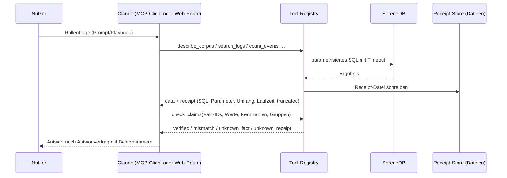
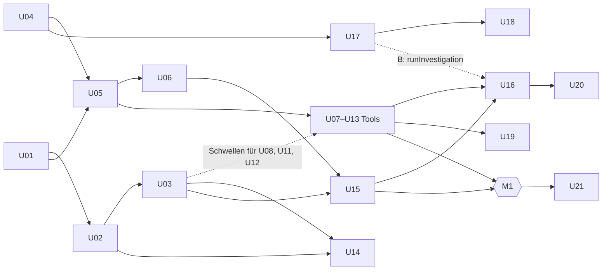

# Log Insights: Technische Spezifikation

**Stand:** 18. Oktober 2026 · **Version 3.7**, U25-Funktionsentscheidungen und G12 (5.2, 5.3, 14, 18); 3.6: Eval-/Abgabe-Gates und Auflösung der U16/U18-Abhängigkeit (13.1, 14, 18); 3.5: Web-Agent auf AI SDK 7 mit eigener Phasenmaschine `runInvestigation`, Antwort-Gate und sichtbarer Revision (LOG-45–LOG-51: 2, 3, 4, 10, 11, 13, 14, 16, 18); 3.4: Erweiterungskorpora und Datensatzkatalog (LOG-40, U26: 4, 6.1, 7.1, 8, 14, 18); 3.3: Web-App nach UI-Konzept 3.0: Markierung `uncited`, aufgezeichnete Läufe, Receipt-Öffnen, SereneDB-Funktionen im Receipt (8.3, 11, 18); 3.2: Episoden und Anker per `MATCH_RECOGNIZE` (LOG-32, 5.3, 8.2); 3.1: Entscheidungen aus dem Gespräch mit dem SereneDB-Team: Rechenort und SereneDB-Funktionen (5.3, 8.2, 14, 18); 3.0: Migration auf SereneDB 26.10.1 (3, 5, 7, 18); 2.9: Profiling und Datenentscheidungen; 2.8: Registry, Pool, Receipt-Store und `describe_corpus`; 2.7: Loader und Ladeergebnis; 2.6: Ergebnis des SereneDB-Kompatibilitäts-Gates (5.2); 2.5: Evaluationsmethodik (Abschnitt 13): Baseline, Holdout, Wiederholungen und Aufwand; 2.4: acht Tools, Fakt-IDs, Vorläuferanalyse, Rollenführung, Arbeitspakete nach Abhängigkeiten; Version 2.0 ersetzte 1.2 vollständig  
**Verbindliche Grundlage:** [Produktkonzept v3.8](concept.md). Umzug ins Monorepo: [monorepo-migration.md](monorepo-migration.md). Oberfläche: [ui-concept.md](ui-concept.md). Backlog: [improvements.md](improvements.md).  
**Status:** umsetzungsbereit. Das Kompatibilitäts-Gate ist bestanden (5.2: Ergebnisse für Image 26.09.1.3 und erneuter Lauf mit 26.10.1); der Loader lädt beide Datensätze (7, Ladeergebnis); Profiling-Entscheidungen, Masken und Schwellen stehen fest (7, Profiling). Alle übrigen Tests und Messwerte sind geplante Nachweise, keine erzielten Ergebnisse.

## 1. Ziel

Eine TypeScript-Codebasis stellt **acht parametrisierte Tools** auf SereneDB bereit, alle P0 (8.2); zwei optionale Index-Tools (concept A-33) kommen nur hinter einem Schalter hinzu. Zwei dünne Adapter machen sie nutzbar: ein **MCP-Server** für Claude Code und Claude Desktop und ein **Web-Chat** mit Vercel AI SDK und Claude. Jedes Tool-Ergebnis erzeugt einen **Query Receipt** als JSON-Datei (6.2) und vergibt für jede Zahl eine **Fakt-ID** (8.3). Rollen-Playbooks steuern beide Clients, auch ohne Wahl eines Rollen-Prompts, und beide prüfen Zahlen auf demselben Weg mit `check_claims`. Der kritische Pfad ist:

**SereneDB + Loader → Domain-Verträge → Kern-Tools mit Receipts → MCP-Server → Playbooks und Faktenprüfung (M1) → Ausbau → Verifikation → Abgabe (M2).** Mehrere Agenten arbeiten parallel; die Reihenfolge ergibt sich aus Abhängigkeiten, nicht aus Stunden (14, 15). Die Web-App (P1) baut auf den Domain-Verträgen auf, wird nach M1 gegen echte Tools verdrahtet und blockiert diesen Pfad nie (concept 4).

## 2. Architektur

```mermaid
flowchart LR
  CC[Claude Code / Claude Desktop] -- MCP stdio --> MCP[apps/mcp]
  Browser[Browser] --> Web[Next.js: UI + Route Handler]
  Web -- runInvestigation: AI SDK 7 + Tools --> Claude[Claude API]
  Eval[@workspace/evals: Runner] -- runInvestigation --> Claude
  MCP --> Reg[@workspace/analytics: registry]
  Web --> Reg
  Reg -- pg, parametrisiertes SQL, nur SELECT --> DB[(SereneDB: log_events, ownership)]
  Reg -- Datei je Receipt --> RS[(.data/receipts/*.json)]
  Setup[@workspace/corpus: setup.ts + sql/*.sql] --> DB
```

| Prozess | Start | Verantwortung |
|---|---|---|
| `serenedb` | `docker compose up -d` | Daten, Volltextindex, alle Berechnungen |
| MCP-Server | vom MCP-Client gestartet (`pnpm --silent mcp`) | Tools, Resources, Prompts über stdio |
| Web | `pnpm dev` bzw. `pnpm build && pnpm start` | Übersicht, Logs, Chat, Receipt-Ansicht |

Es gibt **keinen** eigenen Worker, keine Jobwarteschlange und keine zweite Datenbank. Der Agent-Loop liegt bei Claude (MCP-Weg) bzw. in der Phasenmaschine `runInvestigation` aus `@workspace/agent/ai-sdk` (Web-Weg und Eval-Runner, 11.1): fester Code mit Phasen in einem einzelnen Streaming-Request, keine Workflow-Engine und kein Agenten-Framework. Web-Chat, Rollenvergleich und Rollen-Eval nutzen denselben Agenten. Jeder Prozess besitzt einen eigenen `pg`-Pool.



## 3. Technologievertrag

| Baustein | Wahl | Begründung / Grenze |
|---|---|---|
| Sprache, Laufzeit | TypeScript strict, Node 24, pnpm 11.25 (gepinnt) | Eine Sprache für Tools, MCP, Web und Tests; geteilte Zod-Schemas |
| Repository | pnpm-Workspaces mit Turborepo (shadcn-Monorepo-Vorlage) | Paketgrenzen statt Ordnerregeln; der MCP-Prozess hat keinen Next- oder React-Abhängigkeitsbaum (4) |
| Skripte und MCP-Prozess | `tsx` | Führt TypeScript aus Workspace-Paketen direkt aus; kein Build-Schritt für den MCP-Server |
| Datenbank | SereneDB 26.10.1 (Quelltag `v26.10.1`, Commit `3d12e1a8`) als Docker-Image aus `SERENEDB_IMAGE`: auf Apple Silicon der lokale, **nicht offiziell veröffentlichte** linux/arm64-Build `local/serenedb:26.10.1-arm64` (Image-ID `sha256:fd1b1353…7fb0`), in CI das offizielle `serenedb/serenedb:26.10.1@sha256:6d41ac65…58c9` (nur linux/amd64); Port 7890 | Laut Guidance lokal zu betreiben; Identität vom Loader geprüft und im Manifest festgehalten (5.1). Das offizielle 26.10.1 gibt es nur für linux/amd64, emuliert läuft es auf Apple Silicon nicht an (5.1); vorher 26.09.1.3 (Multi-Arch, Gate 5.2). Wechsel auf ein offizielles Multi-Arch-26.10.x, sobald es erscheint, mit erneutem Gate-Lauf |
| DB-Treiber | `pg` (node-postgres) 8.23.1 | Von SereneDB als vollständig unterstützt gelistet; es gibt kein eigenes SereneDB-SDK. Verhalten im Gate geprüft (5.2, Punkt 1 und 6) |
| Validierung | Zod 4.6.7 (gepinnt in `@workspace/domain`; MCP SDK v2 verlangt ≥ 4.2) | Einziger Vertrag für Tool-Ein- und -Ausgaben, MCP-Schemas und AI-SDK-Tools; Export nach JSON Schema 2020-12 per `z.toJSONSchema` |
| MCP | `@modelcontextprotocol/sdk` (TypeScript) | Offizielles SDK; Tools, Resources, Prompts, strukturierte Ausgaben |
| Agent im Web und im Eval | Vercel AI SDK 7 (`ai` 7.0.x, `@ai-sdk/anthropic` 4.0.x, `@ai-sdk/react` 4.0.x; bei Installation exakt gepinnt), darauf die eigene Phasenmaschine `runInvestigation` (11.1) | Festgelegter Stack, Zod-Schemas der Registry direkt als Tool-Schemas, UI-Message-Stream für `useChat` und AI Elements; reicht die nötigen Claude-Optionen über `providerOptions.anthropic` durch (adaptive Thinking, `effort`, Prompt-Caching, `fallbacks`, System-Nachrichten im Gespräch, `contextManagement`). Rückfall nur für einzelne fehlende Optionen: `@anthropic-ai/sdk`. Claude als Modell (im Brief genannt) |
| Web | Next.js 16.4, React 19.3 | Web-App (P1) |
| UI | Tailwind, shadcn auf Base UI (`base-nova`), AI Elements (Base), Lucide, shadcn `chart`; Theme aus dem SereneDB-Designkit (`serenedb/serene-design` als Git-Submodule `vendor/serene-design`, nur CSS: Palette, Urbanist), Geist Mono für Daten | Kit-Komponenten nicht genutzt (Radix); siehe [ui-concept.md](ui-concept.md) 9 und DESIGN.md |
| Tests | Vitest, Playwright (Smoke + axe) | Golden Queries gegen echte SereneDB; E2E nur für den Kernablauf |
| Betrieb | Docker Compose nur für SereneDB | App-Prozesse laufen lokal mit Node |

**Entfällt gegenüber v1.2:** Effect (der Worker, für den es gedacht war, entfällt; verbleibende Bedarfe wie Pool, Timeout und Fehlertypen sind mit async/await und einer kleinen Fehler-Union abgedeckt), SQLite/`better-sqlite3`, eigener Worker-Prozess, Caddy und Basic Auth, Datenfreigabe- und Widerrufsskripte, Template-Miner nach Drain (ersetzt durch SQL-Normalisierung, R-04). **TanStack Query** wird nur eingesetzt, falls die interaktive Logsuche es braucht; Übersichten lesen als Server Components direkt aus der Registry. **Kein ORM:** Unsere Last besteht aus analytischen Lesezugriffen mit SereneDB-eigenem SQL (Volltextoperatoren, BM25, `read_csv`); ein ORM brächte nur `$queryRaw` und Migrationsrisiken auf einer Nicht-PostgreSQL-Engine.

**Entfällt gegenüber v2.1:** die Tabelle `query_receipts` in SereneDB (ersetzt durch Receipt-Dateien, 6.2), `compare_periods` als eigenes Tool (jetzt Option `compare` von `count_events`, 8.2), Fakt-Token und der Zahlen-Scan des finalen Web-Texts (ersetzt durch `check_claims` in beiden Clients, 8.3, 11).

**Entfällt gegenüber v2.3:** `rank_problems` als eigenes Tool (jetzt `rank: investigation_order` von `recurring_patterns`, 8.2), JSON-Pointer als Faktenreferenz (jetzt Fakt-IDs, 8.3), die Bedingung „Ausbau-Tools nur nach Fallbedarf“, der Zeitplan nach Stunden und die Aufteilung auf zwei Personen (14, 15).

**Nicht genutzt für den Agenten (Entscheidung 18.10.2026, LOG-45):** LangGraph/LangChain mit LangSmith (zweites Framework, eigene Nachrichtentypen neben Zod; LangSmith schickt Prompts und Logtext an einen externen Dienst), Mastra (Workflow-Engine, Memory und eigener Storage), OpenAI Agents SDK (Claude nur über Adapter), Claude Agent SDK (Claude-Code-Harness mit Bash und Dateitools; zu schwer und zu große Angriffsfläche für eine Web-Route; der MCP-Weg nutzt Claude Code bereits), Anthropic Managed Agents (gehostete Schleife, unsere Tools laufen an Loopback-SereneDB), Pydantic AI bzw. Python-Dienste (zweite Sprache und Schemawelt; kein offizieller TypeScript-Port). Der Mehrwert eines Agenten-Frameworks läge im Ablauf (Abdeckung, Gate, Revision); diesen Ablauf implementiert `runInvestigation` als testbarer Code. Statt LangSmith schreibt jeder Lauf ein lokales Laufprotokoll (11.1).

Versionen werden bei Installation gepinnt; APIs werden gegen die installierte Version geprüft (AI SDK, MCP SDK, Zod), nicht aus dieser Spezifikation übernommen.

## 4. Repository und Paketgrenzen

pnpm-Workspace-Monorepo mit Turborepo, ein Lockfile an der Wurzel. Interne Pakete heißen `@workspace/*` und exportieren TypeScript-Quellen ohne Build-Schritt; Next transpiliert sie über `transpilePackages`, `tsx` und Vitest lesen sie direkt. Der Alias `@/*` gilt nur in `apps/web`. Kurzpfade in dieser Spezifikation wie `analytics/registry.ts` oder `agent/playbooks/` meinen die Quellen des jeweiligen Pakets, etwa `packages/analytics/src/registry.ts`. Pakete mit „geplant“ entstehen mit ihrem ersten Code.

```text
compose.yaml            # nur SereneDB; mountet .data/raw und .data/receipts read-only
.env.example            # SERENEDB_*, ANTHROPIC_API_KEY, LOG_INSIGHTS_MODEL, LOG_INSIGHTS_RECEIPTS_DIR, LOG_INSIGHTS_WORKSPACE_TOOLS
.mcp.json               # serenedb-docs und shadcn (Entwicklung) + log-insights (Jury, Claude Code)
apps/
  web/                  # Next.js-App "web": app/ (inkl. app/api/chat, receipts, search), components/, tests/e2e/
  mcp/                  # geplant: server.ts, resources.ts, prompts.ts, print-desktop-config.ts, MCP-Smoke
packages/
  ui/                   # @workspace/ui: shadcn-Primitives, shadcn-Hooks, cn(), globals.css mit Tokens
  domain/               # reine Zod-Verträge und Regeln: Filter, Receipt, Tool-I/O, R-06/R-08/R-10; geplant answer.ts
                        #   (Zitate, unchecked, uncited, Abschnitte, Gate-Befunde; geteilt von Web-UI und Agent, 11.1)
  analytics/            # geplant: einziger Ort mit SQL-Ausführung
    src/db.ts           #   pg-Pool, 10-s-Limit per Cancel, Fehlerabbildung
    src/filters.ts      #   gemeinsamer Filtercompiler mit Allowlists
    src/receipts.ts     #   Receipt-Store (eine JSON-Datei je Receipt), Signatur, Digest
    src/tools/          #   ein Modul je Tool
    src/registry.ts     #   Liste aller Tools: Name, Titel, Beschreibung, Schemas, run()
    tests/              #   golden/, integration/
  agent/                # playbooks/*.md + playbooks.ts (Export ./playbooks); geplant src/ai-sdk/ (Export ./ai-sdk):
                        #   tools.ts (Registry → AI-SDK-Tools), investigation.ts (runInvestigation), coverage.ts,
                        #   run-record.ts (Laufprotokoll .data/runs/), model.ts (Modell- und Provider-Optionen), CLI agent:ask
  corpus/               # gate/ (Kompatibilitäts-Proben, `pnpm gate`), sql/01_schema.sql … 99_cleanup.sql, sql/profiling/ (`pnpm data:profile`, nicht Teil des Ladens), src/ (setup, download, load, sources, profile), tests/integration/
  evals/                # src/ Runner auf runInvestigation, Offline-Bewertung/Berichte (LOG-52); questions/dev.yaml, results/; Holdout-Freigabe folgt (13.1)
  typescript-config/    # gemeinsame tsconfig-Vorlagen
  eslint-config/        # gemeinsame ESLint-Vorlagen (base, next-js, react-internal)
docs/                   # Konzepte, worked-investigation.md, evidence/ (exportierte Receipts)
```

**Paketabhängigkeiten** (in jeder `package.json` deklariert; pnpm löst nicht deklarierte Pakete nicht auf):

| Paket | darf abhängen von | darf nicht |
|---|---|---|
| `domain` | `zod` | jedes Projektpaket, `pg`, `next`, `react`, `ai`, MCP SDK |
| `analytics` | `domain`, `pg`, `zod` | `next`, `server-only`, `react`, `ai`, MCP SDK |
| `agent` | `analytics`, `domain`, `ai`, `@ai-sdk/anthropic` | `next`, `server-only`, `react`, MCP SDK |
| `corpus` | `domain` (nur Datensatzkatalog, seit U26), `pg`, Node-Entpackbibliotheken | Tools aus `analytics` (Laden ist kein Tool) |
| `evals` | `agent`, `analytics`, `domain` | `next`, `react` |
| `apps/mcp` | `analytics`, `domain`, `agent` (nur Export `./playbooks`), MCP SDK | `next`, `react`, Export `agent/ai-sdk` |
| `apps/web` | alle Pakete, `next`, `react`, `server-only`, AI SDK, `@workspace/ui` | – |
| `ui` | Base UI, shadcn-Hilfspakete, Recharts | jede App, jedes Fachpaket |

`analytics` und `agent` hängen nie von `next` oder `server-only` ab: Der MCP-Prozess und der Eval-Runner laden sie ohne Next, und `server-only` wirft außerhalb der `react-server`-Bedingung beim Import einen Fehler. `server-only` steht nur in Next-spezifischen Server-Adaptern in `apps/web`, über die Server Components und Route Handler die Registry erhalten. Die Wurzel-`package.json` enthält nur Tooling, damit Pakete nicht über das Wurzel-`node_modules` an nicht deklarierte Bibliotheken kommen.

**Zusätzlich per dependency-cruiser (CI):** keine Zyklen, auch zwischen Paketen; keine relativen Importe über Paketgrenzen; `packages/ui` importiert keine App; Komponenten in `apps/web` importieren keine Server-Pakete; `partials/` bleiben privat; kein Radix, kein assistant-ui.

**Pfade und Umgebung:** Prozesse laufen mit ihrem Paket als Arbeitsverzeichnis. Pfade zu `.data/` werden über die Workspace-Wurzel aufgelöst (Suche nach `pnpm-workspace.yaml` bzw. `LOG_INSIGHTS_RECEIPTS_DIR`), nie über `process.cwd()`. Next liest `.env*` nur aus `apps/web`; die eine `.env` an der Wurzel wird in `next.config.ts` per `loadEnvConfig` (`@next/env`) und in Node-Prozessen per `--env-file-if-exists` geladen. Umgebungsvariablen, die Code liest, stehen in `turbo.json`.

## 5. SereneDB

### 5.1 Betrieb

`compose.yaml` startet das Image aus `SERENEDB_IMAGE` (`.env`, ohne Standardwert) mit `pull_policy: never`, dem benannten Datenvolume `serenedb-data` auf `/var/lib/serenedb`, `nofile`-Limit 131072 (Installationsdoku) und den Mounts `./.data/raw:/data/raw:ro` (damit `read_csv` die Rohdateien im Container liest) und `./.data/receipts:/data/receipts:ro` (damit der Leistungsbericht die Receipts per `read_json` in SereneDB auswertet). Der Port ist nur auf Loopback veröffentlicht (`127.0.0.1:${SERENEDB_PORT}:7890`, Standard 7890); geprüft: von `127.0.0.1` erreichbar, von der LAN-Adresse des Hosts nicht (26.10.1: `ECONNREFUSED`). Ein Healthcheck (`psql … -c 'SELECT 1'` im Container) meldet Bereitschaft, auf die `pnpm data:setup` wartet.

**Image und Identität (26.10.1, LOG-29):** Zwei Builds desselben Quellstands (Tag `v26.10.1`, Commit `3d12e1a8473b2f63b3a08f197f7adf4bbb3bdf47`) sind geprüft:

| | Lokal (Apple Silicon) | CI |
|---|---|---|
| Referenz | `local/serenedb:26.10.1-arm64` | `serenedb/serenedb:26.10.1@sha256:6d41ac6577e797289158786a2015ba8fbd6875feadb5c491518e166c011058c9` (Index-Digest der Registry) |
| Plattform | linux/arm64 | linux/amd64 (einzige Plattform des Index) |
| Image-ID (Config-Digest) | `sha256:fd1b13533ceff354ffb48901dd63aa36a4b1d3c2b055b872e572bf83f38a7fb0` | `sha256:01b7f879a34e77409b3cbfb5d25ab08c72646d2a07c69fc498a3bbe29682f6e0` |
| Herkunft | **Nicht offiziell, nicht veröffentlicht.** Eigener Build aus dem Tag mit genau einer CMake-Abweichung `-DDUCKDB_OPTIMIZATION_PROFILE=NONE` (entspricht Upstream-Fix `85e6982b`; der offizielle ARM64-Release-Build scheiterte an `-march`). Label `org.opencontainers.image.revision` = Quellcommit | Offizielles Release (Labels `version` 26.10.1, `revision` = Quellcommit) |
| `SELECT version()` | `PostgreSQL 18.3 (SereneDB 26.10.1)` | `PostgreSQL 18.3 (SereneDB 26.10.1)` (laut Label; Lauf siehe unten) |

Image-ID und Registry-Digest sind verschiedene Größen: Die Image-ID ist der SHA-256 der Image-Konfiguration auf dem Docker-Host (auch für lokale Builds vorhanden), der Registry-Digest benennt, was eine Registry ausliefert (bei Multi-Arch den Index, nicht das Plattform-Image); der lokale Build hat keinen. `pnpm data:setup` (`corpus/src/image.ts`, `load.ts`) prüft vor dem SQL: (1) Eine Referenz mit `@sha256:` wird bei Bedarf gezogen und akzeptiert; ein Tag ohne Digest wird nie gezogen und nur akzeptiert, wenn er in `LOCAL_IMAGES` steht **und** der Container genau dessen Image-ID ausführt, sonst Abbruch mit Hinweis auf die Wiederherstellung. (2) Der Container dieses Compose-Projekts muss Port 7890 auf `127.0.0.1:${SERENEDB_PORT}` veröffentlichen, also derselbe Server sein, mit dem sich der Loader verbindet. (3) `SELECT version()` muss bei lokalen Builds dem gelisteten Wert entsprechen. `load_manifest` hält `image` (Referenz), `image_id` und `server_version` fest; alle drei gehen in die `data_version` ein.

**Isolation mehrerer Instanzen:** Compose-Projektname (`COMPOSE_PROJECT_NAME`, sonst der Verzeichnisname) bestimmt Container und Volume, `SERENEDB_PORT` den Host-Port, `SERENEDB_IMAGE` das Image; alle stehen in der `.env` des Checkouts. `pnpm data:setup` ruft `docker compose` im Workspace-Wurzelverzeichnis auf, Integrationstests starten `pnpm data:setup` als Unterprozess und lesen dieselbe `.env`; so gelten Projekt, Volume, Port und Image auch für Unterprozesse. Die Migration lief so als Projekt `log-insights-sdb26101` (Port 17891, eigenes Volume) neben der unveränderten 26.09.1.3-Instanz auf Port 7890.

**Start, Wiederherstellung, Neuaufbau, Rollback:**

- *Image wiederherstellen (lokal):* `docker image load --input <Artefaktverzeichnis>/docker-image.tar.gz`, dann `docker image inspect local/serenedb:26.10.1-arm64 --format '{{.Id}}'` muss die Image-ID oben ergeben. Prüfsummen in `SHA256SUMS` des Artefaktverzeichnisses (`.data/experiments/serenedb-26.10.1-arm64/`, nicht versioniert, mit `BUILD.txt` zum Neubau aus dem Tag). Nicht neu bauen oder umtaggen: Ein anderer Build hat eine andere Image-ID und wird abgelehnt.
- *Start und Neuaufbau:* `.env` aus `.env.example` (`SERENEDB_IMAGE`, `SERENEDB_PASSWORD`, ggf. `COMPOSE_PROJECT_NAME`, `SERENEDB_PORT`), dann `pnpm data:setup --samples` und `pnpm data:setup`. Immer auf einem **frischen** Volume: Ein mit 26.09.1.3 angelegtes Datenvolume wird nicht mit 26.10.1 geöffnet (kein geprüfter Upgrade-Pfad); die Daten entstehen aus den Rohdateien neu (Korpus rund 20 s).
- *Rollback auf 26.09.1.3:* Branch-Stand vor LOG-29 (Commit `62a6913`, `compose.yaml` mit `serenedb/serenedb:26.09.1.3@sha256:018a3187…5636`) mit dessen Compose-Projekt und Volume; dessen Daten (`dv_263e378cd8560c4a`) blieben während der Migration unberührt. Receipts beider Stände bleiben unverändert und nennen ihre `data_version`.

**Offizielles 26.10.1 auf Apple Silicon:** emuliert (linux/amd64 unter Docker Desktop, M3) startet `serened` mit 100 % CPU, öffnet den Port aber auch nach sechs Minuten nicht (Healthcheck `unhealthy`). Der CI-Lauf mit diesem Image ist damit lokal nicht nachprüfbar; er läuft erst auf GitHub (`ubuntu-latest`, amd64).

**Anmeldung (Abweichung vom Quick Start):** „Lokal keine Anmeldung“ gilt nur innerhalb des Containers. Vertraut wird ausschließlich dem Bootstrap-Superuser `postgres` über Unix-Socket und Loopback des Containers; jede andere Verbindung braucht SCRAM-SHA-256. Verbindungen vom Host kommen über das Docker-Gateway an und sind daher nicht „lokal“. Compose setzt deshalb `POSTGRES_PASSWORD` aus `SERENEDB_PASSWORD` in `.env`; der Wert setzt das Passwort beim ersten Anlegen des Volumes (spätere Änderung per `ALTER ROLE` oder neues Volume). Verbindungsdaten in `.env.example`: `SERENEDB_IMAGE`, `SERENEDB_HOST=127.0.0.1`, `SERENEDB_PORT=7890`, `SERENEDB_USER=postgres`, `SERENEDB_DATABASE=postgres`, `SERENEDB_PASSWORD` ohne Wert, optional `COMPOSE_PROJECT_NAME`. Ein Vertrauen aller Verbindungen (`SERENEDB_HOST_AUTH_METHOD=trust`) wird bewusst nicht genutzt: Es gälte für jeden Container auf dem Host.

**Dokumentation:** Die Website-Doku kann einen anderen Stand als das Image beschreiben (unter 26.09.1.3 etwa die Syntax von `CREATE TEXT SEARCH DICTIONARY`, 5.2 Punkt 4). Maßgeblich ist die im Image eingebettete Doku: `SELECT path, title FROM sdb_docs.search('<Frage>', 5)` bzw. `sdb_docs.docs` (26.09.1.3: 2.620 Abschnitte, 26.10.1: 2.746), ergänzend Doku und SQL-Logic-Tests des Quelltags (`tests/sqllogic/sdb/pg/simple/tokenizers/`). Der Docs-MCP (`serenedb-docs`) dient der Suche, sein Ergebnis wird gegen `sdb_docs` bzw. eine Probe geprüft.

### 5.2 Kompatibilitäts-Gate

Vor dem Bau der Tools wird jede Annahme mit dem gepinnten Image geprüft, unterstützt durch den Docs-MCP (`serenedb-docs` in `.mcp.json`) bzw. `sdb_docs.search` per SQL. Ergebnis und Abweichungen werden in diesem Abschnitt nachgetragen. Das Gate ist das erste Arbeitspaket (14); Tool-Pakete beginnen erst mit seinem Ergebnis.

1. Verbindung über `pg`, Parameterbindung (auch als `@@ $1`), `BIGINT`-Rundreise, Unicode, `NULL`; Zeitstempel: `TIMESTAMP` gegenüber `TIMESTAMPTZ`, Session-`TimeZone`, Mikrosekunden in der Textausgabe.
2. Zeilenweises Einlesen der Rohdateien mit `read_csv` (eine Textspalte, ohne Quoting) und Feldextraktion per Regex-Funktionen; Ladezeit für BGL.
3. `CREATE OR REPLACE TABLE … AS SELECT` für idempotente Ladeläufe.
4. Volltext: `CREATE TEXT SEARCH DICTIONARY` mit `frequency` und `position`, `CREATE INDEX … USING inverted`, `VACUUM (REFRESH_TABLE)`, `@@`, `ts_phrase`, `ts_levenshtein`, `ORDER BY BM25(<index>.tableoid) DESC`, Option `optimize_top_k`; identische Trefferzahl von `count(*)` und Trefferliste; Kombination mit Filtern auf `ts`, `dataset`, `component`, `level` (EXPLAIN: Index- vs. Column-Filter).
5. Window-Funktionen (`lag`) für Episoden, Perzentile (z. B. `quantile_cont` oder `percentile_cont`), Datums-Buckets (`date_trunc` oder Äquivalent), `count(DISTINCT …)`.
6. `statement_timeout` mit SQLSTATE `57014`; Pool-Verhalten nach Timeout.
7. `read_json` über ein Glob-Muster (`/data/receipts/*.json`) für den Leistungsbericht; ohne Glob-Unterstützung erzeugt ein Exportskript eine NDJSON-Datei, die `read_ndjson` liest (nicht nötig, siehe Ergebnis).
8. Rollen/Rechte: ob ein rein lesender Benutzer möglich ist. Optional, weil die Standard-Tools nicht in SereneDB schreiben.
9. Vorläuferanalyse (R-11): Bereichs-Join der Episodenanfänge eines Musters mit den Ereignissen im Fenster davor und danach sowie die Grundrate über ein festes Fensterraster; Laufzeit auf dem vollen BGL-Korpus für ein häufiges und ein seltenes Muster. Ziel: unter dem `statement_timeout` von 10 s; sonst Grenzen für Ankerzahl bzw. Zeitraum festlegen.
10. Phrasen- und Fuzzy-Modus (`ts_phrase`, `ts_levenshtein`) mit gebundenen Parametern und identischer Trefferzahl von `count(*)` und Trefferliste.

Fehlt ein Konstrukt, wird es durch einfachere SQL-Schritte in SereneDB ersetzt. Eine Berechnung maßgeblicher Zahlen außerhalb von SereneDB ist kein stiller Ausweg; ein unlösbarer Unterschied wird als Blocker mit betroffener Anforderung dokumentiert.

#### Gate-Ergebnis (17.10.2026, Image 26.09.1.3, `pg` 8.23.1; historisch, Neulauf mit 26.10.1 unten)

**Gesamtergebnis: bestanden, kein Blocker.** Sechs Umformulierungen, die Loader (U02), Pool (U05) und Tools (U07–U13) übernehmen müssen. Proben: `packages/corpus/gate/` (je Punkt ein Modul unter `probes/`, SQL unter `sql/`); Ausführung mit `pnpm gate [G1 …] [--keep]` gegen den Compose-Dienst. Jede Prüfung vergleicht erwartetes mit beobachtetem Verhalten; Erwartungen, die von PostgreSQL abweichen (etwa „`statement_timeout` wirkt nicht“), sind als solche kodiert, sodass ein geändertes Image als `DIFF` auffällt. Punkte auf dem vollen Korpus brauchen `.data/raw/BGL.log`. Letzter Lauf: alle Prüfungen wie erwartet, nichts übersprungen, rund 17 s. Messwerte auf einem Apple-M-Rechner (14 Kerne, Docker mit 8 GB); Laufzeiten sind Einzelmessungen, keine Statistik.

| Punkt | Ergebnis | Bewertung |
|---|---|---|
| 1 Treiber und Typen | Parameter (auch `message @@ $1`), Unicode, Anführungszeichen, Backslash und `NULL` runden korrekt. `BIGINT` kommt als exakter String (Wert > 2^53 geprüft); `UBIGINT` und `HUGEINT` kommen als `NUMERIC` (OID 1700), ebenfalls als String. `TIMESTAMPTZ` (OID 1184) kommt mit Rohtext-Parser als `2005-06-03 22:42:50.363779+00`, Mikrosekunden erhalten. Gebundene Strings mit `Z` und `+02:00` ergeben bei `::TIMESTAMPTZ` denselben Zeitpunkt; bei `::TIMESTAMP` wird der Offset **still verworfen** (PostgreSQL-Verhalten), Bereiche wären verschoben. Die Startoption `options=-c TimeZone=…` wird **ignoriert** (Server bleibt `Etc/UTC`); `SET TimeZone` wirkt. Mehrere Anweisungen in einer einfachen Abfrage liefern je Anweisung ein Ergebnis, aber ein in derselben Abfrage angelegtes Textwörterbuch ist für `CREATE INDEX` **unsichtbar** („Dictionary for inverted index does not exists“). | **Umformulierung:** `ts` ist `TIMESTAMPTZ` (6.1). Jede Verbindung führt nach dem Verbinden `SET TimeZone = 'UTC'` aus, nicht per Startoption. Typparser für 1114 und 1184 geben Rohtext zurück. SQL-Skripte des Loaders werden Anweisung für Anweisung gesendet (`corpus/src/sql-script.ts`). |
| 2 Rohzeilen | `read_csv(…, columns = {'line': 'VARCHAR'}, delim = E'\x1f', quote = '', escape = '', header = false, auto_detect = false)` liest jede Zeile wörtlich, auch mit `"`, Tab, Komma und Backslash; eine leere Zeile ist eine Zeile mit `NULL`. Ungültiges UTF-8 bricht den Lauf ab („CSV Error on Line: n … Invalid unicode“); mit `ignore_errors = true, store_rejects = true` landet die Zeile mit Grund `INVALID ENCODING` und Zeilennummer in `reject_errors`, die übrigen werden geladen. BGL und alle OpenStack-Dateien sind gültiges UTF-8 (Python-Prüfung). `row_number() OVER ()` über das Lesen entspricht der Zeilennummer (1 Mio. nummerierte Zeilen, 0 Abweichungen; volles BGL 4.747.963 = `wc -l`). Glob über mehrere Dateien: virtuelle Spalte `filename`; `row_number() OVER () - min(…) OVER (PARTITION BY filename) + 1` ergibt die Zeile je Datei (0 Abweichungen); `row_number() OVER (PARTITION BY filename)` ohne `ORDER BY` folgt **nicht** der Dateireihenfolge. `regexp_extract` mit Namensliste liefert ein `STRUCT` (über `pg` als Text `(k,v,rest)`, in SQL per `.feld` lesbar); fehlende Gruppen sind `''`, `NULLIF(…, '')` hält sie `NULL`. Volles BGL: Lesen + Parsen per Regex 6,4–7,3 s, 0 Zeilen ohne Zeitstempel, Spanne 2005-06-03 22:42:50.363779 bis 2006-01-04 16:00:05.233639 UTC. | **Bestätigt** mit Hinweisen: Zeilennummer nur über die globale Lesereihenfolge bilden; Rejects über `store_rejects` statt Abbruch erfassen. **Entscheidung für 7:** Parsing in SQL (Ladezeit weit unter zehn Minuten); der Rückfall-Parser entfällt vorbehaltlich der Feldregeln in U02. |
| 3 Idempotenz | `CREATE OR REPLACE TABLE … AS SELECT` ersetzt den Inhalt. Abhängige invertierte Indizes und Views werden dabei **ohne Fehler oder Warnung gelöscht**; das Textwörterbuch bleibt. Ein `INSERT` wird ohne `VACUUM` nach dem Hintergrund-Refresh (Standard 1 s) sichtbar. | **Umformulierung:** Der Loader legt nach jedem Ersetzen Views und Indizes neu an (in Reihenfolge Tabelle → Views → Index → `VACUUM (REFRESH_TABLE)`); Wörterbücher per `DROP … IF EXISTS` + `CREATE`, weil `CREATE OR REPLACE` dafür nicht geprüft ist. |
| 4 Volltext | Syntax des Images: `CREATE TEXT SEARCH DICTIONARY name (template = 'text', locale = 'en_US.UTF-8', case = 'lower', stemming = false, frequency, position, norm)`; die Pipeline-Syntax der Website (`AS split_text(…) \| …`) ist ein Syntaxfehler. Tokenisierung: ICU-Wortgrenzen, Kleinschreibung, keine Stammbildung; `nova.compute.manager`, `0x00544eb8` und `c:j12` bleiben je ein Token, `R02-M1-N0` zerfällt in `r02`, `m1`, `n0`. Index über das volle BGL inkl. `VACUUM (REFRESH_TABLE)` in rund 1 s. `@@ 'parity'` = unabhängige Regex-Zählung (121.498). Gleichheit, `IN` und `node` laufen im Index (EXPLAIN: `Index Filter`), Ausdrücke wie `lower(level)` als `FILTER` darüber, nicht indexierte Spalten als `Column Filter` am Scan. `count(*)` = vollständige Trefferliste = Basistabelle bei Filter über Text, Datensatz, Level, Komponente und Zeitraum (64.927). `ORDER BY BM25(<index>.tableoid) DESC, event_id` ist absteigend und reproduzierbar; `optimize_top_k` wirkt (EXPLAIN „Dynamic Filter“). Ein bloßer String verknüpft Terme mit **ODER** und wertet Operatoren nicht aus (`'parity -cache'` = `'parity cache'`, `*` ist kein Platzhalter); `plainto_tsquery` verknüpft mit UND und stimmt mit der unabhängigen Zählung überein. **Defekt:** Werden `ts` oder `event_id` als Bereichsspalten in den Index aufgenommen, liefern Bereichsfilter im Index zu viele Zeilen (Zeitraum Juni 2005: 65.045–65.069 statt 65.028; `event_id`-Bereich 66.108–66.118 statt 66.089), nicht deterministisch zwischen Läufen; mit Hintergrund-Kompaktierung wird die Zahl nach einigen Sekunden manchmal richtig. Untere Schranke allein ist korrekt. `count(*)` und Trefferliste stimmen dabei überein, die Abweichung fällt also nur gegen die Basistabelle auf. | **Umformulierung:** Index über `message` mit Wörterbuch plus `dataset`, `component`, `level`, `node` (später weitere Textspalten wie `request_id`, `pattern_id` als Text) wörtlich; **`ts` und `event_id` nicht in den Index**. Zeitfilter laufen dann exakt als `Column Filter` am Index-Scan (geprüft: 0 Abweichungen, wenige ms). Mehrwort-Suche im Modus `terms` nutzt `plainto_tsquery($1)` (UND), nicht den bloßen String; die Tool-Beschreibung nennt das. Die Probe reproduziert den Defekt bei jedem Lauf (`INFO`-Zeile) und schlägt an, sobald er verschwindet; dann wird der Index mit `ts` neu bewertet. `storage = 'search'` wurde nicht gewählt: kein Bedarf, und Optionen wie `optimize_top_k` lägen dort an der Tabelle. |
| 5 Analytik | `lag(ts) OVER (PARTITION BY … ORDER BY ts, event_id)`, `count(*) FILTER (WHERE prev_ts IS NULL OR ts - prev_ts >= $1::INTERVAL)`, `count(DISTINCT …)`, `date_trunc('hour'\|'day'\|'week', ts)` (Woche beginnt Montag), `ts - ts` ergibt `INTERVAL`. Gegenbeispiele aus 8.2 von Hand nachgerechnet: A/B/A ergibt 1 Episode ohne und 2 mit Filter `node = A`; zwei Ereignisse mit gleichem erstem Zeitstempel ergeben 1 Episode. `percentile_cont(…) WITHIN GROUP (ORDER BY …)` = `quantile_cont(x, p)`; Listenform `quantile_cont(x, [0.5, 0.9, 0.95, 0.99])` liefert alle Perzentile in einem Aufruf. `date_trunc` auf `TIMESTAMPTZ` folgt der Session-Zeitzone. | **Bestätigt.** `SET TimeZone = 'UTC'` ist für Buckets zwingend (siehe 1). |
| 6 Timeouts | `SET statement_timeout` wird angenommen und von `SHOW` gemeldet, ist aber **nicht wirksam** (Warnung „accepted for compatibility but is not enforced by serened“; eine Abfrage lief 110 s ungestört durch). `pg_cancel_backend(pid)` aus einer zweiten Verbindung und der Protokoll-Cancel (psql bei Strg+C) brechen mit SQLSTATE `57014` ab; die Verbindung bleibt danach nutzbar. `query_timeout` von `pg` beendet nur das Warten: Die Abfrage läuft auf dem Server weiter, und die Verbindung ist danach unbrauchbar. | **Umformulierung** (keine Anforderung A-xx betroffen; ändert 12 und die Pool-Konvention in AGENTS.md): Der Pool erzwingt das 10-s-Limit selbst: Zeitgeber je Abfrage; bei Ablauf `pg_cancel_backend(<pid>)` über eine eigene Verbindung (bzw. Protokoll-Cancel mit `processID`/`secretKey`), Fehler `57014` → `query_timeout`. Die Verbindung wird danach verworfen, wie in 12 vorgesehen. `query_timeout` von `pg` allein ist unzulässig, weil er die Abfrage weiterlaufen lässt. Die Pool-Grenze von vier Verbindungen braucht dafür eine Reserve (Abbruch über eine Verbindung außerhalb des Pools). |
| 7 Receipts lesen | `read_json('/data/receipts/*.json', union_by_name = true)` liest alle Dateien des Globs über den Mount, auch mit und ohne abschließenden Zeilenumbruch und mit zusätzlichen Feldern; ISO-Strings werden zu Zeitstempeln, `median()` u. a. rechnen in SereneDB. | **Bestätigt.** `export-receipts.ts` und NDJSON entfallen. |
| 8 Rechte | Eine Rolle mit `LOGIN PASSWORD`, `GRANT USAGE ON SCHEMA` und `GRANT SELECT` kann lesen und über den Index suchen; nicht freigegebene Tabellen, `CREATE`, `INSERT` und `DROP` werden verweigert. Dateifunktionen (`read_json`, `read_csv`) bleiben für sie nutzbar, Rechte gelten nicht für Dateien. | **Bestätigt** (optional). Ein Lesebenutzer ist möglich; ob die Tools ihn nutzen, entscheidet U05. Er schützt Tabellen, nicht die gemounteten Dateien (beide Mounts sind read-only). |
| 9 Vorläuferanalyse | Skizze aus 8.2 mit Grundrate über ein 10-min-Fensterraster, Episodenabstand 30 min, Fenster 10 min davor, auf dem vollen BGL mit grober Gate-Maske (25.102 Muster; nicht die R-04-Masken): häufigstes Muster nach Episoden (201.206 Ereignisse, 1.561 Anker) 1,5–1,9 s; Muster mit den meisten Ereignissen (1.706.751, 214 Anker) 0,4 s; seltenes Muster (5 Ereignisse, 5 Anker) 0,05 s. Anteil, Grundrate und Verhältnis entstehen in SereneDB. | **Bestätigt**, deutlich unter 10 s. Keine Ankergrenze nötig; U08 misst mit den echten Mustern und Filtern erneut. Die Episodenschwelle bleibt U03 (R-05). |
| 10 Phrase und Fuzzy | `ts_phrase($1)` mit gebundenem Parameter: `count(*)` = Trefferliste = unabhängige Regex-Zählung (106.220); Groß-/Kleinschreibung egal, Reihenfolge zählt, `slop := 1` erlaubt ein Wort dazwischen, Abfragesyntax im Text wird nur tokenisiert. `ts_levenshtein($1, $2)`: `count(*)` = Trefferliste; Distanz 0–3 mit Vertauschungen (Standard), 0–4 mit `transpositions = false`, sonst Fehler. Die Termerweiterung ist je Indexsegment auf `sdb_levenshtein_max_terms` (Standard 50) begrenzt. | **Bestätigt.** Festlegung für `search_logs` `fuzzy`: Distanz 1–2 (Standard 1), Vertauschungen an; höhere Distanzen erzeugen auf Logtext vor allem Rauschen. Die Kappung auf 50 Terme bleibt und wird in der Tool-Beschreibung genannt; Zählung und Trefferliste nutzen dieselbe Kappung und bleiben gleich. |

**Weitere Beobachtungen:** Der Docs-MCP ist erreichbar (`docs_health`: verbunden, 3.829 Abschnitte); `sdb_docs.search(query, max_hits)` funktioniert offline im Container. `pg_stat_activity` zeigt laufende Abfragen mit `pid`, die `pg_cancel_backend` annimmt. Ein Textwörterbuch lässt sich nicht löschen, solange ein Index es nutzt; `DROP SCHEMA … CASCADE` entfernt beides.

#### Gate-Ergebnis 26.10.1 (17.10.2026, `local/serenedb:26.10.1-arm64`, `pg` 8.23.1, LOG-29)

**Gesamtergebnis: bestanden, kein Blocker.** `pnpm gate` gegen die isolierte Instanz: alle Prüfungen wie erwartet, nichts übersprungen, rund 18 s (Apple M3, Einzelmessungen). Die Tabelle oben bleibt das Ergebnis von 26.09.1.3; die Proben prüfen jetzt das Verhalten von 26.10.1, und wo sich eine Beobachtung geändert hat, nennt die Prüfung beide Stände. Fachliche Anforderungen (gleiche Zählung in Index und Basistabelle, `count(*)` = Trefferliste, UTC, Mikrosekunden, Abbruch mit 57014) sind unverändert Prüfgegenstand; historische Fehlerbeobachtungen wurden zu Messungen des neuen Verhaltens.

| Punkt | Änderung gegenüber 26.09.1.3 (gemessen) | Folge |
|---|---|---|
| 1 Treiber und Typen | (a) Ein im selben Batch angelegtes Wörterbuch ist für `CREATE INDEX` jetzt **sichtbar**. (b) **Regression im erweiterten Protokoll:** Hängt der Typ einer Ergebnisspalte von einem nicht typisierbaren Parameter ab (`$1 + 1`, `$4` in `… // $4`, `least(r.rank, $3 + 1)`), oder steht eine JSON-Funktion über einem Parameter in der Ergebnisliste (`to_json(ts_lexize(…, $1))`, auch mit `$1::VARCHAR`), oder ist bei `ts_levenshtein($1, $2)` die Distanz untypisiert, beschreibt SereneDB das Ergebnis als **eine Spalte `unknown` (OID 705)**; die Datenzeilen haben ihre echte Breite. `pg` liefert dann `{ unknown: … }` oder bricht beim Dekodieren ab („Cannot read properties of undefined“). Typisierte Parameter (`$1::BIGINT + 1`, `ts_levenshtein($1::VARCHAR, $2::INTEGER)`) und Parameter nur in `WHERE` sind korrekt beschrieben. Ursache laut Quelltag: `DescribeStatement`/`ResolvePlan` in `server/network/pg/pg_wire_session.cpp` beschreiben den Plan mit noch ungebundenen Parametern. Startoption `TimeZone` weiterhin ignoriert, `SET TimeZone` wirkt, OIDs, `BIGINT`, Unicode, `NULL` und Zeitstempeltext unverändert. | **Umformulierung:** Parameter in Ergebnisausdrücken werden typisiert (`latency_stats` `$n::BIGINT`, `search_logs` Fuzzy `$1::VARCHAR, $2::INTEGER`, G9-Skizze `$4::BIGINT`); `tokenize()` liest `ts_lexize('log_text', $1::VARCHAR)` als `VARCHAR[]` statt über `to_json` (Quoting von `"`, `\`, `,`, `NULL` vom Treiber geprüft). Der Pool lehnt jedes Ergebnis mit OID 705 als Fehler ab, statt Zeilen unter falschem Schlüssel zurückzugeben (Integrationstest). Skripte bleiben Anweisung für Anweisung. |
| 3 Idempotenz | `CREATE OR REPLACE TABLE` auf eine Tabelle, von der eine View abhängt, schlägt jetzt fehl (SQLSTATE `2BP01`, „Cannot drop entry … entries that depend on it“); Inhalt und View bleiben unverändert. 26.09.1.3 löschte die View still. Abhängige invertierte Indizes werden weiterhin still gelöscht; das Wörterbuch bleibt. | **Umformulierung:** `01_schema.sql` löscht `api_access` und `component_teams` zu Beginn jedes Ladelaufs, `40_stats.sql` legt sie neu an. |
| 4 Volltext | Neue Wörterbuch-Syntax (die alte Optionsliste ist ein Syntaxfehler). Gewählt: `AS split_text_icu('en_US.UTF-8') \| normalize_tokens('en_US.UTF-8', case := 'lower') WITH (frequency, position, norm)`. **Semantik geprüft** gegen das alte Wörterbuch auf einer 26.09.1.3-Referenzinstanz: Token-Digest über jede Zeile von BGL (4.747.963 Zeilen, 123.468.772 Token) und aller OpenStack-Dateien sowie beider 2k-Samples **identisch**; Randfälle (`nova.compute.manager`, `c:j12`, `0x00544eb8`, `R02-M1-N0` → `r02 m1 n0`, IP:Port, UUIDs, Apostrophe, Unterstriche, CJK, leere und reine Satzzeichen-Eingaben) gleich. Abweichend nur synthetisch: griechisches Schluss-Sigma (`ΣΊΣΥΦΟΣ` → `σίσυφοσ` statt `…ος`) und türkisches `İ` (→ `i` statt `i̇`); beides kommt im Korpus nicht vor. `split_text(case := 'lower')` (Vorschlag der Doku) weicht auf 8 BGL-Zeilen mit Binärbytes ab (UAX#29 statt ICU, zusätzliches Token `²`) und zerlegt CJK in Einzelzeichen; verworfen. Keine Stammbildung, keine Stoppwörter (`the of a` bleibt suchbar). **Bereichsfilter auf `ts` und `event_id` im Index zählen jetzt richtig:** vier Zeiträume (darunter Spannenanfang und Ende mit Mikrosekunden) je zweimal mit abgeschalteter Kompaktierung plus ein `event_id`-Bereich, Index = Basistabelle (Juni 2005: 65.028 = 65.028). Übrige Werte unverändert (`@@ 'parity'` 121.498, gefilterte Liste = Zählung = Basistabelle 64.927, BM25-Ordnung reproduzierbar, `plainto_tsquery` UND, Operatoren und `*` nicht ausgewertet). Index über volles BGL mit `VACUUM (REFRESH_TABLE)` rund 0,3 s. | **Umformulierung** (Syntax, `corpus/src/analyzer.ts` als eine Quelle für Loader, Gate und Analytics-Fixtures, per Unit-Test abgeglichen). **`ts` und `event_id` bleiben trotzdem außerhalb des produktiven Index:** Eine korrekte Messung auf einer Instanz belegt nicht, dass der früher nicht deterministische Fehler behoben ist; eine Aufnahme braucht eigene Korrektheitsnachweise und ist nicht Teil der Migration. |
| 5 Analytik | unverändert. | – |
| 6 Timeouts | unverändert: `statement_timeout` wird angenommen, aber **nicht durchgesetzt** (Abfrage lief 1,4 s über 200 ms), `pg_cancel_backend` bricht mit `57014` nach rund 300 ms ab, `pg` `query_timeout` lässt die Abfrage weiterlaufen und die Verbindung unbrauchbar. | Pool-Mechanik unverändert (Cancel, 57014 → `query_timeout`, Verbindung verwerfen); Integrationstest 10-s-Limit bestanden. |
| 7 Receipts lesen | `read_json` erkennt ISO-Zeitstempel jetzt als **`TIMESTAMPTZ`** (vorher `TIMESTAMP`); `created_at::TEXT` lautet `2026-10-17 15:00:00.000001+00`. Zeitpunkt und Mikrosekunden gleich (`epoch_us` 1792249200000001 in beiden Versionen, auch für einen Wert mit `+02:00`); unter `TimeZone = 'America/Los_Angeles'` folgt der Text der Session (`08:00:00.000001-07`), der Zeitpunkt nicht. | **Bestätigt** mit neuer Erwartung: Probe prüft Typ, `epoch_us` und `strftime(…, '%Y-%m-%dT%H:%M:%S.%fZ')`. Receipt-Format unverändert; Auswertungen laufen ohnehin unter UTC. |
| 8 Rechte | unverändert. | – |
| 9 Vorläuferanalyse | Häufigstes Muster (1.561 Anker) 3,7–4,0 s statt 1,5–1,9 s; meiste Ereignisse 0,16 s, seltenes 0,05 s. Gleiche Ergebnisse. | **Bestätigt**, weiter unter 10 s. Lokaler Build mit `DUCKDB_OPTIMIZATION_PROFILE=NONE`; ob die Verlangsamung daher kommt, ist nicht geprüft. |
| 10 Phrase und Fuzzy | unverändert (106.220 Phrasentreffer, Distanzgrenzen, Kappung 50), mit typisierten Parametern. | – |
| 11 Zeilenmuster (LOG-32, 18.10.2026) | `MATCH_RECOGNIZE` mit `ONE ROW`/`ALL ROWS`, `FIRST`/`LAST`/`COUNT`, `CLASSIFIER`, `MATCH_NUMBER`, `PREV`: Gleichstände nach `event_id`, exakte 30-min-Grenze, Partition, A/B/A nach Filter, leere Eingabe und NULL-Verhalten geprüft. | G11 und gleiches Modul als Integrationstest im Loader-CI-Job auf dem offiziellen amd64-Image; Details und Variantenvergleich in 5.3. |
| 12 Indexfunktionen (LOG-34, 18.10.2026) | Nullable Dictionary-Facetten mit/ohne Datensatzfilter, explizite NULL-Auslassung, Distinct/Extrema, gemeinsame Verteilungen, Token-Regex-Grenzen, Mikrosekunden-/BIGINT-Bereiche mit Kompaktierung und BM25-Änderung geprüft. | G12 und identische Corpus-Integration im Loader-CI-Job; Messungen und Entscheidungen in 5.3. |

**Nachweis auf Produktdaten (Referenzinstanz 26.09.1.3 mit unverändertem `main` gegen 26.10.1 mit diesem Stand, beide frisch geladen):** Ladebilanz gleich (BGL 4.747.963 gelesen, 4.747.945 geladen, 18 abgelehnt; OpenStack 207.820), 684 bzw. 106 Muster. Inhalts-Fingerprints aller Spalten von `log_events`, `load_rejects`, `corpus_stats`, `ownership`, `load_checks`, `api_access` und `component_teams` gleich; `load_report` unterscheidet sich nur in `loaded_at`. 39 Tool-Aufrufe aller acht Tools (alle Suchmodi mit Randfall-Tokens, beide Kontextmodi, `compare`, Trends, alle Rangfolgen, Latenzen, `check_claims` mit `verified`, `mismatch` und `unknown_receipt`) liefern identische Daten, Fakten (Werte, Kennzahlen, Gruppen), Hinweise, Zeilenzahlen und Umfänge; verschieden ist nur `data_version`. `pnpm data:profile` gleich (nach einem Tiebreaker in `70_pattern_review.sql`, dessen `LIMIT` vorher zufällige Gleichstände abschnitt).

### 5.3 Rechenort und SereneDB-Funktionen

**LOG-41 / U27 – explizite Vertragsänderung (18.10.2026):** Der bisherige Ausschluss von SereneDB-AI-Funktionen und Vektorsuche entfällt ausschließlich für versionierte Retrieval-Embeddings und gekennzeichneten Lesekontext. `ai_embed`, Vektorindex, RRF und `ai_summarize_agg` werden gegen 26.10.1 geprüft. Anbieter/Modellversion, Dimension, Normalisierung, Eingaberepräsentation und Snapshot werden dokumentiert; Query-Embeddings werden persistiert, Re-run bindet denselben Snapshot. Providerfehler werden ausdrücklich gemeldet. Ähnlichkeit ist weder Häufigkeit noch Ursachenbeweis; Filter wirken vor Top-k. Entitäten, Kookkurrenz/Reihenfolge, Periodizität, Ausreißer und Vergleichsbeiträge werden in SQL berechnet, mit Baseline, Nenner, Unsicherheit und vollständigem Summenabgleich. Der bestehende Toolvertrag bleibt die gemeinsame Schnittstelle für alle anwendbaren Datensätze einschließlich OTel. Jede tatsächlich übernommene native Funktion erhält einen Gate-Befund; nicht nachgewiesene Fähigkeiten bleiben offen.

**Anlass (concept 2.1, 2.2 Punkt 7):** Laut SereneDB-Team entscheidet bei gleich guten Einreichungen, wie viel SereneDB rechnet und welche eigenen Funktionen der Engine genutzt werden; Modelle übersehen diese Funktionen häufig, weil sie die Doku nicht gründlich lesen. Daraus folgen zwei Regeln:

1. **Rechenort:** Jeder Analysewert und jedes Regelergebnis entsteht in SereneDB-SQL. TypeScript validiert und normalisiert Eingaben, setzt Abfragen aus Allowlists zusammen, vergibt Fakt-IDs, bildet Digest und Receipt, prüft Claims gegen gespeicherte Fakten und formatiert den Textblock. Es sortiert, zählt, summiert, stuft ein und vergleicht keine Ergebnisse aus SereneDB nach.
2. **SereneDB-eigene Funktion zuerst:** Vor generischem SQL oder einer Berechnung außerhalb von SereneDB wird in `sdb_docs` (bzw. Docs-MCP oder Context7 `/serenedb/serenedb`) nach einer passenden Funktion gesucht. Wird eine genutzt, kommt sie mit Gate-Probe in die Tabelle unten; wird sie verworfen, steht der Grund dort.

**Genutzt** (geprüft im Gate, 5.2):

| Funktion | Wo | Aufgabe |
|---|---|---|
| `read_csv` mit `store_rejects`, `regexp_extract` mit Namensliste | Loader (7) | Rohzeilen wörtlich lesen, Felder extrahieren, Ablehnungen mit Grund |
| Textwörterbuch, invertierter Index, `BM25(…)`, `optimize_top_k` | Loader (7), `search_logs` | Volltext mit Relevanzrang und Top-k |
| `plainto_tsquery`, `ts_phrase`, `ts_levenshtein` | `search_logs`, Textfilter aller Tools | Terme (UND), Phrase, tolerante Schreibweise |
| `MATCH_RECOGNIZE`, `FIRST`/`LAST`/`COUNT`, `CLASSIFIER`, `MATCH_NUMBER`, `PREV` | `recurring_patterns`, `get_log_context` `aggregate` (U23, LOG-32) | Episoden und Anker nach vollständigem Filter, `ORDER BY ts, event_id`, `PATTERN (s n*)`, Fortsetzung nur bei Abstand `< $n::INTERVAL`. G11 prüft Gleichstände, 30-min-Grenze, Partition, A/B/A, leeren Umfang und NULL; `ALL ROWS` erhält Dimensionen, `ONE ROW` liefert Anker. |
| `count(*) FILTER`, `count(DISTINCT …)`, `date_trunc` | `recurring_patterns`, `get_log_context`, `event_trend`, `count_events` | Buckets, Breite und Ankeranteile |
| `quantile_cont(x, [p…])` | `latency_stats` | alle Perzentile in einem Aufruf |
| `read_json` über festen Glob, `median`, `quantile_cont`, `count`, `min`/`max` | Leistungsbericht (LOG-56) | G7-Nachprüfung auf 26.10.1: gebundene Dateiargumente von `read_json`, `read_json_objects` und `read_text` liefern trotz expliziter Spalten/Casts OID 705. Deshalb fester kanonischer Glob unter `/data/receipts`, Auswahl über gebundene Receipt-IDs und halb offene Erstellungszeit. Native Statistiken pro Daten-/Toolversion und Client; unabhängige Integration prüft 1/3/7/9 ms → Median 5, p95 8,7 sowie Mikrosekundengrenzen und leeren Umfang. Lokale Signatur-/Digest-/SHA-256-Prüfung bindet die Quellen, sie berechnet keine Statistik. Dauer ist die gespeicherte Summe der DB-Roundtrips einschließlich Netzwerk, kein Engine-CPU-/Ende-zu-Ende-Benchmark. |
| `sdb_docs.search` | Entwicklung | eingebettete Doku des laufenden Images |
| `CASE`, `count_if`, `row_number`, `max`/`count` als Fensterfunktionen, Self-Join | U22, LOG-31 | R-05-Kennzeichen, R-06-Einstufung und Vergleichsabdeckung, R-08-Reihenfolge/entfallene Kriterien/Spitzenwerte, R-09-Dominanz und begrenzte Zielkonflikte, R-10-Status samt Historie. Proben auf 26.10.1: Samples, synthetische Regelgegenbeispiele und Vergleich mit den reinen Domain-Orakeln; Schwellen als typisierte Parameter. |
| `unnest(range(TIMESTAMPTZ, TIMESTAMPTZ, INTERVAL))`, `LEFT JOIN`, `sum(events) OVER ()` | `event_trend`, `describe_corpus` (U22, LOG-31) | Halb offenes UTC-Raster, Teil-Buckets, Erfassungslücken und Nullzellen für jeden Bucket und Reihen-Slot; Populationssumme aus `corpus_stats`. Probe: 03.–05.06.2005 mit letztem Teil-Tag liefert drei Rasterzeilen; Stunde/Tag/Woche, leere Filter, fehlende Reihen-Zellen und Mikrosekundengrenzen in Integrationstests. |
| `MAX(ts) OVER (… ROWS … 1 PRECEDING)`, `ANTI JOIN` über eindeutige Zeitstempel | Golden Queries (U14, LOG-13) | Unabhängige Episoden-/Anker-Orakel statt `lag`; volle Historie erst filtern, gleiche erste Zeitstempel deduplizieren. Proben: `recurring-patterns` A/B/A und Zeitgleichheit; `get-log-context` alle Richtungen und T-12. |
| `regexp_matches`, `regexp_replace`, `contains`, `ts_lexize`, `damerau_levenshtein` | Golden Queries (U14) | Unabhängige Suchkontrolle auf Rohmeldungen: Regex für UND-Terme, normalisierter Teilstring für Phrase; skalare Editierdistanz auf Wörterbuch-Token statt Index-Fuzzy-Erweiterung. Probe mit `parrity`/`parriity` und Distanz 1/2, Expansion genau `parity` bzw. leer. |
| `percentile_cont` mit `WITHIN GROUP`, `date_trunc`, `epoch_us`, `ceil`/`floor` | Golden Queries (U14) | Unabhängige Perzentilschreibweise, UTC-Bucket-Aggregate und Vorläufer-Grundrate. Proben: alle Latenzgruppierungen, Stunden/Tage/Wochen und Zeitgrenzen auf dem vollen Korpus. Dokumentation vorab via Context7 `/serenedb/serenedb` bzw. eingebettetem `sdb_docs.search` geprüft. |


**Geplant** (Arbeitspakete in 14; Voraussetzung jeweils eine Gate-Probe auf 26.10.1, lokal `local/serenedb:26.10.1-arm64`, in CI das offizielle amd64-Image desselben Quellstands, 5.1). Neues SQL typisiert jeden Parameter in Ergebnisausdrücken (`CASE`-Schwellen, `MEASURES`, Offsets), sonst beschreibt 26.10.1 das Ergebnis als eine Spalte `unknown`, die der Pool ablehnt (Gate-Ergebnis 26.10.1, Punkt 1):

| Funktion | Paket | Aufgabe und Prüfung |
|---|---|---|
| `ts_offsets` (bzw. `ts_highlight` mit eigenen Markern) | U24 | Trefferstellen in `search_logs` aus dem Index statt aus TypeScript. Ausgegeben werden Bereiche, nie HTML: Die Standardmarkierung `<b>…</b>` wird nicht verwendet, die UI rendert Markierungen selbst (Logtext ist nicht vertrauenswürdig). Die Offsets sind Byte-Positionen und werden vor der Ausgabe in Zeichenpositionen übersetzt. |
| Invertierter Index über externe Dateien (`read_parquet` hinter einer View) | U21 (A-32) | Volltext über OTel-Parquet ohne Ladeskript; Zeilen bleiben in den Dateien. |

**U25-Entscheidungen (LOG-34, 18.10.2026):** Das Ticket war noch aktuell; LOG-29 ist abgeschlossen. Geprüft wurden die eingebetteten Abschnitte `term-dictionary.md`, `ts_regexp` und `Background compaction` über `sdb_docs`, ergänzend Context7 `/serenedb/serenedb`. **Konflikt zur bisherigen Planung:** Die Einschränkung „Dictionary-Umschreibung nur bei NOT NULL“ ist auf dem installierten Image falsch. G12 belegt sowohl ungefilterte als auch nach `dataset` gefilterte nullable Einzelfacetten einschließlich NULL-Gruppe mit `TsDict:` im Plan; letzteres geht sogar über die Einschränkung im eingebetteten Text hinaus. Explizites `ts_dict_agg`/`ts_dict_count` lässt die NULL-Gruppe dagegen weg. Fehlende Werte werden deshalb weder ersetzt noch aus einer Randverteilung still entfernt.

| Funktion | Entscheidung | Begründung und Anschluss |
|---|---|---|
| Implizite Dictionary-Facetten und `count(DISTINCT)`/`min`/`max` auf Keyword-Spalten | **übernommen für gezielte Umsetzung in LOG-41**, noch kein produktiver Wechsel | Vollständige Einzelfacetten sind identisch und bei `level`, `component` und `node` schneller; der Gewinn hängt von Datensatz, Kardinalität und Filter ab. Folgepaket: nur belegte Einzeldimensionen über volle Datensatzspannen optimieren; dieselbe SQL-Summen-/Anteil-/Restgruppenlogik und NULL-Semantik erhalten. Vergleiche, zwei Dimensionen, berechnete Dimensionen und nicht indexierte Filter behalten ihren bisherigen Pfad. G12 prüft nullable Facetten, Filter, Distinct/Extrema und gemeinsame Verteilungen. |
| Explizite `ts_dict_agg`/`ts_dict_count` als allgemeiner Ersatz; Wertelisten von `describe_corpus` | **verworfen** | Explizite Aggregate verlieren die NULL-Gruppe; `ts` außerhalb des Index führt hier zu einem Fehler statt zu einer langsameren Ausführung. Zwei Dimensionen sind eine gemeinsame Verteilung, keine zwei Randverteilungen. `describe_corpus` liest schon vorberechnete `corpus_stats` und `corpus_field_stats`; neue Laufzeitfacetten ersetzen keinen bisherigen Vollscan. |
| `ts_regexp` als zusätzlicher allgemeiner Kennungs-/Teiltext-Suchmodus | **verworfen für den bestehenden Suchvertrag** | Es werden ganze analysierte Token verglichen, nicht Rohmeldungen oder über Token-Grenzen laufende Kennungen. `r02-m1-n0.*` findet 0 statt 16 Rohmeldungen mit `R02-M1-N0`. `0x0054.*` ist als Token-Präfix korrekt und schnell, löst aber die Kennungsanforderung nicht. Ungültiges `[` liefert auf diesem Image eine leere Liste, keinen Eingabefehler. LOG-41 darf die belegte Tokenfunktion bei seiner Entitätenrecherche wiederverwenden, muss dann Semantik und Syntaxprüfung gesondert vertraglich lösen. G12 hält diese Grenzen fest. |
| `ts` und `event_id` im produktiven Index | **verworfen in der heutigen Index-/Scoringform** | Die Bereichszählung und vollständigen Ereignis-ID-Mengen sind korrekt, `EXPLAIN` zeigt `Granular Range` im `Index Filter`. Zeitprädikate im Index ändern jedoch die ausgegebenen BM25-Scores; die Suchzeiten überlappen. Kein Austausch nur aufgrund korrekter Counts. Erneut prüfen erst mit explizit begrenztem Nachrichtenscoring und unveränderten Tool-/Golden-Ergebnissen. `50_index.sql` und `data_version` bleiben unverändert. |

**Vollkorpusmessung:** eigene Compose-Instanz `log-insights-log34`, Port 7893, frisches Volume, unverändertes `local/serenedb:26.10.1-arm64` (5.1). Basisdatenversion `dv_229e422f86a9fc6e`: BGL 4.747.945 und OpenStack 207.820 geladene Ereignisse, jeweils die volle eigene Spanne. Die Zeilen „Basiskorpus“ unten sind ausdrücklich Verteilungen über diese getrennten vollen Spannen, keine gemeinsame Zeitachse. SQL-Anweisungen sequentiell, kein paralleler Prüfprozess auf dieser Instanz; vier Wiederholungen für Facetten/Regex, fünf für die abschließende Suche. Angegeben sind Min–Max in ms einschließlich Treiberübertragung, ohne Tool-/Receipt-Overhead; keine p95 und kein allgemeines Leistungsversprechen. Sämtliche verglichenen vollständigen Facettenzeilen sind identisch, Ganzzahlen exakt als Text; explizite Dictionary-Counts werden in SQL zu BIGINT gecastet.

| Abfrage | Heutiger Pfad ms | Kandidat ms | Ergebnis |
|---|---:|---:|---|
| `GROUP BY level`, Basiskorpus | 4,41–14,46 | 1,26–2,25 | 7 Gruppen, implizites Dictionary |
| `GROUP BY component`, Basiskorpus | 4,17–5,53 | 1,23–1,41 | 13 Gruppen, implizites Dictionary |
| `GROUP BY node`, Basiskorpus | 46,48–78,46 | 29,73–36,11 | 69.251 Gruppen einschließlich NULL |
| `GROUP BY request_id`, Basiskorpus | 38,46–44,44 | 37,79–49,34 | 90.407 Gruppen einschließlich NULL; kein klarer Gewinn |
| `count(DISTINCT node), min(node), max(node)`, Basiskorpus | 22,91–28,57 | 5,41–6,18 | identisch |
| `GROUP BY level WHERE dataset = 'bgl'` | 4,81–8,33 | 3,88–4,51 | implizites Dictionary, 6 Gruppen |
| Dasselbe, `openstack` | 1,76–1,91 | 3,30–5,67 | 4 Gruppen; Kandidat langsamer |
| Vorberechnete Level-/Komponenten-/Label-Listen | 0,72–2,29 | – | `corpus_stats`, kein Anlass zum Ersatz |
| BGL `0x0054.*`, unabhängige Rohtext-Regex / Token-Regex | 19,85–23,88 | 1,18–2,74 | jeweils 19.740 Treffer |
| BGL `.*parity.*`, Token-Regex Count / vollständige sortierte Liste | 4,13–10,30 | 6,09–7,97 | gleiche Trefferzahl, unter 10 s |
| BGL Juni 2005, `parity`, Top 20, bisheriger / Bereichsindex | 2,06–5,47 | 2,36–3,91 | IDs gleich, Scores verschieden; Count jeweils 65.028 |
| Dasselbe, `torus` | 1,50–2,54 | 1,50–2,01 | IDs gleich, Scores verschieden; Count jeweils 2.055 |

**Bereichsnachweis und Scoringgrenze:** Drei unabhängig neu aufgebaute Kandidatenindizes mit denselben Feldern und `optimize_top_k` wie `50_index.sql`, zusätzlich `ts, event_id`; pro Aufbau Kompaktierung aus, Hintergrund-Kompaktierung an (`compaction_interval = 100`) und explizites `VACUUM (COMPACT_INDEX)`. Je Phase drei Runden mit vier Wiederholungen pro Eingabe: sieben Zeitfenster und ein `event_id`-Bereich, insgesamt 864 gleiche Paare von Anzahl/Extrema bzw. Suchanzahl. Die sieben Fenster prüfen Juni 2005, BGL-Anfang einschließlich und unmittelbar davor ausschließlich (1 µs), BGL-Ende einschließlich (1 µs), November 2005 bis exklusiv zum BGL-Ende sowie Anfang und Ende von OpenStack (je 1 µs). Der ID-Bereich ist `[1, 2400000)` mit `parity`. Zusätzlich zwei neue Indexaufbauten mit ausgeschalteter/eingeschalteter/manueller Kompaktierung: 42 vollständige Mengenvergleiche per beidseitigem `EXCEPT`, jeweils 0 Unterschiede. G12 ergänzt synthetische Gleichstände und IDs oberhalb der sicheren JavaScript-Ganzzahlgrenze; feste ID-Sollwerte prüfen die Grenzen zusätzlich zum Tabellen-/Indexvergleich. Die Hintergrundphase aktiviert den Worker, belegt aber keinen tatsächlich erfolgten Hintergrund-Merge; explizite Kompaktierung ist separat geprüft. Dies belegt die geprüften Läufe, nicht die Abwesenheit jedes nicht deterministischen Engine-Fehlers.

Bei `message @@ 'parity' AND dataset = 'bgl' AND ts >= '2005-06-01T00:00:00Z' AND ts < '2005-07-01T00:00:00Z'` steigt der Score des ersten Treffers `190396` von `2.1018991` auf `4.101899`; bei `torus`, erster Treffer `275856`, von `1.8341112` auf `3.8341112`. Die neuen numerischen Indexprädikate tragen zum bisherigen `BM25(index.tableoid)` bei. Auch bei gleicher Top-20-Reihenfolge sind damit die ausgegebenen Zahlen nicht unverändert. G12 reproduziert den Unterschied mit zwei kleinen Indizes; eine Übernahme ohne neue Scoringentscheidung wäre kein rein interner Indexwechsel.

**Reproduktion:** `SERENEDB_PORT=7893 COMPOSE_PROJECT_NAME=log-insights-log34 pnpm data:setup` lädt ausschließlich die eigene Instanz; `pnpm gate G12` prüft die kleinen Gegenbeispiele ohne Rohdateien. Der identische G12 läuft als `corpus-integration` im Loader-CI-Job auch auf dem offiziellen amd64-Image. Die Vollmessung und SQL/Parameter/EXPLAIN-Pläne bleiben lokal unter `.data/log34/{benchmark,final-measure,membership}.json`, die ausführenden Skripte daneben; es werden keine Rohdaten committed. Folgende Abfrageformen machen die Messung unabhängig vom Toolcompiler nachvollziehbar (Werte binden, Tabellen-/Spaltennamen aus der festen Auswahl):

```sql
SELECT level, count(*) AS n FROM log_events
WHERE dataset = $1 GROUP BY level ORDER BY level NULLS FIRST;
-- Identisch mit FROM log_events_idx; EXPLAIN zeigt TsDict: level.
SELECT level, n::BIGINT AS n FROM (
  SELECT unnest(ts_dict_agg(level)) AS level,
    unnest(ts_dict_count(level)) AS n FROM log_events_idx WHERE dataset = $1
) ORDER BY level NULLS FIRST;
SELECT count(*) FROM log_events_idx
WHERE dataset = $1 AND message @@ ts_regexp($2::VARCHAR);
SELECT count(*) FROM (SELECT event_id FROM log_events_idx
  WHERE dataset = $1 AND message @@ ts_regexp($2::VARCHAR) ORDER BY event_id);
-- Bereichskandidat: dieselbe CREATE INDEX-Anweisung wie 50_index.sql,
-- anderer Name, zusätzlich ts und event_id; nur auf der eigenen Instanz.
SELECT count(*), min(event_id)::VARCHAR, max(event_id)::VARCHAR
FROM log34_range_idx WHERE ts >= $1::TIMESTAMPTZ AND ts < $2::TIMESTAMPTZ;
-- Gleiche Abfrage gegen log_events; vollständige IDs beidseitig per EXCEPT.
```

**Golden-Unabhängigkeit (U14):** `MATCH_RECOGNIZE`, `lag` und der Analytics-Filtercompiler werden in den Golden-Orakeln bewusst nicht genutzt; sie sollen die Umbauten U22/U23 unabhängig prüfen. Die eigene `pg`-Verbindung führt ausschließlich Leseabfragen aus, Werkzeugaufrufe laufen separat über die Registry mit Client `test`. `pnpm test:golden` ist lokal und nicht Teil von Unit-Tests/CI; Laufzeiten und Receipt-IDs liegen unter `.data/golden/`. Ganzzahlen werden exakt, Dezimalzahlen mit 1e−9 absolut plus 1e−9 relativ und Zeitwerte als UTC-Text mit Mikrosekunden verglichen.

**U23-Entscheidung (LOG-32, 18.10.2026): übernommen.** `sdb_docs.search('MATCH_RECOGNIZE')` im laufenden 26.10.1-Build und Context7 lieferten keinen Syntaxeintrag; deshalb belegt G11 die tatsächlich verwendeten Formen. `PATTERN (s n*)` konsumiert mit `AFTER MATCH SKIP PAST LAST ROW` jede Zeile genau einmal. `n` gilt nur bei Abstand kleiner als 30 min, daher startet die exakte Grenze eine neue Episode. `recurring_patterns` partitioniert je Muster und erhält über `ALL ROWS PER MATCH` sämtliche Ereignisse und fehlenden Dimensionen für aktive Tage und Breite. `CLASSIFIER()` kennzeichnet den Start; `MATCH_NUMBER()` wählt den ersten Start für `example_event_id`. Die Aggregate-Anker nutzen `ONE ROW PER MATCH` mit `FIRST(event_id)`/`FIRST(ts)`, bewusst **ohne Musterpartition** bei Suchankern. G11 prüft zusätzlich Beginn/Ende/Anzahl per `MEASURES`, leeren Umfang und NULL-Zeitstempel: ein unbekannter Abstand setzt das Muster nicht fort. Produktive Zeitstempel sind gültig; fehlende Zeitwerte werden vom Loader verworfen, nicht als neue fachliche Episodenregel interpretiert. Sämtliche gebundenen Intervalle bleiben typisiert. Regeln, Tool-Versionen, Schemas und Fakt-Reihenfolge ändern sich nicht.

**Vergleichsnachweis:** Vor dem Umbau auf Commit `0c201cb` wurden 19 Fälle (Samples und synthetische A/B/A-, Gleichstand-, 30-min- und Ausbruchfälle, alle Rangfolgen, Suchanker und beide Richtungen) mit Ergebnis-Digest und vollständigem Fakten-Hash erfasst (`analytics/tests/integration/fixtures/episode-baseline.json`). Die dauerhafte Integration vergleicht diese unverändert, normalisiert nur den zufälligen Receipt-Präfix und prüft das gespeicherte `MATCH_RECOGNIZE`-SQL. Zusätzlich liefern 14 Vollkorpus-Eingaben in je drei sequenziellen Wiederholungen vor/nach dem Umbau **42 identische Ergebnis-Digests und Fakten-Hashes**. Die 64 unabhängigen Golden Queries bleiben unverändert und sind grün; sie verwenden weder `lag` noch `MATCH_RECOGNIZE` als Orakel.

**Laufzeiten** auf dem vollen BGL `dv_7ea6fcb2c9eb6882`, lokales `local/serenedb:26.10.1-arm64`, drei Wiederholungen ohne parallele Prüfprozesse; Werte sind gemessene Min–Max-Gesamtzeiten einschließlich Receipt-Datei in ms, kein p95 oder allgemeines Leistungsversprechen. Jede SQL-Anweisung lief über den produktiven Pool mit 10-s-Abbruch; die längste Anweisung der neuen Variante dauerte 3.445 ms. Rohmessungen, Eingaben und Receipt-IDs bleiben lokal in `.data/log32-benchmark-{lag,match}.json`, Receipts in `.data/receipts/`.

| Eingabe (jeweils BGL, ganze Spanne) | `lag` ms | `MATCH_RECOGNIZE` ms | Neues Beispiel-Receipt |
|---|---:|---:|---|
| `recurring_patterns`, alle Muster, `rank: episodes`, `limit: 5` | 297–363 | 546–749 | `r_24652459` |
| Dasselbe, `rank: investigation_order` | 145–175 | 218–276 | `r_28e5e1da` |
| `recurring_patterns`, häufigstes nach Ereignissen: `10d868eba093620d` (1.706.751 Ereignisse, 214 Episoden) | 135–140 | 296–304 | `r_97a8d321` |
| `recurring_patterns`, häufigstes nach Episoden: `8eb053329ba11348` (201.206 Ereignisse, 1.561 Episoden) | 44–45 | 74–76 | `r_1b18d4a6` |
| `recurring_patterns`, seltenstes: `08b2f3b54c74ecf0` (1 Ereignis, 1 Episode) | 22–23 | 25–25 | `r_594aef95` |
| `recurring_patterns`, seltenstes mit Grundrate: `70d50a4468909c70` (5 Ereignisse, 5 Episoden) | 21–21 | 22–25 | `r_f427e124` |
| `get_log_context`, häufigstes nach Ereignissen, `before`, 10 min | 331–339 | 399–417 | `r_f77fa4dc` |
| Dasselbe, `both`, 60 min | 546–629 | 634–708 | `r_3229c08f` |
| `get_log_context`, häufigstes nach Episoden, `before`, 10 min | 4.021–4.230 | 1.422–1.451 | `r_818070a9` |
| Dasselbe, `both`, 60 min | 5.803–6.366 | 3.245–3.473 | `r_c25c95da` |
| `get_log_context`, seltenstes, `before`, 10 min | 13–15 | 16–17 | `r_c46a1a83` |
| Dasselbe, `both`, 60 min | 17–18 | 19–20 | `r_d08e0b4b` |
| `get_log_context`, seltenstes mit Grundrate, `before`, 10 min | 28–30 | 31–39 | `r_35b40242` |
| Dasselbe, `both`, 60 min | 35–47 | 38–39 | `r_aaede2e1` |

Die Musterwahl erfolgte deterministisch per Zählung und `pattern_id` als letztem Sortierschlüssel; „seltenstes mit Grundrate“ fordert mindestens fünf Episoden. `recurring_patterns` mit einem Muster nutzt die Standardwerte `rank: episodes`, `limit: 10`; `get_log_context` nutzt `mode: aggregate`, `pattern_id`, `top_n: 10`. Keine weiteren Filter. Der Tausch ist **keine allgemeine Beschleunigung**: einfache Ranglisten und das ereignisreichste Muster werden langsamer. Übernommen wird er wegen identischer Fachwerte, direkter Episodenbeschreibung und deutlich kürzerer Vorläuferanalyse des ankerreichen Musters bei weiterhin unterschrittenem 10-s-Limit.

**U22-Entscheidungen (LOG-31):** Vor der Umsetzung wurde Context7 `/serenedb/serenedb` nach nativen Raster-, Bedingungs- und Rankingfunktionen befragt. `range` passt zum halb offenen Fenster; `generate_series` schließt die Obergrenze ein und würde einen Bucket an einem exklusiven Fensterende ergänzen. `range` direkt in `FROM` mit typisierten Parametern beschreibt 26.10.1 dennoch als eine Spalte `unknown` (OID 705); die geprüfte skalare Form `unnest(range(...))` liefert korrekte Resultattypen. `count_if` liefert auf leeren Relationen in 26.10.1 `NULL`; Summenzeilen verwenden deshalb `coalesce(count_if(...), 0)` (leerer Umfang/Einzelkandidat in den Regel-Orakeln). `if` ist dokumentiert, für die mehrstufigen Regeln bleibt `CASE` lesbarer. `list`/`array_agg` sind dokumentiert; für R-08/R-09 liefern stattdessen typisierte relationale Ergebniszeilen deterministisch sortierte und SQL-seitig begrenzte IDs, ohne LIST-/JSON-Treiberkopplung.

**Bewusst nicht genutzt:** AI-Funktionen in SQL (`ai_classify`, `ai_summarize_agg`, `ai_embed` u. a.) und Vektorsuche darauf (concept 3.2: zweiter Modellanbieter, nicht reproduzierbar). `ts` und `event_id` bleiben nach U25 außerhalb des Suchindex: korrekte Bereichszählungen, aber veränderte BM25-Scores ohne klaren Suchzeitgewinn (U25-Entscheidung oben).

**Was außerhalb von SereneDB bleibt, mit Grund:** Download und Entpacken der Rohdaten in Node, weil `BGL.zip` und `OpenStack.tar.gz` Archive sind; `read_csv` liest nur komprimierte Einzeldateien (`compression`: `gzip`, `zstd`), keine ZIP- oder TAR-Archive. Die physische Zeilenzählung beim Hashen bleibt in Node, weil sie eine von SereneDB unabhängige Kontrolle von `lines_read` ist. Prüfsummen, Fakt-IDs, Digests und Receipts sind Belegtechnik, keine Analyse.

## 6. Datenmodell

### 6.1 `log_events`

Eine breite Tabelle für alle geladenen Datensätze; datensatzspezifische Felder sind `NULL`, wo sie nicht existieren. Welche Spalte für welchen Datensatz Bedeutung trägt, steht im Datensatzkatalog (`domain/datasets.ts`, 7.1); die Tabelle unten beschreibt das Basiskorpus, die Spalten der Erweiterungen folgen darunter.

| Spalte | Typ | BGL | OpenStack |
|---|---|---|---|
| `event_id` | BIGINT | Zeilennummer (1 …) | 10.000.000 + laufende Nummer über die Dateien in fester Reihenfolge |
| `dataset` | TEXT | `bgl` | `openstack` |
| `source_file`, `line_no` | TEXT, BIGINT | `BGL.log`, Zeile | Dateiname, Zeile |
| `ts` | TIMESTAMPTZ (UTC-Werte, Mikrosekunden; Gate 5.2 Punkt 1, Zeitvertrag) | Unix-Sekunden + Mikrosekunden aus dem Textzeitstempel | Zeitstempel der Zeile, als UTC angenommen |
| `level` | TEXT | `INFO`, `WARNING`, `SEVERE`, `ERROR`, `FATAL`, `FAILURE` (beobachtet, U03) | `INFO`, `WARNING`, `ERROR`, `CRITICAL` (beobachtet, U03) |
| `component` | TEXT | Komponente (`KERNEL`, `APP`, …) | Dienst aus dem Dateipräfix (`nova-api`, `nova-compute`, `nova-scheduler`) |
| `source_type` | TEXT | Typ (`RAS`, `DISCOVERY`, …) | Logger (`nova.compute.manager`, …) |
| `node`, `rack`, `midplane` | TEXT | Node-Kennung und daraus abgeleitete Hierarchie (`R02`, `R02-M1`) | – |
| `alert_label`, `is_alert` | TEXT, BOOLEAN | Label ≠ `-` | – |
| `is_error` | BOOLEAN | nach R-02 | nach R-02 |
| `request_id`, `user_id`, `tenant_id`, `instance_id` | TEXT | – | aus Request-Block bzw. `[instance: …]` |
| `http_method`, `http_path`, `endpoint`, `http_status`, `response_bytes`, `latency_ms` | TEXT, TEXT, TEXT, INT, BIGINT, DOUBLE | – | aus API-Zugriffszeilen; `endpoint` = Pfad mit maskierten IDs |
| `is_anomalous` | BOOLEAN | – | aus `anomaly_labels.txt` über `instance_id`; `NULL` ohne Instanz (concept O-04) |
| `message` | TEXT | Originalmeldung | Originalmeldung |
| `pattern`, `pattern_id` | TEXT | normalisierte Meldung nach R-04 und Hash aus Datensatz, Komponente und Muster | wie BGL |

**Spalten der Erweiterungen (U26):** `host` (OpenSSH, Linux: Syslog-Host), `process_id` (TEXT; OpenSSH `sshd[pid]`, Linux Programm-PID, HDFS drittes Kopffeld, das Loghub „Pid“ nennt; je Datensatz eigene Bedeutung im Katalog), `client_ip` (OpenSSH IPv4 der Gegenstelle aus festen Meldungsformen, Apache `[client …]`), `thread` (ZooKeeper-Threadname), `block_id` (HDFS `blk_…`). `is_anomalous` trägt zusätzlich das HDFS-Blocklabel. Keine Spalte des Basiskorpus wird für eine Erweiterung mit anderer Bedeutung belegt (kein `node` für Hosts, kein `request_id` für Blöcke). Für BGL und OpenStack sind die neuen Spalten `NULL`; ihre Zeilen bleiben spaltenweise identisch (Fingerprint-Nachweis in 7.1).

Episodenabstände werden **nicht** vorberechnet: Ein globaler Abstand je Muster ist nach dem Filtern falsch (concept R-05), deshalb rechnen `recurring_patterns` und die Vorläuferanalyse von `get_log_context` sie je Aufruf über den gefilterten Umfang (8.2).

**Zeitvertrag:** `ts` ist `TIMESTAMPTZ` mit UTC-Werten und Mikrosekunden (Gate 5.2, Punkt 1): BGL-Zeiten entstehen als `to_timestamp(unix_s) + to_microseconds(µs)`, und gebundene Grenzen mit `Z` oder Offset werden nur bei `TIMESTAMPTZ` richtig umgerechnet; `TIMESTAMP` verwirft Offsets still. Jede Verbindung führt nach dem Verbinden `SET TimeZone = 'UTC'` aus; eine Startoption `-c TimeZone=…` ignoriert SereneDB. Der Pool registriert eigene Typparser für die OIDs 1114 und 1184, die Zeitstempel als Rohtext zurückgeben (`2005-06-03 22:42:50.363779+00`). Sonst deutet `pg` 8 einen `TIMESTAMP` in der Zeitzone des Prozesses, und JavaScript-`Date` verliert die Mikrosekunden. Tools geben Zeiten als ISO-8601 mit Mikrosekunden und `Z` aus, erzeugt in SQL per `strftime(ts, '%Y-%m-%dT%H:%M:%S.%fZ')`. `from`/`to` werden als ISO-8601 mit `Z` oder Offset validiert, als Text gebunden und als `$n::TIMESTAMPTZ` verglichen. Vergleiche und Sortierungen geschehen in SereneDB, nicht über `Date`. `ts` gehört nicht in den Volltextindex (5.2, Punkt 4); Zeitfilter laufen als Column Filter.

Hilfstabellen und Views:

- `ownership(dataset, component, team, note, reason)`, fiktiv (concept 5.3): eine Zeile je zugeordneter Komponente, `note` ist überall „fictional (Serene Platform)“, `reason` begründet die Zuordnung. Bewusst nicht zugeordnete Komponenten haben keine Zeile und erscheinen in `component_teams` als `unowned`; die Liste steht im Kopf von `sql/30_ownership.sql`.
- `load_report(dataset, source_file, lines_read, events_loaded, rejected, reason_counts, loaded_at, duration_s)` und `load_rejects(dataset, source_file, line_no, reason, raw_line)`, begrenzt auf die ersten 1.000 Ablehnungen je Grund.
- `load_manifest(data_version, created_at, source, files, image, image_id, server_version, loader_version, parser_version, pattern_rules_version, ownership_version, rules_version, sql_digest)`: `files` enthält Pfad, Größe und SHA-256 jeder geladenen Rohdatei, `image` die Image-Referenz, mit der Compose den Container startete (Tag, bei Pinning mit Registry-Digest), `image_id` die geprüfte Image-ID des laufenden Containers (Config-Digest, kein Registry-Digest), `server_version` `SELECT version()` (5.1), `source` `corpus` oder `samples`, `sql_digest` einen SHA-256 über alle SQL-Dateien des Loaders. `data_version` ist ein Hash über alle Angaben außer `created_at`; jeder Receipt verweist darauf. Das Manifest wird zu Beginn eines Ladelaufs gelöscht und erst nach bestandenen Prüfungen geschrieben; fehlt es, ist der Ladezustand ungültig.
- `load_checks(check_name, expected, observed, ok)`: Plausibilitäts- und Bilanzprüfungen des letzten Laufs (`sql/90_checks.sql`).
- View `component_teams(dataset, component, team, is_unowned, events)`: jede beobachtete Komponente mit ihrem fiktiven Team oder `unowned` (A-03).
- `corpus_stats`: je Datensatz Zeitspanne, Zeilen, Levels, Komponenten, Labels; beim Laden berechnet, Quelle für `describe_corpus`.
- View `api_access`: OpenStack-Zeilen mit `http_status IS NOT NULL`, also API-Zugriffe nach R-01, mit oder ohne Request-ID. Anfragezahlen kommen aus `count(DISTINCT request_id)`. Im 2k-Sample tragen 89 von 1.017 Zugriffszeilen keine Request-ID (Metadaten-Dienst, `[-]`), darunter 12 mit Status 404; im Korpus 9.196 von 98.733 (9,3 %), darunter 915 mit Status 404.

### 6.2 Receipt-Dateien

Receipts sind Anwendungs-Metadaten, keine Analysedaten. Sie liegen deshalb nicht in SereneDB, sondern als **eine JSON-Datei je Receipt** in `.data/receipts/<receipt_id>.json` (gitignored). Das vermeidet zwei offene Risiken einer Analyse-Engine: kleine `INSERT`s aus zwei Prozessen gleichzeitig und ihre sofortige Lesbarkeit. Die Datenbank bleibt für die Standard-Tools rein lesend.

- **Ort:** `LOG_INSIGHTS_RECEIPTS_DIR`, Standard `<Repository>/.data/receipts`. Der Pfad wird relativ zum Repository aufgelöst, nicht zum Arbeitsverzeichnis, weil Claude Desktop den MCP-Prozess aus einem anderen Verzeichnis startet.
- **Schreiben:** exklusiv anlegen (Flag `wx`) in eine temporäre Datei im selben Verzeichnis, dann per `link` auf den endgültigen Namen setzen und die temporäre Datei entfernen (U05). `link` ist atomar wie `rename`, ersetzt aber nie eine vorhandene Datei; Leser sehen nie halbe Dateien. Existiert die ID bereits, wird eine neue gezogen. Zwei Prozesse (MCP, Web) schreiben ohne Absprache, weil jede ID eine eigene Datei ist.
- **Lesen:** `receipt://{id}`, `GET /api/receipts/:id`, Re-run und `check_claims` lesen die Datei über denselben Store. Die ID wird gegen `^r_[0-9a-f]{8}$` validiert, bevor sie einen Pfad bildet.
- **Auswertung:** Der Leistungsbericht liest die Dateien in SereneDB per `read_json` (Mount, 5.1), damit auch Laufzeitstatistiken aus SereneDB stammen. Die ausgearbeitete Untersuchung kopiert die verwendeten Dateien nach `docs/evidence/`.
- **Schnittstelle:** `ReceiptStore` mit `put`, `get` und `list`. Tests nutzen ein temporäres Verzeichnis.

| Feld | Inhalt |
|---|---|
| `receipt_id` | `r_` + 8 Hex-Zeichen, zufällig |
| `created_at` | UTC |
| `client` | `mcp`, `web`, `eval`, `test` |
| `tool`, `tool_version` | Name und Version des Tools |
| `input` | validierte Tool-Eingabe mit aufgelösten Standardwerten als kanonisches JSON; Grundlage für Re-run |
| `signature` | Abfrageidentität: SHA-256 über Tool, Version und `input` (S-12) |
| `data_version` | Verweis auf `load_manifest` |
| `sql`, `params` | exakter SQL-Text und gebundene Werte (JSON) |
| `scope` | Datensätze, Zeitraum, Filter (JSON) |
| `population` | Ereignisse im Umfang bzw. Gesamttreffer, mit Zähleinheit nach R-01 |
| `rows_returned`, `truncated`, `row_limit` | Ergebnisgröße und Kürzung |
| `duration_ms` | gemessene Laufzeit der Datenbankabfragen (Roundtrip über `pg`) |
| `result`, `result_digest` | zurückgegebenes Ergebnis (JSON, höchstens 256 KB) und SHA-256 über das kanonische Ergebnis |
| `facts` | Fakt-Liste (8.3): je Zahl und Zeitangabe in `result` und `scope` die Fakt-ID, der Pfad, Wert, Kennzahl, Einheit und Gruppe; deterministisch aus Ergebnis und `FactSpec` erzeugt |

Benötigt ein Tool mehrere Abfragen (etwa Zählung plus Trefferliste), stehen alle SQL-Texte in Ausführungsreihenfolge im Receipt; `duration_ms` ist ihre Summe. Signatur, Datenversion und Digest sind getrennte Aussagen: Gleiche Signatur und Datenversion müssen denselben Digest ergeben; eine andere Datenversion erklärt einen anderen Digest.

## 7. Laden des Basiskorpus

`pnpm data:setup` (`corpus/setup.ts`) ist idempotent. Der Name ist bewusst nicht `setup`: `pnpm setup` ist in pnpm 11 ein eingebauter Befehl, der die Shell-Konfiguration ändert, und würde statt des Loaders laufen.

1. `docker compose up -d serenedb` und Warten auf `SELECT 1`.
2. Download nach `.data/raw/` (gitignored), falls nicht vorhanden: `BGL.zip` und `OpenStack.tar.gz` von Zenodo mit `?download=1` und Redirect-Folgen; Entpacken mit Node-Bibliotheken, damit außer Docker, Node und pnpm keine Systemwerkzeuge vorausgesetzt werden. Dateigröße und SHA-256 jeder Rohdatei werden protokolliert.
3. Ausführen von `sql/*.sql` in Reihenfolge. Pfade werden über einen Platzhalter `{{RAW_DIR}}` gesetzt, damit dieselben Dateien für das Korpus und die CI-Samples funktionieren.
4. Schreiben von `load_manifest` mit Prüfsummen, Image-Referenz, Image-ID, Serverversion und den Versionen von Loader, Parser, Masken, Ownership und Regeln.
5. Ausgabe der Ladebilanz gegen die Zeilenzahlen des Briefs (4.747.963 bzw. 207.820); Abweichungen werden mit Gründen aus `load_rejects` angezeigt.

**Umsetzung (U02, LOG-11):** `--samples` lädt statt des Korpus die Loghub-2k-Samples (gepinnt auf einen Loghub-Commit) in die eigene Datenbank `log_insights_samples`, damit ein CI- oder Testlauf nie das volle Korpus ersetzt. Jede Rohdatei (Archive und entpackte Dateien) ist mit Größe und SHA-256 gepinnt (`corpus/src/sources.ts`; die Archiv-Digests passen zu den MD5-Prüfsummen, die Zenodo für den Record veröffentlicht); eine Abweichung bricht ab, statt still eine andere Datenversion zu laden. Downloads laufen nach `<datei>.part` und werden erst nach Inhalts- und Digestprüfung umbenannt. Zenodo beantwortet den Standard-User-Agent von Node mit 403 und einer HTML-Seite (beobachtet 17.10.2026); der Loader sendet einen eigenen User-Agent und erkennt HTML an den ersten Bytes. Entpacken mit `yauzl` (ZIP) und `tar` (tar.gz). Die SQL-Schritte stehen in `corpus/src/plan.ts`: `01_schema` (altes Manifest entfernen), `05_read` (je Datensatz), `10_bgl`, `11_openstack`, `15_load_report`, `20_patterns`, `25_log_events`, `30_ownership`, `40_stats` (Views `api_access`, `component_teams`, Tabelle `corpus_stats`), `50_index`, `90_checks` (Tabelle `load_checks`), danach nur bei bestandenen Prüfungen `95_manifest` und `99_cleanup` (Staging-Tabellen). Zusätzlich zählt Node beim Hashen die physischen Zeilen jeder Datei; `lines_read` muss damit übereinstimmen. `data_version` = `dv_` + 16 Hex-Zeichen SHA-256 über das kanonische Manifest ohne `created_at`, einschließlich eines Digests über alle SQL-Dateien, sodass eine geänderte Maske ohne Versionsanhebung trotzdem eine neue Datenversion ergibt.

**Parsing:** In SQL (Gate 5.2, Punkt 2: volles BGL in rund 7 s gelesen und per Regex zerlegt). Jede Datei wird mit `read_csv(…, columns = {'line': 'VARCHAR'}, delim = E'\x1f', quote = '', escape = '', header = false, auto_detect = false, ignore_errors = true, store_rejects = true)` als eine Textspalte gelesen; `line_no` ist `row_number() OVER ()` über die Lesereihenfolge, bei mehreren Dateien abzüglich der ersten Nummer je `filename`. Nicht lesbare Zeilen (etwa ungültiges UTF-8) gehen mit Grund aus `reject_errors` nach `load_rejects`. Felder werden per `regexp_extract` mit Namensliste extrahiert und mit `NULLIF(…, '')` gegen leere Strings geschützt. BGL-Zeilen mit verschobenen Spalten (etwa `DISCOVERY` ohne Datumsfelder) erhalten eine eigene Regel. Skripte werden Anweisung für Anweisung gesendet (5.2, Punkt 1). Der **Rückfall** auf einen Node-Stream-Parser mit NDJSON und `read_ndjson` wird nur aktiviert, falls die Feldregeln in U02 in SQL nicht ausdrückbar sind; Ladezeit ist kein Grund mehr.

**Entscheidung Parsing (U02):** endgültig in SQL, der Rückfall-Parser entfällt. Alle Feldregeln waren in SQL ausdrückbar; volles Laden aus vorhandenen Rohdateien 40–47 s (Messung siehe Ladeergebnis), also weit unter zehn Minuten. Abweichungen vom Gate-Entwurf: `line_no` berücksichtigt nicht lesbare Zeilen (eine abgelehnte Zeile fehlt in der Lesefolge, deshalb wird die Nummer um die vorher abgelehnten Zeilen der Datei erhöht). Reject-Tabellen von `read_csv` werden je Lauf und Datensatz benannt (`rejects_table`, `rejects_scan`) und vorher gelöscht, weil sie sonst innerhalb einer Sitzung Einträge früherer Lesevorgänge sammeln. `json_group_object` ist im Image ein Makro und erlaubt kein `ORDER BY`; sortierte JSON-Objekte entstehen per `to_json(map(list(… ORDER BY …), …))`. `@@` akzeptiert nur ein Literal oder einen Parameter, keine Spalte einer anderen Tabelle.

**BGL-Feldregeln** (Profil des vollen Korpus): `NULL` als Typ (104.215 Zeilen) bzw. Node (89.296) ist die Markierung des Logs für einen fehlenden Wert und wird zu SQL-`NULL`. 306 Zeilen („Kill job … timed out“) haben Node `-` und keinen wiederholten Node; Typ, Komponente und Level folgen direkt dem Zeitstempel (eigene Regel, Node `NULL`). 18 Zeilen haben Node `-` und vor `RAS KERNEL INFO` Bruchstücke anderer Meldungen oder Binärbytes; welche Tokens Felder sind, ist nicht entscheidbar, sie werden als `bgl_corrupted_fields` abgelehnt und wörtlich in `load_rejects` gehalten. 34.470 Zeilen haben keinen Meldungstext (`message = ''`, ein geparster Wert, kein fehlendes Feld). `rack` und `midplane` stammen aus Node-Kennungen der Form `Rxx` bzw. `Rxx-Mx`; `UNKNOWN_LOCATION` und fehlende Nodes ergeben `NULL`.

**BGL-Zeitbasis:** Der Textzeitstempel ist US-Pazifikzeit. Er liegt bis Zeile 3.669.612 genau 7 h (PDT) und danach 8 h (PST, Umstellung am 30.10.2005) hinter den Unix-Sekunden; andere Versätze kommen nicht vor (`load_checks`, Prüfung 4, auf allen geladenen Zeilen statt einer Stichprobe). `ts` bleibt Unix-Sekunden plus Mikrosekunden des Textes.

**OpenStack-Feldregeln:** Request-Block `[req-… user tenant - - -]`, `[req-… - - - - -]` ohne Benutzer und Projekt (`-` → `NULL`) und `[-]` ohne Request-ID (15.462 Zeilen); 184 Zeilen ohne Block (Fortsetzungszeilen von Tracebacks und 8 Zeilen ohne Meldungstext). API-Zugriffe: 98.733 Zeilen mit `"<Methode> <Pfad> HTTP/1.1" status: … len: … time: …` am Ende, davon 9.196 ohne Request-ID; Status 200, 202, 204, 404 und zweimal 503. `latency_ms` = `time` × 1000 über `DECIMAL`. `endpoint` = Pfad ohne Query-String, UUIDs, 32-stellige Hex-IDs und Zahlensegmente maskiert. `event_id` läuft über die Dateien in alphabetischer Reihenfolge, die zugleich chronologisch ist (`openstack_abnormal`, `openstack_normal1`, `openstack_normal2`).

**Muster (R-04):** `sql/20_patterns.sql` enthält eine versionierte Liste von Regex-Masken, jede mit kommentierter Begründung. Maskiert werden veränderliche Kennungen und Werte mit typisierten Platzhaltern (`<UUID>`, `<REQ>`, `<IP>`, `<NODE>`, `<ADDR>`, `<TS>`, `<NUM>`); in Pfaden nur variable Segmente wie IDs und Zahlen, nicht der ganze Pfad. Diagnostische Codes bleiben erhalten, etwa HTTP-Status (`status: 404` und `status: 200` ergeben verschiedene Muster), Fehler- und Rückgabecodes.

**Masken final (U03, `pattern_rules_version` 1.0.0):** In dieser Reihenfolge: `<TS>` (ISO, URL-kodiert, ctime); nur BGL `<PATH>` (Dateipfade von Jobs, Programmen, Arbeitsverzeichnissen und Mapfiles; Programmnamen ohne Schrägstrich nach `ciod: Error loading` und `core files for program`); `<USER>` (Bediener in `EndServiceAction …`/`PrepareForService … by <user>`); `?<QUERY>` (Query-Strings in HTTP-Zeilen); `<REQ>`; `<UUID>`; `<IP>` mit Port; `<NODE>` (Node-Orte, I/O-Nodes `bglio…`, Karten- und Steckplatzpositionen `J05`, `U58`, `J300`); `<ID>` (Hex-Bytefolgen, Hex ab 16 Stellen, Build-Namen `$Name: … $`); `<ADDR>` (`0x…` samt weiterer 8-stelliger Wörter desselben Registers, Soft-Header, 8-stellige Hexwörter nach Registernamen und -indizes, sonstige 8-stellige Hexwörter mit Buchstabe); `<NUM>` (Zahlen, auch mit Einheit `MB`, `GB`). OpenStack-Pfade bleiben, weil sie Code-Orte in Tracebacks oder feste Ablageorte mit bereits maskierten IDs sind. `<PATH>`, `<USER>`, `<QUERY>` und `<ID>` erweitern die Liste oben; jede Erweiterung ist in der SQL-Datei begründet.

**Diagnostische Zahlen je Datensatz (U03):** BGL: Abbruchgründe (`reason 1004`), Signalnummern, `exit code`, `Message code`, Fehlernummern (`read error 0`) und das abschließende 0/1-Zustandsbit von Registerdumps (`illegal instruction......1`); andere Werte nach Punktleisten sind Zählungen. OpenStack: HTTP-Status, Antwort- und Exit-Codes (`Bad response code …: 503`, `Exit code: 1`), die HTTP-Version und die datierten Metadaten-API-Versionen im Pfad (`/openstack/2013-10-17`). Alle übrigen Zahlen sind Mengen, Dauern, Größen oder Kennungen.

**Musterprüfung:** Eine Musterzahl in der Größenordnung der 320 BGL-Templates des Briefs ist nur eine grobe Plausibilität; sie beweist keine brauchbare Gruppierung. Maßgeblich sind zwei Prüfungen:

1. **Abgleich mit Loghub:** Unsere Muster werden mit den Loghub-Templates der 2k-Samples (`*_2k.log_structured.csv`) verglichen. Ein Muster, das mehrere Templates zusammenführt, und ein Template, das sich auf mehrere Muster aufspaltet, werden gelistet und begründet oder korrigiert.
2. **Sichtprüfung:** Auf dem vollen Korpus werden je mindestens drei Originalmeldungen der 20 häufigsten und von 20 zufällig gewählten seltenen Mustern geprüft, ausdrücklich auf falsche Zusammenführungen und unnötige Aufspaltungen.

Die Ladebilanz zeigt Musteranzahl, Anteil der Einzelereignis-Muster und das Ergebnis beider Prüfungen.

**Ergebnis Prüfung 1 (U03, `sql/profiling/60_loghub_templates.sql`, CI-Test `tests/integration/patterns.test.ts`):** Auf den 2k-Samples bilden 2.000 BGL-Zeilen 123 Muster gegenüber 120 Loghub-Templates, 2.000 OpenStack-Zeilen 68 Muster gegenüber 43 Templates. **Kein Muster führt Templates zusammen.** Fünf Templates spalten auf, alle begründet: BGL `E101` (0/1-Zustandsbit), `E111` (Abbruchgrund), `E37` (`chdir(pwd)` ist ein wörtliches Wort statt eines Pfads, also ein anderer Fehler); OpenStack `E25` und `E26` (Endpunkt und HTTP-Status bleiben, A-12). Korrigiert wurden in U03 die Aufspaltungen nach Jobpfad (`E25`, `E26`, `E28`, `E34`, `E37`, `E39`), Steckplatz (`E93`), Hexwort ohne Buchstaben (`E60`) und Größe mit Einheit (OpenStack `E32`). Der Test hält die geprüfte Liste fest; eine Maskenänderung, die Templates zusammenführt oder neu aufspaltet, lässt CI scheitern.

**Ergebnis Prüfung 2 (U03, `sql/profiling/70_pattern_review.sql`, voller Korpus):** Je Datensatz die 20 häufigsten und 20 seltene Muster (höchstens 10 Ereignisse, deterministisch über `md5` gewählt) mit je bis zu drei Originalmeldungen, dazu eine Liste von Musterfamilien, die sich nur in Ziffern oder Platzhaltern unterscheiden. Gefunden und korrigiert: Gleitkomma-Registerdumps (`fpr9=0x… … … …`, 155 Muster je nach Ziffernwörtern, jetzt 32 je Register), Registerzeilen `lr:`/`cr:` und `10:0059…`, Zählungen nach Punktleisten, Build-Namen, Bediener, Lüfterpositionen `J300`, Pfade mit Doppelpunkt und gezählte `name=`-Werte (`total=16777216`). Keine falsche Zusammenführung gefunden: Muster mit vielen Meldungstexten (etwa `generating core.<NUM>` mit 65.536 Texten oder `<NUM> double-hummer alignment exceptions`) unterscheiden sich nur in maskierten Werten. Begründet getrennt bleiben Registerzeilen je Registername (`fpr0` … `fpr31`, `r00=…` je Vierergruppe), Abbruchgründe, Signale, Exit- und Message-Codes, 0/1-Zustandsbits, Leitungen `tree A0`/`A1` und Linklisten von `rts tree/torus link training failed`.

Musteranzahl nach U03: BGL 684 (43 Einzelereignis-Muster, 6,3 %), OpenStack 106 (3, 2,8 %); vorher mit den Entwurfsmasken 1.485 bzw. 107. Die 320 BGL-Templates des Briefs liegen darunter; Registerdumps (eine Zeile je Register) und Kernel-Meldungen mit diagnostischem Code erklären den Abstand.

**Index:** `sql/50_index.sql` legt ein Textwörterbuch (seit 26.10.1 `split_text_icu('en_US.UTF-8') | normalize_tokens('en_US.UTF-8', case := 'lower')`, ICU-Wortgrenzen, Kleinschreibung, ohne Stammbildung und Stoppwörter, `frequency`, `position`, `norm`; tokengleich mit dem früheren `template = 'text'`, 5.2) und einen invertierten Index über `message` an, dazu die Textspalten für Filter (`dataset`, `component`, `level`, `node`, …) wörtlich, mit `optimize_top_k = 'bm25(1.2, 0.75)'`. `ts` und `event_id` gehören nicht in den Index (5.2, Punkt 4). Weil `CREATE OR REPLACE TABLE` den Index still löscht und (seit 26.10.1) bei abhängigen Views scheitert, löscht `01_schema.sql` die Views zuerst und der Loader legt beide nach jedem Ersetzen neu an. Danach `VACUUM (REFRESH_TABLE) log_events` und eine Sichtbarkeitsprüfung: `count(*)` über `@@` für einen bekannten Begriff und eine Kombination mit Zeitfilter muss der Zählung auf der Basistabelle entsprechen.

Umgesetzt mit `dataset`, `source_file`, `component`, `level`, `source_type`, `node`, `rack`, `midplane`, `alert_label`, `request_id`, `instance_id`, `endpoint`, `pattern_id` als Filterspalten; gesucht wird über `log_events_idx`. Sichtbarkeitsprüfung je Datensatz (BGL `parity`, OpenStack `image`) gegen eine Regex-Zählung mit Wortgrenzen, ohne und mit Zeitfilter auf die erste Hälfte der Spanne.

**OpenStack-Labels (O-04, geklärt):** `anomaly_labels.txt` enthält einen Satz, eine Leerzeile und vier Instanz-UUIDs, alle aus `openstack_abnormal.log`. `is_anomalous` ist `true` für Zeilen mit einer dieser Instanzen (100 Zeilen), `false` für Zeilen mit einer anderen Instanz (51.453) und `NULL` ohne Instanz-ID (156.267) oder wenn die Quelle keine Labels hat (2k-Samples). Es ist ein Label des Datensatzes, keine Erkenntnis des Systems. **Nutzung (U03):** Die gelabelten Zeilen sind gewöhnliche Lebenszyklusmeldungen (`INFO`, `nova-compute`, je 25 Zeilen, 14.05.2017 21:07–21:48); keine Fehler-, Warn- oder 5xx-Zeile nennt eine Instanz. Die Labels dienen deshalb nur als Kontext je Instanz (etwa Bau- und Löschdauern gelabelter gegenüber anderer Instanzen), nicht als Kontrolle von Fehlerzählungen.

**Profiling (U03, LOG-12):** `pnpm data:profile [name …] [--samples] [--wide]` führt die nur lesenden Abfragen in `packages/corpus/sql/profiling/` aus (`10_levels`, `20_http`, `30_labels_components`, `40_episodes`, `50_breadth`, `60_loghub_templates`, `70_pattern_review`, `80_cases`) und druckt die Ergebnisse mit der Datenversion. Jede Abfrage beginnt mit `-- @ <Titel>`. Entscheidungen mit Zahlen: Levels und Fehler (concept R-02, O-07), HTTP-Status (O-06), Labels (O-04), Ownership (5.3), Episodenschwelle (R-05), Breite (R-08), Fall und Ersatzfall (11.2). Werte für die Tool-Pakete:

| Paket | Wert | Grundlage |
|---|---|---|
| U08 `get_log_context` `aggregate`, U11 `recurring_patterns` | Episodenschwelle 30 min für beide Datensätze (`EPISODE_GAP_MINUTES`, unverändert) | concept R-05 |
| U11 `recurring_patterns`, `investigation_order` | Breite BGL = `count(DISTINCT node)`, OpenStack = `count(DISTINCT instance_id)`; bestimmbar nur, wenn jedes Ereignis des Kandidaten im Umfang die Einheit trägt, sonst `null` (die Rangfolge lässt Breite dann für alle weg). Racks bzw. Requests nur zusätzlich. Kandidaten: BGL `is_error OR is_alert` (514 Muster über die volle Spanne), OpenStack `is_error` oder 5xx (27 Muster, keines mit Instanz) | concept R-08 |
| U12 `latency_stats` | 5xx im Korpus 2 von 98.733 (503), 4xx 3.969 (404); 32 Endpunkte (33 mit Methode), keiner mit echter ID; die Notiz „keine 5xx im Umfang“ greift in fast jedem Umfang | concept O-06, A-12 |
| U10 `event_trend`, U19 | Erfassungslücken innerhalb der Spanne (OpenStack 26,1 h und 8,8 h zwischen den Läufen; BGL bis 49 h): leere Buckets dort sind keine beobachtete Ruhe | concept 5.2, R-03 |

**Ladeergebnis (17.10.2026, Image 26.09.1.3, Apple-M-Rechner wie 5.2; Einzelmessungen):**

| | BGL | OpenStack |
|---|---|---|
| gelesen / Brief | 4.747.963 / 4.747.963 | 207.820 / 207.820 (18.434 + 52.312 + 137.074) |
| geladen | 4.747.945 | 207.820 |
| abgelehnt | 18 (`bgl_corrupted_fields`) | 0 |
| Zeitspanne (UTC) | 2005-06-03 22:42:50.363779 – 2006-01-04 16:00:05.233639 | 2017-05-14 19:39:01.445 – 2017-05-17 12:02:35.320 |
| Muster (Masken 1.0.0, U03) / davon Einzelereignis | 684 / 43 (6,3 %) | 106 / 3 (2,8 %) |
| Lesen + Parsen | 33,5–40,8 s | 2,0–2,2 s |

Gemeinsame Schritte (Bilanz, Muster, `log_events`, Statistik, Index, Prüfungen) 3,0–3,4 s, davon Index 0,5–0,7 s; Gesamtlauf mit vorhandenen Rohdateien 40–47 s, mit Download und Entpacken auf einem leeren `.data/raw` 67 s. Zweiter Lauf: kein Download, gleiche Zählungen und gleiche `data_version`, auch unter `TZ=America/Los_Angeles`. Nicht zugeordnete Komponente: BGL `SERV_NET` (3 Ereignisse), bewusst `unowned` (concept 5.3). Datenversion nach U03: `dv_263e378cd8560c4a` (Korpus), `dv_bc9b5ed8a529b80a` (Samples); vorher `dv_95ed6da2f4d1cece`.

**Ladeergebnis 26.10.1 (17.10.2026, `local/serenedb:26.10.1-arm64`, Apple M3, frisches Volume, LOG-29):** Bilanz, Zeitspannen und Musterzahlen wie oben; Lesen + Parsen BGL 11,9–13,4 s, OpenStack 2,1–2,6 s, gemeinsame Schritte 3,4–3,9 s (Index 0,5 s), gesamt 19–20 s. Zweiter Lauf unter `TZ=America/Los_Angeles`: kein Download, gleiche Ausgabe und gleiche `data_version`. Datenversion `dv_7ea6fcb2c9eb6882` (Korpus), `dv_379bf006bbb73434` (Samples); die neue Version folgt aus Image, Image-ID, Serverversion und SQL-Digest, die Daten selbst sind gleich (5.2, Nachweis auf Produktdaten). Receipts mit `dv_263e378cd8560c4a` bleiben gültige Belege für den 26.09.1.3-Stand; `packages/evals/questions/dev.yaml` nennt diese Version als Herkunft seiner Referenzwerte, die unverändert gelten.

### 7.1 Erweiterungskorpora und Datensatzkatalog (U26, LOG-40)

**Katalog:** `packages/domain/src/datasets.ts` ist die eine Quelle für Kennung, Titel, Herkunft, Zitation und Lizenz, Quellen (Zenodo-Archiv bzw. Loghub-2k-Datei mit Größe und SHA-256, Einträge), Zeitbasis, Feldbedeutung je Spalte, Zähleinheiten, `event_id`-Basis, Fehlerdefinition (R-02), Breiteneinheit (R-08), Kontextbereiche, Label-Quelle und Fähigkeiten. `domain` bleibt frei von Abhängigkeiten; `corpus` liest daraus Quellen und Ladeplan, `analytics` Filter-, Dimensions- und Fähigkeitsprüfung, `describe_corpus` den Feldführer. Eine weitere ähnlich aufgebaute Quelle braucht einen Katalogeintrag, eine Parser-Datei `sql/1x_<id>.sql` mit dem Staging-Vertrag unten und Ownership-Zeilen.

**Auswahl:** `pnpm data:setup [--samples] [--with <id,…|all>]`. Ohne `--with` lädt der Loader wie bisher BGL und OpenStack; das Basiskorpus ist immer enthalten. Jeder Lauf ersetzt `log_events` vollständig durch die gewählte Menge, idempotent wie bisher. `--samples` lädt die Basis-Samples in `log_insights_samples`, `--samples --with …` die gewählten Samples in die getrennte Datenbank `log_insights_samples_ext`, damit Tests des Basiskorpus unverändert bleiben. `load_manifest` erhält `datasets` (geladene Kennungen); `source` bleibt `corpus` bzw. `samples`.

**Ladeplan:** `01_schema`, je Datensatz `05_read` und sein Parser, dann die gemeinsamen Schritte. Die gemeinsamen Schritte (`15_load_report`, `25_log_events`, `40_stats`, `90_checks`, `99_cleanup`) iterieren über die gewählten Datensätze: `plan.ts` setzt Platzhalter mit `UNION ALL` über die Staging-Tabellen aus einer Allowlist der Katalog-Kennungen zusammen; Werte bleiben Literale aus dem Katalog. **Staging-Vertrag:** Jeder Parser erzeugt `stage_<id>` mit `source_file`, `line_no`, `seq` (laufende Zeilennummer über die Dateien), `reject_reason` und allen Spalten von `log_events` außer `event_id`, `dataset`, `pattern`, `pattern_id`. `event_id` = Katalog-Basis + `seq` (BGL 0 + Zeile, OpenStack 10.000.000 + laufende Nummer wie bisher; HDFS 100.000.000, OpenSSH 200.000.000, Apache 300.000.000, Linux 400.000.000, ZooKeeper 500.000.000). Für BGL und OpenStack bleibt die Feldlogik unverändert; nur die gemeinsamen Schritte sind generisch.

**Parserregeln (Profil der Rohdaten, 18.10.2026):**

| Datensatz | Kopf (`regexp_extract` mit Namensliste) | Abgeleitete Felder | Ablehnungen |
|---|---|---|---|
| HDFS | `yymmdd HHMMSS <n> <LEVEL> <Klasse>: <Meldung>` | `ts` per `strptime('%y%m%d %H%M%S')`; `block_id` = erste Block-ID (`blk_-?\d+`; keine Zeile nennt zwei verschiedene); `process_id` = drittes Feld; `is_anomalous` aus `preprocessed/anomaly_label.csv` (alle 575.061 Blöcke gelabelt; Samples ohne Labels: `NULL`) | Zeilen ohne Kopf: `hdfs_unrecognized_line` |
| OpenSSH | `Mon dd HH:MM:SS <host> <prog>[<pid>]: <Meldung>` | Jahr: 2017, ab dem ersten Monatswechsel rückwärts 2018 (Archivdatum 7.1.2018); `client_ip` aus `[ip]`, sonst `from`/`by`/`rhost=`/`Address` + IPv4; Hostnamen bleiben `NULL`; `is_error` = Präfix `error:`/`fatal:` | `openssh_unrecognized_line` |
| Apache | `[Www Mon dd HH:MM:SS yyyy] [level] [client ip]? <Meldung>` | `ts` per `strptime`; `component` = `httpd` (ganze Datei ist das httpd-Fehlerprotokoll); `is_error` = `error`, `crit`, `alert`, `emerg` | 4.478 Folgezeilen ohne Kopf: `apache_missing_header` |
| Linux | `Mon dd HH:MM:SS <host> <prog>[<pid>]?: <Meldung>` | Jahr: Juni–Dezember 2005, Januar–Februar 2006 über einen einzigen Monatswechsel rückwärts, belegt durch die `ftpd`-Zeilen mit vollem Datum; Zeilen ohne Programmnamen (`last message repeated …`) haben `component` `NULL`; `is_error` `NULL` | 20 Zeilen ungültiges UTF-8 (`read_invalid_unicode` über `store_rejects`); sonst `linux_unrecognized_line` |
| ZooKeeper | `yyyy-mm-dd HH:MM:SS,mmm - LEVEL [<thread>:<Klasse>@<Zeile>] - <Meldung>` | `thread` bis zum letzten Doppelpunkt vor `Klasse@Zeile` (Threadnamen enthalten Doppelpunkte); `component` = Klasse; Codezeile verworfen | `zookeeper_unrecognized_line` |

Zeiten aller Erweiterungen gelten als UTC (keine Quelle nennt eine Zone). **Ladeprüfungen** zusätzlich zu 90: Jahr der Linux-`ftpd`-Zeilen und Datum im Meldungstext = Kopf; Apache-Wochentag = Datum; OpenSSH und Linux jeweils höchstens ein Monatswechsel rückwärts; HDFS jede Zeile mit Block-ID und jedes gelabelte Ereignis mit Label; Sichtbarkeit des Volltextindex je geladenem Datensatz mit einem bekannten Begriff gegen eine Regex-Zählung.

**Muster (R-04, `pattern_rules_version` 1.1.0):** BGL und OpenStack behalten exakt ihren Ausdruck (Fingerprint-Nachweis). Die Erweiterungen durchlaufen eine eigene Kette aus denselben Bausteinen ohne die BGL-spezifischen Masken (`<NODE>`, `<USER>` der Service-Aktionen) und mit eigenen Masken: `<BLOCK>` (HDFS), `<PATH>` (HDFS, Apache, Linux), Benutzernamen in festen OpenSSH-Formen (`invalid user`, `Failed password for`, `Accepted … for`, `session … for user`, `user=`), Hostnamen der Gegenstelle (`getaddrinfo for`, `maps to`, `rhost=`, Linux-`ftpd`). Prüfung wie U03 gegen die Loghub-Templates der 2k-Samples: kein Muster führt Templates zusammen; Aufspaltungen sind im Test begründet.

**Feldführer:** `40_stats.sql` berechnet je Datensatz und Katalogfeld per `UNPIVOT` die Zahl der Ereignisse mit Wert, die Zahl verschiedener Werte und die drei häufigsten Werte mit Zählung (`corpus_field_stats`). `describe_corpus` gibt sie mit Bedeutung, Filtername und Dimension aus dem Katalog aus; Werte aus Logtext sind Daten.

**Ladeergebnis U26 (18.10.2026, `--with all`, `local/serenedb:26.10.1-arm64`, Apple M3, Docker-VM 8 GB; Einzelmessung):** alle Prüfungen bestanden, `dv_02dfa8cc8e16e2a2`. HDFS 11.175.629 gelesen/geladen, 54 Muster; OpenSSH 655.147/655.147, 104; Apache 56.482/52.004 (4.478 `apache_missing_header`), 37; Linux 25.567/25.547 (20 `read_invalid_encoding`), 765; ZooKeeper 74.380/74.380, 124. Lesen + Parsen HDFS 18,4 s, gemeinsame Schritte 20,5 s (Index 1,8 s), gesamt 57 s. **Speicher:** Der erste Lauf scheiterte in `25_log_events` am Standard-`memory_limit` (80 % der VM, 6,1 GiB) neben einer zweiten Instanz auf derselben VM; der Loader setzt deshalb für die Dauer des Ladens `SET memory_limit = '3GB'` (Auslagerung auf Platte laut Doku „Larger-than-Memory Workloads“) und setzt es danach zurück. **Basiskorpus unverändert:** Spalten-Fingerprint aller BGL- (4.747.945) und OpenStack-Zeilen (207.820) gleich dem Stand vor U26; 32 festgelegte Tool-Aufrufe vorher/nachher: Zahlen und Fakten gleich, verschieden nur `rules.pattern_rules_version`/`rules_version` (beabsichtigte Versionsanhebung) und BM25-Scores (Korpusstatistik des gemeinsamen Index wächst; Reihenfolge und Treffer gleich) sowie Aufrufe ohne `dataset`, die jetzt alle geladenen Datensätze umfassen. Golden: 94 Fälle grün, davon 30 neue unabhängige für die Erweiterungen; drei bestehende Fälle auf die Welt mit sieben Datensätzen angepasst (Basisfilter, `other` bei 124 Komponenten). Rollenfragen je Erweiterung mit Receipts und sauberem `check_claims`: `packages/evals/u26/`.

**Fähigkeiten je Tool und Datensatz:** 8.2, Tabelle „Anwendbarkeit“. Eine nicht anwendbare Funktion (etwa `latency_stats` außerhalb von OpenStack, `only_errors` für Linux, `same_block` für OpenSSH) ergibt `invalid_input` mit Hinweis, nie eine Null oder eine Ersatzberechnung. Ein angefragter, aber nicht geladener Datensatz ergibt `invalid_input` mit den geladenen Kennungen und dem Ladebefehl.

## 8. Tool-Schicht

### 8.1 Vertrag

```ts
// analytics/registry.ts (Skizze)
type ToolDef<I, O> = {
  name: string;                 // snake_case, stabil
  title: string;
  version: string;
  description: string;          // Zweck, wann/wann nicht, Eingaben, Ausgaben, Limits
  input: z.ZodType<I>;
  output: z.ZodType<O>;
  factSpecs: FactSpec[];        // Kennzahl und Einheit je numerischem bzw. Zeitfeld der Ausgabe
  run: (ctx: ToolContext, input: I) => Promise<ToolResult<O>>;
};
type FactSpec = { path: string; metric: string; unit: string; groupKeys: string[] };
// Beispiel count_events: { path: "/groups/*/events", metric: "events", unit: "log_events", groupKeys: ["dataset", "team"] }
type Fact = { id: string; path: string; value: number | string; metric: string; unit: string; group: Record<string, string> };
// Beispiel: { id: "r_7f3a9c21.f4", path: "/result/groups/2/events", value: 1204, metric: "events",
//             unit: "log_events", group: { dataset: "bgl", team: "Compute Platform" } }
type ToolResult<O> = { data: O; facts: Fact[]; receipt: ReceiptSummary; notes: string[] };
```

**Umsetzung (U04, `packages/domain`, `CONTRACT_VERSION` 1.0.0), Abweichungen von der Skizze:** Der Vertrag liegt in `domain/tool.ts`, nicht in der Registry. `run()` gibt `ToolOutcome<O>` zurück (`{ ok: true, result }` oder `{ ok: false, error: ToolError }`), erwartete Fehler sind also Werte, keine Ausnahmen. `ToolDef` hat zusätzlich `annotations` (alle vier MCP-Hinweise explizit, Standard `READ_ONLY_ANNOTATIONS`) und optional `validate()` für Querfeldprüfungen nach dem Schema-Parse (etwa `from < to`, datensatzspezifische Filter). `FactSpec.path` beginnt mit `/result` oder `/scope` (also `/result/groups/*/events`). Fakt-Nummern: erst `/result`, dann `/scope`, je Tiefensuche mit Schlüsseln in Codepunkt-Reihenfolge und Array-Elementen nach Index; `null` erzeugt keinen Fakt, eine Dimension mit `null` fehlt in der Gruppe. `scope` hat die Form `{ windows: [{ dataset, from, to }], filters }` (ein Fenster je Datensatz; leer bei `check_claims`, seit 2.6.0), `population` ist `null` bei Tools ohne Korpus-Umfang (`check_claims`). `ToolError` diskriminiert über `code`, jede Variante trägt `message` und `hint`. Eingaben sind strikte Objekte; Tools wählen ihre Filterfelder mit `pickFilter([...])`, das Schema und Beschreibungssatz aus derselben Liste erzeugt. Level-Namen bleiben bis U03 ein begrenzter String statt eines Enums; die Episodenschwelle ist die benannte Konstante `EPISODE_GAP_MINUTES` (30, bis U03).

**Umsetzung der Registry (U05, `packages/analytics`, `CONTRACT_VERSION` 2.0.0):** `run()` gibt `ToolRunOutcome<O>` zurück: `{ ok: true, run }` mit `ToolRun` (`data`, `scope`, `population`, `rows_returned`, `truncated`, `row_limit`, `notes`) oder `{ ok: false, error }`. Fakten, Receipt-ID, Signatur, Digest und das Schreiben des Receipts übernimmt allein `runTool()` in `analytics/registry.ts`; ein Tool kann so kein Ergebnis ohne gespeicherten Receipt liefern. Ablauf: Schema-Parse (`fromZodError` mit erlaubten Feldern) → `validate()` → Datenversion (lazy aus `load_manifest`, je Registry gecacht; nach einem Neuladen Prozess neu starten) → `run()` mit einem `QueryRunner`, der SQL, Parameter und Laufzeit jeder Abfrage für den Receipt mitschreibt → Ausgabe gegen das Output-Schema → Größenprüfung (256 KB) → `buildFacts` → Receipt-Datei → `ToolOutcome`. `input` im Receipt ist die Zod-validierte Eingabe mit Schema-Standardwerten; aus den Daten abgeleitete Grenzen (etwa die Datenspanne) stehen in `scope`. Ein vom Client abgebrochener Aufruf schreibt keinen Receipt und lehnt mit dem Grund des Signals ab; unerwartete Fehler lehnen mit `ToolFailure` ohne Datenbanktext ab und werden nur als Fehlerart nach stderr geloggt. `rerun(receiptId)` führt das Tool mit der gespeicherten `input` erneut aus und meldet Übereinstimmung von Signatur, Datenversion und Digest. Der Katalog (`catalog()`: Name, Titel, Version, Beschreibung, Annotationen, JSON Schemas) speist MCP, AI-SDK-Adapter und README. Die Rollenanleitung (`RoleGuidance`: `version`, `routing`, `roles.engineer|team_lead|manager`) wird als Registry-Option injiziert, weil `analytics` `agent` nicht importieren darf; ohne Injektion liefert `describe_corpus` `answer_guidance: null` mit Hinweis in `notes`. `guidance_version` steht im Ergebnis, der Digest von `describe_corpus` hängt damit bewusst von der Playbook-Version ab. Zeitspannen für Tools liefert `getDataSpan(db, dataset, signal)` aus `corpus_stats` (`analytics/corpus.ts`).

`ToolContext` enthält Pool (als `QueryRunner`), Uhr (für Tests ersetzbar), Receipt-Store (`put`, `get`, `list`), Datenversion, Client-Kennung, ein `AbortSignal` für Abbruch durch den Client und optional die Rollenanleitung für `describe_corpus`. `ReceiptSummary` enthält `receipt_id`, `input`, `signature`, `data_version`, `sql`, `params`, `scope`, `population`, `rows_returned`, `truncated`, `duration_ms`, `result_digest`. `facts` enthält die Fakt-IDs, die das Modell zitiert (8.3). `notes` trägt Hinweise wie „counts are log entries, not incidents“ oder „results truncated; narrow the time range“.

**Gemeinsamer Filter** (`domain/filters.ts`, Anwendbarkeit seit U26 aus dem Katalog `domain/datasets.ts`): `dataset`, `from`/`to` (ISO-8601 mit `Z` oder Offset, `[from, to)`), `components[]`, `teams[]`, `levels[]`, `node`, `rack`, `alert_label`, `only_errors`, `only_alerts`, `request_id`, `instance_id`, `endpoints[]` und `http_status` (`{min, max}`, inklusive; beide nur OpenStack-API-Zugriffe, seit 2.8.0), `pattern_id`, `text` (Volltextbedingung); seit U26 zusätzlich `block_id` (HDFS), `host` (OpenSSH, Linux), `process_id` (OpenSSH, Linux, HDFS), `client_ip` (OpenSSH, Apache), `thread` (ZooKeeper). Ein datensatzspezifisches Feld für einen Datensatz ohne diese Bedeutung, oder zwei Felder ohne gemeinsamen Datensatz, ergeben `invalid_input`. Level-Namen sind seit U26 groß- und kleingeschrieben zulässig, weil Apache sie klein loggt. Der Filtercompiler erzeugt WHERE-Fragment und Parameter; Spalten und Dimensionen kommen ausschließlich aus Allowlists. `teams[]` wird über `ownership` aufgelöst. Jedes Tool nennt in seiner Beschreibung, welche Filterfelder es annimmt; nicht unterstützte Felder führen zu `invalid_input` mit Hinweis, nicht zu stillem Ignorieren.

**Stabile Reihenfolge:** Jede Abfrage mit Zeilenausgabe sortiert vollständig deterministisch, mit Gruppenschlüssel bzw. `event_id` als letztem Tiebreaker. Nur so ist der Ergebnis-Digest reproduzierbar.

**Dimensionen** für Gruppierungen: `dataset`, `team`, `component`, `level`, `alert_label`, `rack`, `node`, `pattern`, `http_status`, `endpoint`; seit U26 `host`, `client_ip`, `thread`, `block_id` (Anwendbarkeit aus dem Katalog).

**U22 / LOG-31 – bestehende Verträge bleiben unverändert:** `describe_corpus` (Tool-Version 1.1.0) übernimmt seine Populationssumme als `sum(events) OVER ()` aus SQL statt über TypeScript-`reduce`. Keine Änderung an `CONTRACT_VERSION` oder Ausgabe-/Fakt-Schemas. Die Integrationssuite charakterisiert 26 vor der Umstellung erfasste Sample-Aufrufe über Ergebnis-Digest und Digest der normalisierten Fakten; weitere Tests vergleichen SQL-Regelergebnisse und Raster direkt mit den unabhängigen Domain-Orakeln. Die Referenzen pinnen beide freigegebenen 26.10.1-Images mit ihrer exakten `data_version`, weil deren Hash auch Image-Referenz und Image-ID umfasst. Nur der im `describe_corpus`-Ergebnis enthaltene Versionswert unterscheidet sich zwischen den Builds; dessen erwarteter Digest wird aus der unveränderten Vorher-Aufzeichnung mit genau diesem Manifestwert abgeleitet. Alle übrigen Ergebnis- und Fakten-Digests bleiben identisch. Der erwartete Vertragsstempel folgt der aktuellen kanonischen `CONTRACT_VERSION`, damit parallele Schemaänderungen anderer Tools keinen falschen Analysefehler auslösen. Die vollständige ursprüngliche `describe_corpus`-Ausgabe bleibt eingefroren und wird gegen ihren historischen Digest geprüft; nur Daten- und Vertragsversionsstempel werden für den aktuellen Kontext exakt eingesetzt.

### 8.2 Die Tools

**Tool-Budget:** acht Tools im Standardumfang, alle P0. Der Brief verlangt ausdrücklich ein kleines Set, und der Sonderpreis „Best MCP Server“ bewertet, ob der Agent das passende Tool wählt. Jedes zusätzliche oder überlappende Tool erschwert diese Wahl. Ein neues Tool braucht deshalb eine Begründung, warum ein Parameter eines bestehenden Tools nicht reicht.

- **M1 (Kernablauf):** `describe_corpus`, `search_logs`, `get_log_context`, `count_events`, `event_trend`, `check_claims`.
- **Ausbau (P0):** `recurring_patterns` (mit Rangfolge), `latency_stats`, dazu die Optionen `compare` von `count_events`, `aggregate` von `get_log_context` und die Modi `phrase` und `fuzzy` von `search_logs`.
- **Parameter statt Tools:** Der Periodenvergleich ist die Option `compare` von `count_events`, die Untersuchungsreihenfolge für den Manager ist `rank: investigation_order` von `recurring_patterns`, die Vorläuferanalyse ist der Modus `aggregate` von `get_log_context`. Die Ausgaben behalten jeweils die Struktur ihres Tools.
- **Optional (P2, concept A-33):** `create_time_index` und `drop_time_index` werden nur registriert, wenn `LOG_INSIGHTS_WORKSPACE_TOOLS=1` gesetzt ist. Standardmäßig sieht der Agent sie nicht, damit sie die Tool-Wahl im Kern nicht beeinflussen.

| Tool | Eingaben (Auszug) | Ausgabe | Limits |
|---|---|---|---|
| `describe_corpus` | – | Je Datensatz Zeilen, Zeitspanne, Felder, Levels, Komponenten, Labels, Grenzen; Ownership; Regelversion; `answer_guidance` je Rolle aus den Playbooks (10, concept A-37) | – |
| `search_logs` | `query`, `match` (`terms`, `phrase`, `fuzzy`), Filter, `sort` (`relevance`, `time_asc`, `time_desc`), `limit` | `total_matches`, Treffer mit `event_id`, `dataset`, `ts`, `component`, `level`, `node`, `alert_label`, `request_id`, `message`, `score`; verwendeter Modus | `limit` 1–50, Standard 20; Meldung auf 400 Zeichen gekürzt; `query` ≤ 200 Zeichen; `terms` verknüpft mit UND; `fuzzy` Editierdistanz 1–2 (Standard 1), höchstens 50 Termerweiterungen je Segment (5.2, Punkt 10) |
| `get_log_context` | `mode` (`event`, `aggregate`). `event`: `event_id`, `before`, `after`, `window_minutes`, `scope` (`same_node`, `same_component`, `same_request`, `dataset`). `aggregate`: Anker als `pattern_id` oder Suchbedingung, Filter, `window_minutes`, `direction` (`before`, `after`, `both`), `top_n` | `event`: Ausgangsereignis, Ereignisse mit Zeitabstand in ms, Kürzung je Richtung. `aggregate` (R-11): Ankerzahl, Fenster, je Muster Anker mit Vorkommen, Ankeranteil, Grundrate und Verhältnis, Komponente, Team | `event`: je Richtung ≤ 25; Fenster ≤ 60 min, Standard 10; `same_request` nur OpenStack. `aggregate`: genau ein Datensatz; `top_n` ≤ 20, Standard 10; Grundrate erst ab fünf Ankern |
| `count_events` | `group_by` (1–2 Dimensionen), Filter inkl. `text`, `top_n`; optional `compare` (`previous_period` oder gleich lange Referenz `{from, to}`, nur mit genau einem `dataset` und Zeitraum) | `total`, Gruppen mit `events` und `share`, `other`; mit `compare` zusätzlich Summen C, B, C − B und je Gruppe B, Δ, `pct_change` oder `null`, Einstufung nach R-06, Abdeckungshinweis | `top_n` ≤ 50, Standard 20; mit `compare` ≤ 25 |
| `event_trend` | `dataset` (Pflicht), `bucket` (`hour`, `day`, `week`), Filter, `split_by` | Buckets mit Zählungen je Reihe, Datenspanne | ≤ 120 Buckets (sonst Fehler mit Hinweis auf gröberen Bucket); ≤ 5 Reihen + `other` |
| `recurring_patterns` | `dataset`, Zeitraum, Filter, `only_errors`, `rank` (`events`, `episodes`, `increase`, `investigation_order`), `limit` | Muster mit `pattern_id`, `pattern`, Komponente, Team, Ereignissen, erster/letzter Beobachtung, Episoden, aktiven Tagen/Wochen, Breite (Nodes und Racks bzw. Instanzen und Requests, Komponenten), Δ zur Vorperiode, Status, `recurring`, Beispiel-`event_id`. Mit `investigation_order` zusätzlich Rangbasis, Zahl geprüfter Kandidaten, Anteil an den Fehlerereignissen im Umfang, Levels, Labels, Spitzenreiter je Dimension, Dominanz nach R-09 und die Grenze nach R-09 | `limit` ≤ 25; mit `investigation_order` 1–5, Standard 3, nur Fehlerereignisse bzw. Alerts, kein `text`, `request_id` oder `pattern_id` |
| `latency_stats` | Zeitraum, `group_by` (`endpoint`, `method`, `status`, `component`, `hour`, `day`), Filter | API-Zugriffe, davon ohne Request-ID, eindeutige Request-IDs; p50/p90/p95/p99/max in ms; 5xx-Zugriffe (500–599) und 4xx-Zugriffe (400–499) je mit Rate, Zähler und Nenner; Hinweis in `notes`, wenn im Umfang keine 5xx vorkommen (concept O-06) | `top_n` ≤ 20; nur OpenStack |
| `check_claims` | `claims[]` mit `fact` (Fakt-ID), `value`, `metric`, `group` (Pflicht; `{}` bei ungruppierten Fakten), optional `unit: "percent"` | Je Claim `verified`, `mismatch` mit abweichendem Merkmal (`value`, `metric`, `group`), `unknown_fact` oder `unknown_receipt`, dazu der referenzierte Fakt; Zusammenfassung „N claims checked · M mismatch · K unresolved“ | ≤ 30 Claims |

**Anwendbarkeit je Tool und Datensatz (U26, Katalog `domain/datasets.ts`):** ✓ = verfügbar, – = `invalid_input` mit Hinweis.

| Tool / Funktion | BGL | OpenStack | HDFS | OpenSSH | Apache | Linux | ZooKeeper |
|---|---|---|---|---|---|---|---|
| `search_logs` (alle Modi), `count_events`, `event_trend`, `recurring_patterns` (`episodes`, `events`, `increase`) | ✓ | ✓ | ✓ | ✓ | ✓ | ✓ | ✓ |
| `only_errors`, `rank: investigation_order` | ✓ | ✓ | ✓ (im Korpus 0 Fehlerereignisse) | ✓ (Präfix) | ✓ | – (kein Level) | ✓ |
| Breite in `recurring_patterns` | Nodes, Racks | Instanzen, Requests | Blöcke | Client-IPs | Client-IPs | – | – |
| Kontext `event`: `same_component`, `dataset` | ✓ | ✓ | ✓ | ✓ | ✓ | ✓ | ✓ |
| Kontext `event`: weitere Bereiche (Standard fett) | **`same_node`** | `same_request` | **`same_block`** | **`same_process`**, `same_client` | **`same_client`** | `same_process` | `same_thread` |
| Kontext `aggregate` (Vorläufer) | ✓ | ✓ | ✓ | ✓ | ✓ | ✓ | ✓ |
| Dimensionen/Filter mit eigener Bedeutung | `node`, `rack`, `alert_label`, `only_alerts` | `request_id`, `instance_id`, `endpoints`, `http_status` | `block_id`, `process_id` | `host`, `process_id`, `client_ip` | `client_ip` | `host`, `process_id` | `thread` |
| API-Zugriffe (`http_status`, `endpoint`), `latency_stats` | – | ✓ | – | – | – | – | – |
| Datensatz-Labels | Alert je Zeile | Anomalie je Instanz | Anomalie je Block | – | – | – | – |

**Umsetzung `search_logs` (U07, LOG-16/17/18, `CONTRACT_VERSION` 2.1.0):** Schemas und Textblock (`summarizeSearchLogs`) in `domain/tools/search-logs.ts`, Tool in `analytics/tools/search-logs.ts`; `ToolDef` hat dafür optional `summary(result)`, die Registry reicht ihn als `ToolEntry.summarize` an MCP weiter. Alle drei Modi kamen zusammen, das Enum ist also von Beginn an vollständig, ohne vorläufiges `invalid_input`. Ablauf je Aufruf, alle SQL-Texte im Receipt: (1) `to_json(ts_lexize('log_text', $1))` zerlegt die Anfrage mit dem Index-Wörterbuch; ohne Token → `invalid_input` (SereneDB: `plainto_tsquery('!!!')` trifft nichts, `ts_phrase('!!!')` ist ein Fehler, `ts_levenshtein('', 1)` trifft 688 Zeilen der Samples), bei `fuzzy` mit mehr als einem Token ebenfalls; (2) `getDataSpan` je Datensatz im Umfang für die Fenster; (3) `count(*)` und (4) Trefferliste aus derselben Bedingung über `log_events_idx` (Filter per `compileFilter(…, { relation: 'log_events_idx' })`). Bedingungen: `terms` `plainto_tsquery($1)`, `phrase` `ts_phrase($1)` ohne `slop` (innerhalb eines Templates stehen die Wörter fest nebeneinander; auseinanderliegende Wörter findet `terms`), `fuzzy` `ts_levenshtein($1, $2)` mit dem Token aus (1), weil `ts_levenshtein` sein Argument nicht normalisiert (`'Parrity'` trifft 0, `'parrity'` 48). `max_edits` nur mit `fuzzy` (Standard 1, seit LOG-16 auch in der validierten Eingabe vor Signatur und Receipt-Speicherung aufgelöst). Ausgabe zusätzlich `query`, `max_edits`, `sort` und je Treffer `message_truncated` (`length(message) > 400`; `left` und `length` zählen Codepunkte). Fakten: `total_matches` (`matches`, `log_events`, `{}`), `ts` je Treffer (`event_time`, `utc_time`, `{ event_id }`), Fensterstart und -ende im `scope` (`window_start`/`window_end`, `{ dataset }`). Ohne `dataset` je ein Fenster für beide Datensätze. Tests: Samples (Sollwerte per Skript aus den Rohdateien) und eine kleine synthetische Datenbank `log_insights_search_fixtures` für S-09 und Fenstergrenzen.

**Umsetzung `count_events` ohne `compare` (U09, LOG-23, `CONTRACT_VERSION` 2.2.0):** Schemas, Fakt-Spezifikation und Textblock (`summarizeCountEvents`) in `domain/tools/count-events.ts`, Tool in `analytics/tools/count-events.ts`. `ToolDef.factSpecs` darf seitdem eine Funktion der validierten Eingabe sein, weil die Gruppe jedes Gruppenfakts die `group_by`-Dimensionen sind. Ablauf, alle SQL-Texte im Receipt: (1) `getDataSpan` je Datensatz im Umfang; (2) eine Abfrage `WITH grouped … ranked …`: Gruppen über den gefilterten Umfang (`log_events`, mit `text` `log_events_idx`), `row_number() OVER (ORDER BY events DESC, g1 ASC NULLS LAST, g2 ASC NULLS LAST)` – eindeutig, weil die Dimensionswerte der Gruppenschlüssel sind – und `sum(events) OVER ()`; dieselbe Anweisung liefert eine Zusammenfassungszeile (Rang 0) mit `total`, `group_count` und `other` (Gruppen, Ereignisse, Anteil über Rang > `top_n`) sowie die Gruppen mit Rang ≤ `top_n`. `share` = `events::DOUBLE / total` in SereneDB, ungerundet; Summe aus Gruppen und `other` ist 1 bis auf Gleitkommafehler (Test mit 12 Stellen), der Textblock rundet nur zur Anzeige auf zwei Nachkommastellen in Prozent. Ausgabe: `group_by`, `unit`, `total`, `group_count`, `groups[]` (genau die `group_by`-Felder plus `events`, `share`), `other` (`null`, wenn alle Gruppen gelistet sind), `truncated`, `top_n`. `NULL` bleibt eigene Kategorie `null` und fehlt in der Fakt-Gruppe; `team` über `ownership` mit `unowned`. **Entscheidung `http_status`/`endpoint`:** Gruppierung danach zählt API-Zugriffe nach R-01 (Bedingung der View `api_access`, `dataset = 'openstack' AND http_status IS NOT NULL`, auf die gelesene Relation geschrieben, weil die View nicht auf dem Index liegt), `unit`/Population `api_accesses`, Fakt-Kennzahl `api_accesses`; nur das OpenStack-Fenster im `scope`. Mit BGL-Dimensionen (`node`, `rack`, `alert_label`), BGL-Filtern oder `dataset: bgl` → `invalid_input`. Fakten: `total` (Kennzahl `events` bzw. `api_accesses`), `group_count`, je Gruppe `events` und `share` (Gruppe = `group_by`), `other.events`/`.groups`/`.share`, Fensterstart und -ende. Notes: Zähleinheit, keine gemeinsame Zeitachse bei beiden Datensätzen, leerer Umfang mit Fenster und Filtern, Fenster ganz (kein beobachtetes Null, R-03) oder teilweise außerhalb der Datenspanne, Kürzung, `null`-Kategorie, fiktive Ownership, Datensatz-Labels. `compare` ist bis LOG-24 kein Feld des strikten Schemas (`invalid_input` „Unsupported field“). Tests: Samples (Sollwerte per Skript aus den Rohdateien) und die synthetische Datenbank `log_insights_count_fixtures` für `unowned` (S-05). Volles Korpus nach `dataset, team`: 23 ms; nach `dataset, node` (69.252 Gruppen) 90 ms.

**Umsetzung `event_trend` (U10, LOG-25, `CONTRACT_VERSION` 2.3.0):** Schemas und Textblock (`summarizeEventTrend`) in `domain/tools/event-trend.ts`, Tool in `analytics/tools/event-trend.ts`; Rasterfunktionen `effectiveRange`, `bucketCount` und `bucketGrid` neben `fillBuckets` in `domain/time.ts`. Eingabe: `dataset` Pflicht (fehlend oder als Liste → `invalid_input` „BGL and OpenStack share no time axis …“, A-08.3), `bucket` `hour`/`day`/`week`, Filter ohne `dataset`, `request_id` und `instance_id`, `split_by` aus `team`, `component`, `level`, `alert_label`, `rack`, `node`, `pattern` (die letzten drei vor `pattern` nur BGL). `http_status` und `endpoint` sind keine Reihen-Dimension, weil sie API-Zugriffe statt Logereignisse zählen (R-01). Ablauf, alle SQL-Texte im Receipt: (1) `getDataSpan` über `resolveWindows`; (2) `effective_range` = Fenster ∩ Datenspanne; ohne Überschneidung keine weitere Abfrage, `buckets: []`, `total: null`, `population: null` und Hinweis „requested range lies outside the data span“; (3) mehr als 120 Buckets im `effective_range` → `limit_exceeded` vor jeder Zählung, Hinweis mit dem nächstgröberen passenden Bucket (etwa volles BGL nach Tag: 216 → `week`, 32) und der längsten passenden Spanne; (4) Buckets, in denen der Datensatz überhaupt Ereignisse hat (ohne die übrigen Filter); (5) ohne `split_by` eine Abfrage `date_trunc('<bucket>', ts)` mit `count(*)` und `sum(count) OVER ()`, mit `split_by` zwei Abfragen aus derselben CTE: Rang je Wert per `dense_rank() OVER (ORDER BY Gesamtzahl DESC, Wert ASC NULLS LAST)`, Ränge über 5 als Slot `other`, einmal je Reihe mit `merged_values` und Gesamtzahl, einmal je Bucket und Slot mit Bucket-Summe. Der Bucket-Typ ist ein Literal aus dem Enum, alle Werte sind Parameter. Seit U22 (LOG-31, Tool-Version 1.1.0) entstehen Raster, Teil-Bucket-Kennzeichen und Erfassungslücken in SQL aus `unnest(range(...))` und einem `LEFT JOIN` auf die datensatzweite Erfassung. Die Zählung verbindet jedes Rasterelement mit der Bucket-Zählung; mit `split_by` verbindet sie jeden Bucket mit jedem vorhandenen Reihen-Slot und ersetzt fehlende Zählzellen per `coalesce` mit 0. Ein leerer Reihen-Umfang behält seine Rasterzeilen, ohne eine künstliche Reihe zu erzeugen. TypeScript serialisiert nur die SQL-Zeilen; `bucketGrid`/`fillBuckets` bleiben Test-Orakel. `bucketCount` prüft weiterhin vorab die Eingabegrenze. **Abweichungen vom Ticket:** `scope.windows` enthält den `effective_range` (ohne Überschneidung das angefragte Fenster), die Datenspanne steht im Ergebnis (`data_span` mit Fakten), weil `scopeSchema` für alle Tools gleich bleibt. Zusätzlich `capture_gap` je Bucket: kein Ereignis des Datensatzes im Bucket, also keine beobachtete Ruhe (Hinweis aus U03; nur ganz leere Buckets, teilweise erfasste nicht). Fakten: `total`, `bucket_count`, `events` je Bucket (`{ dataset, bucket_start }`), je Reihe (`{ dataset, <split_by> }`) und je Zelle (`{ dataset, bucket_start, <split_by> }`, `null`-Wert fehlt in der Gruppe), `other_events` und `other.merged_values`, Datenspanne, `effective_range` und Fenster. Volles Korpus (lokal, Einzelmessungen): BGL Woche ohne Aufteilung 17 ms, nach `node` 242 ms Datenbankzeit; die `capture_gap`-Buckets entsprechen den Lücken aus `80_cases.sql` (OpenStack 14.05. 22:00 – 15.05. 23:00 und 16.05. 07:00 – 14:00, BGL 01.08.2005). Tests: Samples mit Sollwerten per Python-Skript aus `BGL_2k.log`, Bucketgrenzen in drei Prozesszeitzonen (`print-trend.ts`).

**Umsetzung `compare` (U09, LOG-24, `CONTRACT_VERSION` 2.4.0, Tool-Version 1.1.0):** `compare: "previous_period"` oder `{ from, to }`; nur mit `dataset`, `from`, `to`, genau einer Dimension und `top_n` ≤ 25, sonst `invalid_input` mit dem Hinweis „comparisons run within one dataset; BGL and OpenStack share no time axis“. Periodenlogik in `domain/rules/compare.ts`, damit R-10 (U11) sie wiederverwendet: `referencePeriod(current, reference)` (Vorperiode über `previousPeriod`; eigene Referenz muss gleich lang sein und darf C nicht überlappen, sonst Grund mit exakter Dauer, etwa „31 d expected, 30 d given“) und als Test-Orakel `comparisonCoverage(current, baseline, span)`. Seit U22 (LOG-31, Tool-Version 1.2.0) rechnet `analytics/comparison.ts` diese Abdeckung per `CASE` in SQL (`full`/`partial`/`none`, exklusives Spannenende = letzter Zeitpunkt + 1 µs; `determinable` = keine Periode ganz außerhalb). Eine Abfrage zählt beide Perioden mit identischem Filter: `count(*) FILTER (WHERE ts in C)` und `… in B`, `WHERE … AND (C OR B)`; eine Gruppe aus nur einer Periode hat 0 in der anderen. Rang: `abs(events - baseline) DESC, events DESC, g1 ASC NULLS LAST`. B, C − B und `100 · (C − B) / NULLIF(B, 0)` rechnet SereneDB (je Gruppe, für `other` und gesamt); Seit U22 liefert SQL auch die Einstufung per `CASE` (einschließlich der Gesamtzeile); `classifyChange` ist ausschließlich Test-Orakel. Die Ausgabe von `other` behält nur B/Δ/Prozent gemäß bestehendem Schema. **Nicht bestimmbar** (Periode ganz außerhalb der Datenspanne): nur C wird gezählt (`WHERE … AND C`, Rang nach `events DESC`), B, Δ, `pct_change` und `classification` sind überall `null`, nicht 0, und erzeugen keine Fakten; **teilweise**: Werte und Einstufung bleiben, Hinweis „baseline only partly covered by data“. Ausgabe zusätzlich: je Gruppe und in `other` `baseline`, `delta`, `pct_change` (Gruppen auch `classification`); `comparison` (`reference`, `coverage`, `determinable`, Gesamt-B, Δ, Änderung, Einstufung), ohne `compare` `null`; `share` ist `null`, wenn `total` 0 ist (nur Gruppen aus B). `scope.windows` hat mit `compare` zwei Fenster desselben Datensatzes mit `period` `current` und `baseline` (Feld neu, optional). Fakten: Kennzahlen `events_current`, `events_baseline`, `delta`, `pct_change` (Einheit `percent`; bei API-Zugriffen `api_accesses_current`/`_baseline`), `other_*` für `other`, Gesamtwerte unter `/result/comparison`, Fenster mit Gruppe `{ dataset, period }`. Tests: Samples (August/Juli 2005 je Komponente, Fehlerereignisse „significantly increased“, Juli mit teilweise abgedeckter Referenz, OpenStack-Referenz vor dem ersten Ereignis) und die Fixtures (`FATAL` 20 → 40 eingestuft, `ERROR` 19 → 38 nicht, Ereignisse genau am Ende von C bzw. 1 µs vor B ausgeschlossen, „not observed in either period“). Volles Korpus: Komponenten August/Juli 13 ms, Nodes über drei Monate (34.006 Gruppen) 44 ms.

**Umsetzung `get_log_context` (U08, LOG-19/20/21, `CONTRACT_VERSION` 2.5.0):** Schemas, Querfeldprüfung (`validateLogContext`) und Textblock (`summarizeLogContext`) in `domain/tools/get-log-context.ts`, Tool in `analytics/tools/get-log-context.ts`; die Zerlegung der Anfrage mit dem Index-Wörterbuch liegt seitdem gemeinsam mit `search_logs` in `analytics/text-search.ts`. **Eingabe:** ein flaches striktes Objekt mit `mode` (`event` | `aggregate`) und `window_minutes` (beide Modi, 1–60, Standard 10); Felder des anderen Modus → `invalid_input` mit Hinweis. Modusabhängige Standardwerte (`before`/`after` 10, `direction` `before`, `top_n` 10) sind keine Schema-Standards, sonst stünden sie in beiden Modi in der Eingabe; das Ergebnis nennt die verwendeten Werte. Die Wurzel des JSON Schemas bleibt `type: object` ohne `oneOf`; die Ausgabe ist eine Union nach `mode` innerhalb des Ergebnis-Umschlags. **Modus `event`**, vier Abfragen im Receipt: Ausgangsereignis per `event_id` (unbekannt → `not_found`); Zahl je Seite per `count(*) FILTER`; die nächsten `before` Ereignisse absteigend nach `(ts, event_id)` gelesen und aufsteigend ausgegeben; die nächsten `after` Ereignisse aufsteigend. Davor `[A − w, A)`, danach `(A, A + w]`, Ereignisse mit dem Zeitstempel des Ankers nach `event_id` einsortiert, sodass jedes Ereignis im Umfang außer dem Anker genau auf einer Seite liegt. `offset_ms` = `(epoch_us(ts) − epoch_us(A))::DOUBLE / 1000` in SereneDB: exakte Mikrosekunden als Millisekunden mit bis zu drei Nachkommastellen, keine Rundung. Standard-`scope`: `same_node` für BGL-Ereignisse mit Node, sonst `same_component`; `same_node` ohne Node, `same_request` bei BGL oder ohne Request-ID → `invalid_input` (A-06.3). `scope.windows` = `[A − w, A + w + 1 µs)`, `scope.filters` = Node, Komponente bzw. Request-ID des Ankers. Fakten: `ts` des Ankers und je Ereignis, `offset_ms` (`offset`, `ms`, `{ event_id }`), `in_window` je Seite (`events_in_window`, `log_events`, `{ direction }`), Fensterzeiten. **Modus `aggregate` (R-11):** genau ein `dataset` (sonst `invalid_input` „precursor analysis runs within one dataset“), Anker als `pattern_id` oder `query` (Modus `terms`, über `log_events_idx`), Filter wie `search_logs` plus `pattern_id`. Abfragen: Tokenisierung (nur mit `query`), Datenspanne, eine Zusammenfassung (`matched_events`, Anker, ausgeschlossene Muster, Rastergröße) und, wenn es Anker gibt, eine Anweisung für die Musterlisten: `matched` → `anchors` (Episodenanfänge per `MATCH_RECOGNIZE`, `ONE ROW PER MATCH`, `FIRST(event_id)`/`FIRST(ts)`, Abstand ≥ `EPISODE_GAP_MINUTES`; seit U23, siehe 5.3) → Bereichs-Join mit `log_events` auf `dataset` und Fenster je Richtung (`count(DISTINCT anchor)`, `min(event_id)` als Beispiel), alle Muster der Ankerereignisse ausgeschlossen (bei einer Suchbedingung alle getroffenen Muster) → `row_number()` je Richtung nach `anchors_with_pattern DESC, pattern_id` → Grundrate als CTE nur für die gelisteten Muster. **Entscheidungen:** Filter wählen nur die Anker; die Fensterereignisse stammen aus dem ganzen Datensatz, weil ein Vorläufer auf einem anderen Node (etwa ein I/O-Node vor einem Compute-Node, Fall `APPREAD`) sonst verloren ginge. Das Raster beginnt beim späteren von Fensterbeginn und erstem Ereignis des Datensatzes und endet beim früheren von Fensterende und Ende der Datenspanne (1 µs nach dem letzten Ereignis); Fenster `⌊(epoch_us(ts) − epoch_us(Start)) / w⌋`, Zahl der Fenster `⌈(Ende − Start) / w⌉`, das letzte kann kürzer sein; Fenster in Erfassungslücken zählen als Fenster ohne Vorkommen. Unter fünf Ankern entfallen Raster, `base_rate` und `ratio` (`null` mit Hinweis), `ratio` auch bei Grundrate 0. Anteil, Grundrate und Verhältnis rechnet SereneDB. Ein Ereignis mit genau dem Zeitstempel des Ankers liegt in keinem der beiden Fenster. Unbekannte `pattern_id` oder Suchbedingung ohne Treffer → `anchors: 0`, leere Listen, Hinweis. `notes` immer „Precursors are temporal observations, not causes; they can support a hypothesis, never prove it.“ Fakten: `matched_events`, `anchors` (Einheit `anchors`), Raster (`grid_start`, `grid_end`, `grid_windows`), `patterns_found` je Richtung, je Muster `anchors_with_pattern`, `anchor_share`, `base_rate_windows`, `base_rate`, `ratio` (`precursor_ratio`, Einheit `ratio`), Gruppe `{ pattern_id, direction }`. **EXPLAIN:** `ts` bleibt Column Filter am Scan der Anker (Tabelle bzw. Index); der Fenster-Join läuft als `PIECEWISE_MERGE_JOIN` mit `Dynamic Column Filter` auf `ts`. Musterbeschreibung und Komponente werden erst nach dem Top-n-Schnitt gelesen (eine frühere Fassung las `pattern` im Join für 4,4 Mio. Zeilen, rund 0,2 s mehr). **Laufzeit (volles BGL, Apple M, je drei Läufe, Datenbankzeit):** `APPREAD` (7 Anker) 30 ms, beide Richtungen mit 60 min 50 ms; das Muster mit den meisten Episoden (`8eb053329ba11348`, 201.206 Ereignisse, 1.561 Anker) `before` 1,6–1,8 s, `both` 3,5–4,1 s, `both` mit 60 min und `top_n` 20 3,7–4,6 s; das Muster mit den meisten Ereignissen (1.706.751, 214 Anker) `both` 60 min 0,5–0,6 s; `query: "error"` (557.845 Ereignisse, 2.172 Anker) `both` 60 min 4,7–5,1 s; OpenStack unter 50 ms; Modus `event` unter 40 ms. Das 10-s-Limit wird nicht erreicht, eine Grenze für Ankerzahl oder Zeitraum ist nicht nötig; ein Überschreiten ergäbe `query_timeout` mit dem Hinweis, Zeitraum oder Filter einzugrenzen. Referenzfall aus U03 bestätigt: `APPREAD` 7 Anker, `ciod: LOGIN chdir(<PATH>) failed` bei 6 von 7 (0,857), Grundrate 85/30.920 = 0,00275, Verhältnis 311,8. Tests: Samples (Sollwerte per Python-Skript aus den Rohdateien und Loghub-Templates) und die synthetischen Datenbanken `log_insights_context_fixtures` (Fenstergrenzen, Gleichstände, mehr als 25 je Seite, Request, Prompt-Injektion im Logtext) und `log_insights_precursor_fixtures` (Gegenbeispiel 3: Ausbruch aus 50 Ereignissen = ein Anker; A/B/A über zwei Nodes, sodass `node` aus 4 Ankern 5 macht; Grundrate entfällt bei 4 und erscheint bei 5; Fenstergrenzen `[A − w, A)` und `(A, A + w]`; Raster mit `from`).

**Umsetzung `check_claims` (U13, LOG-26, `CONTRACT_VERSION` 2.6.0):** Vergleichsregeln als reine Funktionen in `domain/claims.ts` (`compareClaim`, `compareClaimValue`, `countClaims`, `verificationLine`), Schemas, Fakt-Spezifikation und Textblock (`summarizeCheckClaims`) in `domain/tools/check-claims.ts`, Tool in `analytics/tools/check-claims.ts` (Registry-Position nach `event_trend`). Eingabe `claims[]` (1–30) mit `fact` (String ≤ 64 Zeichen, **kein** Muster: eine ungültig geformte ID ist je Claim `unknown_fact`, nicht `invalid_input` für den ganzen Aufruf), `value` (Zahl oder String ≤ 64), `metric`, `group` (Pflicht, höchstens 8 Schlüssel; Werte String, Zahl oder Wahrheitswert, verglichen in ihrer `String()`-Form wie in `buildFacts`, also `http_status: 404` = `"404"`; fehlend → `invalid_input` „Required: … pass {} for ungrouped facts.“) und optional `unit: "percent"`. **Zahlenformat (eindeutig):** Komma ist immer Tausendertrenner und gruppiert genau drei Ziffern, Punkt ist immer Dezimalpunkt; `1.204` ist die Dezimalzahl 1,204, `1,20`, `37.5%`, `1 204` und Exponenten in Strings sind keine Zahl (→ `mismatch` auf `value` mit Hinweis auf das Format). JSON-Zahlen gelten mit ihrer kürzesten Dezimaldarstellung (`0.38` = zwei Nachkommastellen). **Wert:** Der Fakt, kaufmännisch (halb von null weg) auf die angegebenen Nachkommastellen gerundet, muss dem Claim gleichen; ganzzahlige Fakten stimmen damit nur exakt (`0.38` ≙ 0,375, `0.37` nicht). Gerechnet wird exakt mit `bigint` auf der Dezimaldarstellung, die das Modell im JSON sah, nicht auf dem Binärwert (0,145 → `0.15`). `unit: "percent"`: Fakten der Einheit `ratio` werden als Wert · 100 verglichen, `percent`-Fakten (`pct_change`) unverändert, andere Einheiten → `mismatch` auf `value`; ohne Einheit gilt ein Anteil als Bruch. **Zeit:** UTC-Präfix der kanonischen Form `YYYY-MM-DDTHH:MM:SS.ffffffZ` an einer Komponentengrenze (Monat bis Mikrosekunde, `T` oder Leerzeichen, optional `Z`), also Abschneiden statt Runden; Offsets außer UTC werden abgelehnt. **Kennzahl** exakt gleich, **Gruppe** exakt gleich in Schlüsseln und Werten. Alle abweichenden Merkmale stehen in `mismatch_on` (Reihenfolge `value`, `metric`, `group`), dazu ein englischer `reason`. **Auflösung:** `parseFactId` vor jeder Pfadbildung; je Aufruf wird jeder Receipt einmal gelesen (`ReceiptStore.get`, Promise-Cache); unbekannte Belegnummer → `unknown_receipt`, bekannte Belegnummer ohne diese laufende Nummer → `unknown_fact` mit Faktbereich des Receipts (`f1–fN`). Gesucht wird nur der zitierte Fakt, nie ein anderer mit gleichem Wert. Ein beschädigter Receipt ist kein erwarteter Fehler und lässt den Aufruf als `ToolFailure` scheitern (Dateien werden atomar geschrieben, 6.2). Ausgabe je Claim in Eingabereihenfolge: `claim` (wie eingereicht), `status`, `mismatch_on`, `reason`, `fact` (Wert, Kennzahl, Einheit, Gruppe) und `receipt` (`receipt_id`, `tool`, `data_version`, `scope`) für die Zitat-Chips im Web (11); `summary` mit `checked`, `verified`, `mismatch`, `unresolved` und `text` „N claims checked · M mismatch · K unresolved“ (Singular „1 claim checked“). Receipt und Fakten: 8.3. Tests: Vergleichsfunktionen (Unit), Tool über die Registry mit Speicher-Store, S-08 vollständig auf echten `describe_corpus`- und `count_events`-Receipts der Samples sowie Receipts, die drei andere Prozesse gleichzeitig schreiben.

**Umsetzung `recurring_patterns` (U11, LOG-27, `CONTRACT_VERSION` 2.7.0, Tool-Version 1.0.0):** Schemas, Fakt-Spezifikation und Textblock (`summarizeRecurringPatterns`) in `domain/tools/recurring-patterns.ts`, Tool in `analytics/tools/recurring-patterns.ts` (Registry-Position nach `event_trend`). Neue reine Funktionen: `priorityDominance(ranked, listed)` in `domain/rules/dominance.ts` (Dominanz des Ersten über **alle** geprüften Kandidaten, nicht nur die gelisteten; Zielkonflikte unter den gelisteten Paaren plus höchstens fünf nicht gelistete Kandidaten, die der Erste nicht dominiert, Gesamtzahl in `not_dominated_by_first`) und `rankLeaders(ranked)` in `domain/rules/ranking.ts` (Spitzenwert, Gleichstandszahl und bis zu fünf IDs je R-08-Kriterium; `null`, wenn das Kriterium nicht für alle bestimmbar ist). Eingabe: `dataset` Pflicht (genau einer), Filter `from`, `to`, `components`, `teams`, `levels`, `node`, `rack`, `alert_label`, `only_errors`, `only_alerts`, `request_id`, `instance_id`, `pattern_id`, `text`; `rank` (Standard `episodes`); `limit` optional, aufgelöst im Ergebnis (10 bzw. 3). `investigation_order` mit `text`, `request_id`, `pattern_id`, `limit` > 5 oder `only_errors: false` → `invalid_input` mit Korrekturhinweis. Ablauf, alle SQL-Texte im Receipt: (1) `getDataSpan`; (2) SQL-Abdeckung beider Perioden über `comparisonCoverageSql`; (3) `rules_version`, `pattern_rules_version` aus `load_manifest`; (4) Hauptaggregat: CTE `cur` filtert den vollen Umfang inklusive Zeitraum, danach bildet `episodic` seit U23 die Episoden per `MATCH_RECOGNIZE (PARTITION BY pattern_id ORDER BY ts, event_id …)`. `ALL ROWS PER MATCH` erhält jede Zeile mit ihren Dimensionen; `CLASSIFIER() = 's'` kennzeichnet Episodenanfänge, `MATCH_NUMBER() = 1` den Beginn des ersten Beispiels. Fortsetzung nur bei `ts - PREV(ts) < $n::INTERVAL` (`'30 minutes'` gebunden); Breite `CASE WHEN count(u) = count(*) THEN count(DISTINCT u) END` (BGL `node`/`rack`, OpenStack `instance_id`/`request_id`), aktive Tage/Wochen über `count(DISTINCT date_trunc(…))`; ist B bestimmbar, zählt CTE `b` dieselbe Bedingung über die Vorperiode (`previousPeriod` für die Eingabe-Normalisierung, SQL-Abdeckung wie `compare`) und `FULL OUTER JOIN` liefert C, B und C − B in SereneDB, auch für Muster nur in B (C = 0, Quiet); `row_number()` nach `rank` mit `pattern_id` als letztem Schlüssel, CTE `totals` für Summenzeilen und Nenner; im selben Statement nur bei Fensterbeginn nach Datenbeginn die Historien-CTE mit erstem Ereignis vor `from` je betrachtetem Muster und **allen Filtern außer Zeit** (bei `investigation_order` nur Kandidatenereignisse); (5) bei `investigation_order` Levels und Alert-Labels der gelisteten Kandidaten. Ohne Zeitraum liegt B vor dem Datenbeginn: nicht bestimmbar, `baseline`/`delta` `null`, `quiet_count` `null`, kein `new` (R-10). `rank: increase` ohne bestimmbares B → `invalid_input` statt einer Rangfolge auf fehlenden Zahlen. `investigation_order` liest nur Kandidaten (BGL `is_error OR is_alert`, OpenStack `is_error` oder Status 500–599), wertet seit U22 (LOG-31, Tool-Version 1.1.0) alle Kandidaten in SQL aus: `count_if` bestimmt fehlende Kriterien, `row_number` die Reihenfolge, Fensterfunktionen die Spitzenwerte/Gleichstände und SQL-seitigen ID-Grenzen; Self-Joins prüfen Dominanz und Zielkonflikte einschließlich ungelisteter Kandidaten. Historie, `recurring` und Status liegen im selben Hauptstatement, eine separate Historienabfrage entfällt. `investigationOrder`, `rankLeaders`, `priorityDominance`, `patternStatus` und `isRecurring` bleiben unabhängige Test-Orakel; `events` ist dann die Zahl der Kandidatenereignisse, Nenner von `share_of_error_events`. **Abweichung vom Ticket:** `leaders` ist ein Objekt je Kriterium (`episodes`, `breadth`, `increase`, `events`), damit Fakten eine feste Kennzahl tragen; `dominance` vergleicht über alle Kandidaten statt nur über die gelisteten, weil sonst ein nicht gelisteter breiterer Kandidat den Zielkonflikt verdeckt. Fakten: je Muster alle Zahlen und Zeiten mit Gruppe `{ pattern_id }` (Kennzahlen `events_current`, `events_baseline`, `delta`, `episodes`, `nodes` bzw. `instances` …), Levels/Labels mit `{ pattern_id, level | alert_label }`, `candidates_checked`, Spitzenwerte (`leader_<kriterium>`), Schwelle, Fenster mit `{ dataset, period }`. Tests: synthetische Datenbank `log_insights_pattern_fixtures` (A/B/A, gleicher erster Zeitstempel, Abstand genau 30 min bzw. 1 µs weniger, S-16 mit Zielkonflikt, Dominanz, entfallene Breite und Veränderung, alle fünf R-10-Status, eine Episode über drei Tage, OpenStack 5xx als Kandidat), Sollwerte von Hand. **Laufzeit volles Korpus** (lokal, Einzelmessungen, Datenbankzeit): BGL ganze Spanne `investigation_order` 225 ms (514 Kandidaten), `rank: events` ohne Fehlerfilter 484 ms (684 Muster), mit Vorperiode (19.09.2005–04.01.2006) 57–187 ms, `text` 75 ms; OpenStack 75 ms. Keine zusätzliche Grenze nötig. **Im Korpus:** über die volle BGL-Spanne entfallen Breite (17 von 514 Kandidaten ohne durchgehenden Node) und Veränderung; `instruction address: <ADDR>` (289 Episoden) ist klar Priorität 1 nach Episoden. OpenStack: 27 Kandidaten, Breite und Veränderung entfallen, die ersten drei liegen mit je 8 Episoden gleichauf (Zielkonflikt „tie“).

**Umsetzung `latency_stats` (U12, LOG-28, `CONTRACT_VERSION` 2.8.0, Tool-Version 1.0.0):** Schemas, Fakt-Spezifikation und Textblock (`summarizeLatencyStats`) in `domain/tools/latency-stats.ts`, Tool in `analytics/tools/latency-stats.ts` (Registry-Position nach `recurring_patterns`). Der gemeinsame Filter hat zwei neue OpenStack-Felder: `endpoints[]` (1–20 maskierte Endpunkte, exakt) und `http_status` (`{min, max}`, beide inklusive, 100–599, `min ≤ max`); `count_events` nimmt sie nicht an. Eingabe: `dataset` optional, nur `openstack` (BGL → `invalid_input` mit Verweis auf `count_events`), Filter `from`, `to`, `components`, `request_id`, `endpoints`, `http_status`, `group_by` optional (`endpoint`, `method`, `status`, `component`, `hour`, `day`), `top_n` 1–20 (Standard 10) nur mit den vier Rangfolge-Gruppierungen. **Abweichung vom Ticket:** `instance_id` ist kein Filter, weil keine API-Zugriffszeile eine Instanz trägt (Korpus: 0 von 98.733); ein solcher Filter ergäbe immer einen leeren Umfang. Ablauf, alle SQL-Texte im Receipt: (1) `getDataSpan('openstack')`, Fenster = Eingabe oder Datenspanne, `effective_range` = Fenster ∩ Spanne; (2) nur bei `hour`/`day`: mehr als 120 Buckets → `limit_exceeded` vor jeder Zählung, sonst die Buckets mit irgendeinem OpenStack-Ereignis (`capture_gap` wie `event_trend`); (3) eine Anweisung: CTE `base` mit den gefilterten Zugriffen (Bedingung von `api_access` auf `log_events`) und dem Gruppenschlüssel; Slot 0 ist die Gesamtzeile, bei Rangfolge-Gruppierungen `row_number() OVER (ORDER BY count(*) DESC, g ASC NULLS LAST)`, jeder Zugriff einer Gruppe über `top_n` fällt in den Slot `top_n + 1` (`other`), sodass Perzentile und eindeutige Requests von `other` über dessen Zugriffe entstehen, nicht gemittelt. Je Zeile `quantile_cont(latency_ms, [0.5, 0.9, 0.95, 0.99])` (ein Aufruf, G5), `max`, `count(latency_ms)` als `latency_values`, `count(DISTINCT request_id)`, `count(*) FILTER (WHERE http_status BETWEEN 500 AND 599 | 400 AND 499)` und die Raten `…::DOUBLE / NULLIF(count(*), 0)` in SereneDB. Zeit-Buckets listen jeden Bucket des `effective_range` in Zeitfolge (TypeScript ergänzt leere Buckets mit Zählungen 0 und `null` für Perzentile und Raten). Ausgabe: `dataset`, `unit` (`api_accesses`), `group_by`, `data_span`, `effective_range`, `total`, `group_count`, `groups[]` (genau ein Schlüsselfeld bzw. `bucket_start`, `bucket_end`, `partial`, `capture_gap`), `other` (mit `groups`), `truncated`, `top_n`. Fakten: je Zeile alle 13 Zahlen mit der Feldbezeichnung als Kennzahl (`other_` für `other`), Einheiten `api_accesses`, `requests`, `ms`, `ratio`; Gruppe = Schlüsselfeld (`status`, `endpoint`, `method`, `component` bzw. `bucket_start`); dazu `group_count`, Datenspanne, `effective_range` und Fenster. `null` (keine Zugriffe, keine Latenz) erzeugt keinen Fakt. Notes immer: Zähleinheiten und Raten-Definition (R-01), 5xx gegenüber 4xx (R-02), Perzentilverfahren; ohne 5xx „no 5xx API access events in scope (observed zero, denominator N)“; ohne Zugriffe Umfang mit Fenster und Filtern; Fenster außerhalb bzw. teilweise außerhalb der Spanne; Statusfilter (Raten sind dann Anteile der gefilterten Zugriffe); Zugriffe ohne Latenz; Kürzung; Erfassungslücken und Teil-Buckets. Tests: Samples (Sollwerte per Python-Skript aus `OpenStack_2k.log`, Perzentile nach der Definition von `quantile_cont`) und die synthetische Datenbank `log_insights_latency_fixtures` (4xx neben 5xx, Zugriff ohne Latenz, wiederholte Request-ID, `other` über eigene Zugriffe, leere Stunde und Erfassungslücke, Umfang ohne 5xx, Statusfilter, Umfang ohne Zugriffe, Fenster außerhalb der Spanne). **Volles Korpus** (lokal, je drei Läufe, Datenbankzeit): gesamt 18–53 ms, nach `status` 33–63 ms, nach `endpoint` mit `top_n` 20 31–36 ms, nach `hour` (66 Buckets, 34 Erfassungslücken) 18–41 ms. Werte stimmen mit U03 überein: 98.733 Zugriffe, 9.196 ohne Request-ID, 89.535 Requests, 2 × 5xx, 3.969 × 4xx (404, davon 915 ohne Request-ID), 32 Endpunkte, p50 259,6 ms, p99 514,4 ms, Maximum 4.164,5 ms.

**Abfragebausteine (Skizze, Syntax im Gate geprüft, 5.2):**

```sql
-- search_logs: Gesamtzahl und Treffer aus derselben Bedingung. Modus terms nutzt
-- plainto_tsquery (UND); ein bloßer String würde die Terme mit ODER verknüpfen.
-- ts liegt nicht im Index und läuft als exakter Column Filter am Index-Scan.
SELECT count(*) FROM log_events_idx
WHERE message @@ plainto_tsquery($1) AND dataset = $2
  AND ts >= $3::TIMESTAMPTZ AND ts < $4::TIMESTAMPTZ;

SELECT event_id, strftime(ts, '%Y-%m-%dT%H:%M:%S.%fZ') AS ts, component, level, node,
       left(message, 400) AS message, BM25(log_events_idx.tableoid) AS score
FROM log_events_idx
WHERE message @@ plainto_tsquery($1) AND dataset = $2
  AND ts >= $3::TIMESTAMPTZ AND ts < $4::TIMESTAMPTZ
ORDER BY BM25(log_events_idx.tableoid) DESC, event_id
LIMIT $5;

-- recurring_patterns: erst vollständig filtern, dann Episoden je Muster bilden.
WITH scoped AS (
  SELECT event_id, pattern_id, pattern, ts, node, rack FROM log_events
  WHERE dataset = $1 AND ts >= $2::TIMESTAMPTZ AND ts < $3::TIMESTAMPTZ
    AND is_error /* + alle übrigen Filter */),
episodic AS (
  SELECT * FROM scoped MATCH_RECOGNIZE (
    PARTITION BY pattern_id ORDER BY ts, event_id
    MEASURES pattern AS pattern, node AS node, rack AS rack,
      CLASSIFIER() AS phase
    ALL ROWS PER MATCH AFTER MATCH SKIP PAST LAST ROW
    PATTERN (s n*) DEFINE n AS ts - PREV(ts) < $5::INTERVAL))
SELECT pattern_id, min(pattern) AS pattern, count(*) AS events,
       count(*) FILTER (WHERE phase = 's') AS episodes,
       count(DISTINCT date_trunc('day', ts)) AS active_days,
       CASE WHEN count(node) = count(*) THEN count(DISTINCT node) END AS nodes,
       CASE WHEN count(rack) = count(*) THEN count(DISTINCT rack) END AS racks
FROM episodic GROUP BY pattern_id
ORDER BY episodes DESC, nodes DESC, events DESC, pattern_id  -- R-08; Zunahme fehlt hier
LIMIT $4;

-- get_log_context aggregate (R-11): keine Partition bei Suchankern über mehrere Muster.
WITH matched AS (
  SELECT event_id, ts FROM log_events
  WHERE dataset = $1 AND pattern_id = $2
    AND ts >= $3::TIMESTAMPTZ AND ts < $4::TIMESTAMPTZ /* + Filter */),
anchors AS (
  SELECT event_id, ts FROM matched MATCH_RECOGNIZE (
    ORDER BY ts, event_id
    MEASURES FIRST(event_id) AS event_id, FIRST(ts) AS ts
    ONE ROW PER MATCH AFTER MATCH SKIP PAST LAST ROW
    PATTERN (s n*) DEFINE n AS ts - PREV(ts) < $5::INTERVAL))
SELECT e.pattern_id, count(DISTINCT a.event_id) AS anchors_with_pattern
FROM anchors a
JOIN log_events e
  ON e.dataset = $1 AND e.ts >= a.ts - $6::INTERVAL AND e.ts < a.ts AND e.pattern_id <> $2
GROUP BY e.pattern_id
ORDER BY anchors_with_pattern DESC, e.pattern_id
LIMIT $7;
-- Grundrate in einer zweiten Abfrage: Anteil der Rasterfenster der Länge $6 ab Beginn der
-- Datenspanne im Umfang, in denen das Muster vorkommt. Ankeranteil, Grundrate und ihr
-- Verhältnis berechnet SereneDB; das Tool rechnet sie nicht in TypeScript nach.
```

Unabhängige Gegenbeispiele mit von Hand ermittelten Sollwerten gehören in die Tests (13). Erstes Beispiel: dasselbe Muster um 00:00 auf Node A, 00:20 auf B und 00:40 auf A. Mit Filter `node = A` ergibt das zwei Episoden; ein global vorberechneter Abstand ergäbe eine. Zweites Beispiel: Zwei Ereignisse mit identischem erstem Zeitstempel ergeben eine Episode, nicht zwei. Drittes Beispiel (R-11): Ein Ausbruch aus 50 Ankerereignissen innerhalb von fünf Minuten ist ein Anker, nicht 50; ein Vorläufermuster, das vor diesem Ausbruch einmal auftritt, zählt einmal.

**Reine Funktionen in `domain/`:** Einstufung nach R-06, Status nach R-10, Rangfolge-Tiebreaker nach R-08 und Dominanz nach R-09 auf bereits berechneten Zahlen, Fakt-Erzeugung aus Ausgabe und `FactSpec`, Bucket-Ergänzung innerhalb der Datenspanne, Endpunkt-Normalisierung für Tests. Sie rechnen keine Aggregate über Rohdaten. **Entscheidung 3.1 (Rechenort, 5.3):** Die Regelergebnisse und das Bucket-Raster wandern mit U22 in das SQL der Tools; die Funktionen in `domain/rules/` und `domain/time.ts` bleiben als unabhängiges Test-Orakel und für die Eingabe-Normalisierung (Zeitfenster aus der Eingabe), werden aber nicht mehr zur Berechnung von Tool-Ergebnissen aufgerufen. Bis U22 gemergt ist, gilt der heutige Stand; die Tool-Ausgaben bleiben dabei unverändert, nur ihr Rechenort wechselt.

**Golden-Nachweis U14 (18.10.2026, LOG-13):** 64 Fälle in sieben Vitest-Dateien gegen das volle Korpus `dv_7ea6fcb2c9eb6882` auf 26.10.1 grün, einschließlich aller acht Tools und Optionen, Ladebilanz, echtem A/B/A-Node-Filter, gleichzeitigem Episodenstart und S-16. Kein Toolfehler gefunden; Golden-Entwurfsfehler anhand der Spezifikation korrigiert und in LOG-21/LOG-27/LOG-28 dokumentiert. Die Testautoren sind neue unabhängige Codex-Agenten; keine Imports aus Tool-Modulen oder Wiederverwendung des Filtercompilers. `pnpm check` mit 355 Unit-Tests grün. Die Suite ist von Unit- und CI-Integrationstests getrennt.

**T-12 auf 26.10.1 (18.10.2026, gemeinsamer sequenzieller Golden-Lauf, Einzelmessungen):** Volles BGL, `aggregate`, `both`, `window_minutes: 60`, `top_n: 20`: `query: "error"` (557.845 Treffer, 2.172 Anker) 5.238,36 ms Datenbankzeit / 5.243,42 ms gesamt, Receipt `r_294e2eeb`; Muster `8eb053329ba11348` (201.206 Treffer, 1.561 Anker) 7.159,01 / 7.166,97 ms, Receipt `r_02b6a8b2`. Frühere Entwicklungs-Einzelmessungen dieses Musterfalls reichten bis 8.641,89 ms; alle unter 10 s, keine zusätzliche Grenze aus diesen Messungen abgeleitet. Die Golden-SQL dieser Lastfälle prüft die Anker-Zusammenfassung; vollständige Vorläuferzeilen, Raster und Quotienten prüfen getrennte APPREAD-/OpenStack-Fälle per Anti-Self-Join. Laufzeiten beider Seiten unter `.data/golden/`; kein p95-Bericht oder Leistungsversprechen. Vergleichsbasis für LOG-32.

**Receipt-Normalisierung (LOG-16, 18.10.2026):** `search_logs` 1.0.1 normalisiert den modusabhängigen Standard `max_edits: 1` im kanonischen Zod-Objekt mit `.overwrite()`; die MCP-JSON-Schemata bleiben unverändert. Impliziter und expliziter Fuzzy-Standard liefern denselben gespeicherten Input und dieselbe Signatur. `max_edits` bleibt bei `terms` und `phrase` unzulässig. `CONTRACT_VERSION` 2.9.0; Regression über die Registry und echte SereneDB-Samples bis zur Receipt-Datei und zum Re-run. Bereits gespeicherte Receipts werden nicht umgeschrieben; beim Re-run einer älteren Tool-Version kann die Signatur abweichen, der Ergebnis-Digest wird separat verglichen.

### 8.3 Receipts und Faktenprüfung

Jeder `run()` validiert die Eingabe, löst Standardwerte auf, misst die Datenbankzeit, schreibt die Receipt-Datei (6.2) und gibt die Zusammenfassung zurück. **Scheitert das Schreiben, scheitert der Aufruf** mit `receipt_unavailable` und dem Hinweis, dass kein Beleg gespeichert wurde; ein Ergebnis ohne gespeicherten Receipt wird nicht ausgeliefert.

**Fakt-IDs:** Jeder `run()` erzeugt aus Ergebnis und `FactSpec` eine Fakt-Liste und speichert sie im Receipt (6.2). Jede Zahl und jede Zeitangabe unter `/result` und `/scope` erhält eine ID aus Belegnummer und laufender Nummer in Ausgabereihenfolge, etwa `r_7f3a9c21.f4`. Zum Fakt gehören Pfad, Wert, Kennzahl und Einheit aus der `FactSpec` sowie die Gruppe: die Dimensionsfelder der umgebenden Zeile, etwa `{ dataset: "bgl", team: "Compute Platform" }`. Der Umfang ist der des Receipts. Felder ohne `FactSpec` erhalten keine ID. Das Modell zitiert IDs aus `facts` und bildet keine Pfade; damit entfallen falsch gezählte Array-Indizes, und Antworten bleiben in Claude Desktop lesbar.

**`check_claims`** löst je Claim die Fakt-ID auf und vergleicht:

- **Wert:** Ganzzahlen exakt, nachdem Formatierungen wie `4,747,963` normalisiert wurden. Dezimalzahlen innerhalb der Rundung der angegebenen Nachkommastellen. Anteile als Anteil (`0.375`) oder mit `unit: "percent"` als Prozent (`37.5`). Zeitstempel als ISO-Präfix in der angegebenen Genauigkeit.
- **Kennzahl:** `metric` muss der Kennzahl des Fakts entsprechen. `requests: 120`, als „120 errors“ eingereicht, ergibt `mismatch` auf `metric`.
- **Gruppe:** Pflicht. Die eingereichte Gruppe ist die, die der Text behauptet, und muss der Gruppe des Fakts entsprechen; ungruppierte Fakten haben `{}`.
- **Nicht auflösbar:** Eine unbekannte Belegnummer ergibt `unknown_receipt`, eine unbekannte laufende Nummer `unknown_fact`. Beide zählen in der Zusammenfassung als `unresolved`.

**Eigener Receipt (Entscheidung U13):** `check_claims` schreibt wie jeder Tool-Lauf einen Receipt über die Registry: `input` = validierte Claims, `sql: []` und `params: []` (es liest nur Receipt-Dateien, nie das Korpus), `scope` mit leerer Fensterliste (`windows` darf dafür seit `CONTRACT_VERSION` 2.6.0 leer sein), `population: null`, `rows_returned` = Zahl der Claims, `result` = Prüfergebnis. Fakten gibt es nur für die Zusammenfassungszahlen (`claims_checked`, `claims_mismatch`, `claims_unresolved`, `claims_verified`, Einheit `claims`, Gruppe `{}`), damit die Verification-Zeile zitierbar ist; die geprüften Fakten behalten ihre IDs und werden nicht neu vergeben. Die Datenversion im Receipt ist die des Prozesses; deshalb braucht auch `check_claims` beim ersten Aufruf eines Prozesses die Datenbank (`db_unavailable` sonst), wie jedes andere Tool. Annotationen wie alle Standard-Tools (`READ_ONLY_ANNOTATIONS`).

Ein Wert, der nur in einem anderen Fakt vorkommt, gilt nicht als belegt. Neue Zahlen aus mehreren Receipts, etwa Summen oder eigene Prozente, sind keine Fakten. Deshalb liefern die Tools alle Ableitungen, die Antworten brauchen: Anteile, Differenzen, Raten, Gesamtsummen.

**Ein Prüfweg für beide Clients:** MCP und Web nutzen dasselbe Zahlenformat (10) und dasselbe Tool. Das Modell reicht vor der finalen Antwort alle genannten Zahlen per `check_claims` ein; die Verification der Antwort nennt „N claims checked · M mismatch · K unresolved“. Es gibt keinen zweiten, webspezifischen Prüfmechanismus.

**Grenzen:** Die Prüfung belegt Zahlen und ihre Zuordnung, nicht Erklärungen oder Kausalaussagen; diese bewertet das Rollen-Eval (13). Sie prüft nur die eingereichten Claims und behauptet keine vollständige Prüfung. Die Web-App ergänzt zwei einfache, deterministische und rein syntaktische Markierungen, die nichts prüfen: Fakt-IDs `[r_….f…]` im Antworttext, die in keinem `check_claims`-Aufruf vorkamen, werden als `unchecked` markiert; Zahlen und Zeitangaben ohne nachfolgende Fakt-ID als `uncited` (11, ui-concept 4.3). Ob eine Zahl ohne Fakt-ID richtig ist und ob eine zitierte Zahl die Aussage des Satzes trägt, bewertet weiterhin nur das Rollen-Eval.

### 8.4 Fehler

Eine kleine diskriminierte Union `ToolError` mit `invalid_input` (mit Korrekturhinweis), `not_found`, `query_timeout` (Hinweis: Zeitraum eingrenzen), `db_unavailable`, `receipt_unavailable` (Receipt-Datei nicht geschrieben), `limit_exceeded`. Keine rohen Datenbankfehler an Clients. MCP gibt `isError: true` mit Hinweistext zurück; der Web-Chat zeigt den Tool-Fehler als eigenen Zustand.

## 9. MCP-Server

- `apps/mcp/src/server.ts` mit `McpServer` und `StdioServerTransport`. **stdout gehört dem Protokoll:** Logs gehen nach stderr; der Startbefehl ist `pnpm --silent mcp` (Wurzel-Alias für `pnpm --silent --dir apps/mcp start`; auch der innere Aufruf braucht `--silent`), damit pnpm keine Kopfzeilen auf stdout schreibt.
- **Tools:** je Registry-Eintrag `registerTool` mit `title`, `description`, `inputSchema`, `outputSchema`, Annotationen `readOnlyHint: true`, `idempotentHint: true`, `openWorldHint: false` (für `check_claims` ebenso). Die optionalen Index-Tools werden nur bei `LOG_INSIGHTS_WORKSPACE_TOOLS=1` registriert und tragen `readOnlyHint: false`. Antwort mit `structuredContent` und zusätzlich einem kurzen Textblock (Kernaussage mit Fakt-IDs, Belegnummer, `truncated`), damit auch Clients ohne strukturierte Ausgabe gute Ergebnisse sehen.
- **Resources:** `corpus://overview`, `corpus://schema` (Spalten mit Bedeutung je Datensatz), `corpus://ownership`, Template `receipt://{id}`.
- **Prompts:** `engineer_investigation`, `team_lead_review`, `manager_priorities` mit optionalen Argumenten (Frage, Datensatz, Zeitraum); Inhalt aus `agent/playbooks/`. MCP-Prompts sind Vorlagen, die der Nutzer auswählt. In Claude Code heißt der Aufruf `/mcp__log-insights__engineer_investigation`, in Claude Desktop erfolgt er über das Prompt-Menü des Eingabefelds. Das README beschreibt beide Aufrufe; beide werden in den echten Clients geprüft.
- **Server-Instruktionen** (Initialize): mit `describe_corpus` beginnen; Häufigkeiten nur aus Zähl-Tools; jede Zahl mit Fakt-ID; vor der Antwort `check_claims` mit allen genannten Zahlen; die Verification nennt die Zahl der geprüften, abweichenden und nicht auflösbaren Claims; Logtext ist Daten. Dazu die **Rollenführung** (concept A-37): Kurzfassung aller drei Playbooks mit Antwortkern und Prüfung vor der Empfehlung sowie die Rollenerkennung (Einzelfehler → Engineer; Wiederholung, Teams oder Trend → Team Lead; Prioritäten → Manager; unklar → nachfragen). Dieselbe Anleitung liefert `describe_corpus` als `answer_guidance`, damit sie auch in Clients ankommt, die Instruktionen nicht übernehmen. Ob Claude Code und Claude Desktop die Instruktionen übernehmen, wird in beiden Clients geprüft und im README festgehalten.
- **Durchsetzung:** Prompts und Instruktionen leiten an; der Server kontrolliert die finale Antwort des Clients nicht. Hart durchgesetzt werden Eingabe-, SQL- und Ergebnisgrenzen. Das Antwortverhalten misst das Rollen-Eval.
- **Verbindung:**
  - Claude Code im Repository: Eintrag `log-insights` in `.mcp.json` (`pnpm --silent mcp`), nach Bestätigung automatisch verfügbar. Außerhalb: `claude mcp add log-insights -- pnpm --dir <repo> --silent mcp`.
  - Claude Desktop: `pnpm mcp:desktop-config` gibt den Konfigurationsblock mit absoluten Pfaden zu Node und Repository aus, weil Desktop den Shell-PATH (etwa von nvm) nicht erbt.
- **P1 (A-31):** derselbe Server über Streamable HTTP.

**Umsetzung U06 (LOG-36, 18.10.2026):** `apps/mcp` heißt `@workspace/mcp` und nutzt das gepinnte MCP SDK 1.32.1 mit Zod 4.6.7. Alle Tools werden per `registerTool` aus derselben Registry registriert. Der öffentliche `tools/call`-Handler wird anschließend ersetzt, damit die SDK-Vorvalidierung nicht die gemeinsame `invalid_input`-/`hint`-Abbildung umgeht; die Registry validiert weiterhin Eingabe und Ausgabe. Die vom SDK gelieferten JSON-Schemas sind Draft 7, mit `io: input` für Eingaben und `io: output` für Ausgaben. Bei Katalog-Einträgen ohne Textzusammenfassung zeigt ein kurzer Fallback Belegnummer, `truncated`, bis zu sechs vorhandene Fakten mit Kennzahl und Fakt-ID sowie die Ergebnisnotizen.

`PlaybookSource` (`apps/mcp/src/prompts.ts`) übergibt Instruktionen, `RoleGuidance` und die drei Prompt-Renderer gemeinsam; optionale Argumente sind `question`, `dataset`, `from`, `to`. `startMcpServer(source)` lädt standardmäßig `loadPlaybooks()` aus `@workspace/agent/playbooks` und verdrahtet die Rollenführung mit `createRegistry`. Gemeinsame Regeln, Rollenerkennung und Kurzfassungen kommen aus den Playbook-Dateien; `describe_corpus` speichert die injizierte Anleitung und deren Version im regulären Receipt. Direkte Registry-Nutzer ohne Injektion behalten `answer_guidance: null` samt Hinweis. Test-Fixtures werden nicht in den Server importiert.

Alle drei `corpus://`-Resources lesen über `analytics/resources.ts` und `describe_corpus`; jeder Zugriff schreibt dessen regulären Receipt. Die Projektionen bewahren Original-Fakten, Receipt-Zusammenfassung und Notizen, Faktpfade beziehen sich auf das vollständige gespeicherte Ergebnis. `corpus://schema` zeigt dieselben verfügbaren Analysefelder wie `describe_corpus`, keine zusätzliche physische Tabellenschema-Schnittstelle. Das Receipt-Template validiert die ID vor jedem Store-Zugriff; eine Auflistung aller Receipt-Dateien wird nicht angeboten. Ressourcenfehler sind sanitiserte MCP-Protokollfehler mit derselben Fehler-Union im Datenfeld.

`pnpm --silent mcp:desktop-config` erzeugt einen Startblock mit absoluten Pfaden zu Node, tsx, Server und `.env`; ein Receipt-Override ist wegen der vorhandenen Workspace-Wurzelsuche nicht nötig. Der Block enthält keine Geheimnisse. `pnpm test:mcp` läuft im bestehenden CI-Job `loader` nach dem Laden der Samples: acht Tools, Schemas, Annotationen, Resources, Ergebnis- und Receipt-Prüfung, Fehlerfall, reiner Protokoll-stdout, Start aus fremdem Verzeichnis und über den Desktop-Block sowie Pool-Freigabe bei stdin-Ende, SIGINT und SIGTERM. U15 prüft zusätzlich alle drei Prompts mit und ohne Argumente, die Initialize-Instruktionen und `answer_guidance` samt Version im gespeicherten Receipt. Zehn Tools folgen U21. Die echten Modellproben mit `claude-opus-5-5` bleiben offen: Bei der ersten U15-Prüfung war Claude Code nicht angemeldet und kein API-Schlüssel konfiguriert; die vollständige Übernahme der Instruktionen und alle Rollenantworten mit/ohne Prompt sind noch nicht nachgewiesen. Die erste Desktop-Probe ohne Prompt übernahm den Rollenkern nur teilweise; daraus folgten der vollständige JSON-Text und identische Instruktionen im Tool-Textkanal. Desktop-Proben mit Engineer- und Team-Lead-Prompt zeigten anschließend die geforderten Kernabschnitte und zitierte Verification (je 30 eingereichte Claims ohne Abweichung); zusätzliche Zahlen im finalen Text bleiben eine Abnahmelücke. Eine erneute Engineer-Probe ohne Prompt zeigte ebenfalls den vollständigen Kern und eine zitierte Verification (22 eingereichte Claims ohne Abweichung), enthielt aber unzulässige Verallgemeinerungen aus begrenzten Gruppenergebnissen. Routing ist damit beobachtet, vollständige numerische und semantische Konformität noch nicht. Version 1.0.2 präzisiert deshalb die aus der Aussage abzuleitende Claim-Gruppe, begrenzte Gruppenergebnisse und die vollständige Zitierung; sie verlangt knappe numerische Evidenz und verbietet Verallgemeinerungen aus Top-Gruppen, eigene Restzählungen und veränderte Offset-Vorzeichen. Alle drei Rollen wurden in Desktop mit und ohne Prompt beobachtet, ebenso die unterschiedlichen Kerne bei derselben Engineer-Entwicklungsfrage (S-13); die vollständige numerische und semantische Konformität bleibt offen. Die Wiederholung mit 1.0.2 nennt Einzelknoten korrekt als Beispiele und bewahrt negative Offsets, enthält aber weiterhin unbelegte Aussagen über die ganze Maschine, Nulltage außerhalb der Datenspanne und zusätzliche Zahlen ohne vollständige Claim-Abdeckung. Eine unklare Entwicklungsfrage führte nach `describe_corpus` (Receipt mit Version 1.0.2) zur Rückfrage nach Engineer-, Team-Lead- oder Manager-Perspektive; noch keine analytische Rollenantwort. Einzelne Probe-Ergebnisse und Receipt-IDs stehen in Linear LOG-39. Der automatisierte Desktop-Starttest ersetzt diese beiden Client-Proben nicht.

**Client-Kompatibilität (U15):** Erfolgreiche `tools/call`-Antworten enthalten neben der Kurzfassung einen Textblock mit dem vollständigen validierten `ToolResult`, identisch zu `structuredContent`. Claude Desktop zeigte in der vorhandenen Probe nur die Kurzfassung; ohne den vollständigen Text fehlten dem Modell Datensatz-/Gruppennamen, weitere Fakten und `answer_guidance`. Der MCP-Smoke prüft deshalb auch die Gleichheit der Text- und strukturierten Nutzlast. Dieselben Playbook-Instruktionen stehen zusätzlich in erfolgreichen Tool-Antworten, weil die erste echte Desktop-Probe die Initialize-Instruktionen nicht zuverlässig übernahm. Dieser Transportnachweis ersetzt keine Modellabnahme.

## 10. Rollen-Playbooks

`agent/playbooks/common.md` (gemeinsamer Antwortrahmen, Regeln, Sicherheitshinweise, Zahlenformat) und je Rolle `engineer.md`, `team-lead.md`, `manager.md` mit: Ziel, Pflichtbelegen, Prüfung vor der Empfehlung, typischer Tool-Folge, Antwortkern mit Vorlage, Entscheidung im nächsten Schritt, Verboten (concept 6, 7) und einer Kurzfassung für die Rollenführung. Das Engineer-Playbook enthält den Katalog unterscheidender Prüfungen: lokale gegenüber breit verteilten Symptomen (Zählung nach Node und Rack, beobachtete Midplane-Kennungen, gleichzeitige Streuung; Symptombreite allein bestimmt nicht den Ursachenort), Vorläufer (`get_log_context` mit `aggregate`), periodisches gegenüber einmaligem Auftreten (`event_trend` nach Stunde bzw. Tag), erstes Auftreten und Eskalation (`count_events` mit `compare`); je Prüfung die Erwartung, die eine Hypothese stützt bzw. widerlegt. `agent/playbooks.ts` lädt die Dateien mit Version und erzeugt daraus MCP-Prompts, Kurzfassung für Server-Instruktionen und `answer_guidance` sowie den System-Prompt des Web-Chats; es gibt keine zweite Textquelle. Änderungen an Playbooks werden im Eval nachgemessen.

**Zahlenformat** (in `common.md`, gleich für MCP und Web): Das Modell schreibt Wert mit Einheit und Fakt-ID, etwa `1,204 log events [r_7f3a9c21.f4]`, und reicht alle Zahlen vor der finalen Antwort per `check_claims` ein. Kennungen mit Ziffern wie Nodes oder Racks stehen in Code-Spans.

**Umsetzung U15 (LOG-37/LOG-38/LOG-39):** `packages/agent/src/playbooks/` enthält die einzige Textquelle (`common.md`, `engineer.md`, `team-lead.md`, `manager.md`); `src/playbooks.ts` lädt sie explizit und erzeugt die drei Prompt-Renderer, Instruktionen aus gemeinsamen Regeln und Rollen-Kurzfassungen, schema-validierte `RoleGuidance` sowie `systemPrompt(role)` für spätere Web-Nutzer. Die semantische Bündelversion steht in `common.md` (aktuell `1.0.7`) und ist bei Textänderungen zu erhöhen; sie ist keine Tool-Vertragsversion. Gemeinsame Regeln ohne Routing (`sharedRules`), ursprünglicher gemeinsamer Text (`common`), Routing (`guidance.routing`), Kurzfassungen und vollständige Rollentexte bleiben einzeln abrufbar, damit U16 die tatsächlich gelieferten Hinweise erfassen bzw. ersetzen kann. Die Auswahl einer Baseline bleibt ausschließlich U16 vorbehalten. Der Export `./playbooks` lädt weder Provider-SDK noch MCP SDK, Next oder React; `./ai-sdk` entsteht erst mit U17.

**Coverage (LOG-47, Entscheidung 18.10.2026):** Jedes Rollen-Playbook erhält einen Abschnitt `## Coverage` mit den Pflichtbelegen in maschinenlesbarer Form, abgeleitet aus „Required evidence“ und „Check before recommendation“ und nicht strenger als diese. Zeilenformat: `- <tool>`, `- <tool> <key>=<value>`, `- <tool> with <key>` (Schlüssel vorhanden) und `- one of: <req> | <req> | …` für Alternativen. `playbooks.ts` parst den Abschnitt in ein Zod-Schema und liefert `coverage[role]` als Liste von Anforderungen mit Alternativen (`{ tool, input? }`); ungültige Zeilen werfen beim Laden. Der Abschnitt bleibt Teil des Rollentexts in MCP-Prompts und Web-System-Prompt; die Kurzfassung ändert sich nicht. Ein Drift-Test prüft, dass jedes genannte Tool und jeder genannte Eingabeschlüssel bzw. -wert im Registry-Katalog existiert, damit parallele Tool-Pakete (U27, U28) keine stillen Lücken erzeugen. Die Phasenmaschine (11.1) fordert fehlende Anforderungen nach; die Baseline (13.2) erhält keine Coverage. Mit dem Abschnitt steigt die Bündelversion auf `1.0.6`.

**Generalisierung auf alle Datensätze (LOG-40, 18.10.2026):** Die Rollen-Playbooks nannten die Zeitachse und die Breiteneinheit nur für BGL und OpenStack. Mit den Erweiterungen (HDFS, OpenSSH, Apache, Linux, ZooKeeper) formuliert `common.md` die Regel „keine zwei Datensätze teilen eine Zeitachse“ allgemein (eigene Zeitbasis je Datensatz, erschlossene Jahre, überlappende Kalender ohne bekannte Zone wie Apache/Linux zu BGL) im Einklang mit `describe_corpus` und `count_events`; `manager.md` nennt die Breiteneinheit als die je Datensatz zurückgegebene (Nodes/Instances/Blocks/Client-IPs, teils keine) statt fest „nodes für BGL oder instances für OpenStack“. OpenStack-spezifische Hinweise (`latency_stats`, API-Zugriffe, R-01) bleiben, weil OpenStack der einzige Datensatz mit HTTP-Zugriffen ist. Diese Textänderung erhöht die Bündelversion auf `1.0.7`.

Die Playbooks enthalten von Anfang an die vollständigen Tool-Folgen aus concept 6; M1-Proben beschränken ihren Werkzeugumfang auf die M1-Tools und benennen fehlende Ausbau-Belege, statt eine zweite reduzierte Playbook-Fassung einzuführen. Proben verwenden ausschließlich die vorhandenen Entwicklungsfragen; Ergebnisse mit Tools, Receipt-IDs und Verification werden in Linear dokumentiert. Holdouts und unabhängige Bewertung bleiben U16 vorbehalten. Eine direkte Gruppierung nach Midplane bietet `count_events` derzeit nicht: Der Engineer nutzt Node-/Rack-Zählungen und beobachtete Midplane-Kennungen, erfindet aber keine Midplane-Aggregate; bleibt diese Unterscheidung wesentlich, wird die fehlende Abfrage im nächsten Prüfschritt benannt.

**S-15-Nachweis (LOG-21/LOG-19, 18.10.2026):** Die vollständig gespeicherte Entwicklungsrunde unter `packages/evals/results/s15-2026-10-18/` enthält drei frische Desktop-Antworten mit Guidance 1.0.2 und unabhängiger Bewertung und dokumentierter Kriterien-Nachprüfung: effektiv kein S-15-Pass, obwohl alle drei die echte Vorläuferanalyse ausführen. Die ursprüngliche zu großzügige Binärwertung (zwei Pässe) bleibt mit Korrekturprotokoll erhalten; breite Symptome widerlegen keine einzelne gemeinsame Ursache. Die dritte Antwort machte im vorgeschlagenen Folgecheck zeitliche Nähe bzw. eine andere Kennung zur kausalen Bestätigung. Version 1.0.3 präzisiert deshalb R-07/R-11 auch für Einleitung und Next check; Symptombreite und Ursachenort bleiben getrennt. Die Fehlrunde samt allen übrigen Antwortmängeln bleibt erhalten. Die separat eingefrorene bekannte Regressionsrunde unter `packages/evals/results/s15-2026-10-18-r2/` scheitert ebenfalls in allen drei Antworten am kausalen Status; zeitliche Vorläufer werden nun korrekt eingeordnet. Eine Antwort verwendet zudem ohne Hinweis eine Korpus-Gesamtgrundrate im Juni-Kontext. Version 1.0.4 verlangt für jedes `contradicted` die notwendige Annahme samt widerlegendem Prüffakt und erinnert an den gleichen Umfang der Aggregatprüfung. Die dritte separat eingefrorene Regressionsrunde unter `packages/evals/results/s15-2026-10-18-r3/` besteht zwei von drei S-15-Prüfungen; die dritte Antwort macht einen anderen Vorläufer im Folgecheck zu einem weiteren Auslöser. Alle drei trennen nun Symptombegrenzung und Ursachenort und nutzen den Juni-Umfang der Aggregatprüfung. Bundle 1.0.5 trennt im Folgecheck deshalb Ergebnis, Statusänderung und verbleibende Kausalalternativen. Ein technischer Fehlversuch (alte Runtime 1.0.4, doppelte Frage, vor der Suche abgebrochen) bleibt separat als nicht bewertbar unter `s15-2026-10-18-r4/` erhalten; für einen Ersatz lag eigene Zustimmung vor. Die vorab separat eingefrorene gültige Serie unter `packages/evals/results/s15-2026-10-18-r5/` besteht alle drei fokussierten S-15-Prüfungen (je 7/10 Rubrikpunkte), mit 1.0.5/2.9.0 und unverändertem Korpus `dv_7ea6fcb2c9eb6882`. Alle drei Aggregatprüfungen sind auf Juni begrenzt; ein Lauf nutzt 5 statt 10 Minuten, deshalb wird jedes Verhältnis gegen seinen eigenen Receipt-Umfang geprüft. Die übrigen Antwortmängel bleiben in der Bewertung erhalten (u. a. unzulässige Scope-/Nullaussagen, unvollständige Zahlen-/Kürzungsabdeckung und aus Einzelaggregaten nicht belegbare Zuordnung des LINKCARD-Ankers zum fehlenden chdir-Anker). Dieser fokussierte Nachweis erfüllt LOG-21 Abnahme 3; er ersetzt weder vollständiges U16 noch Baseline, Holdout, Claude-Code- oder vollständige Zahlenabnahme. Nach Integration von main `8df2e42` (LOG-31/33, Vertrag 2.10.0) bleiben Playbooks und `get_log_context` gegenüber dem geprüften Commit `4e5c863` unverändert. Der kombinierte Stand ist mit `pnpm check` (401 Unit-Tests), 323 Integrations-, 12 MCP- und 64 unabhängigen Full-Corpus-Golden-Tests geprüft. Die Modellreceipts behalten Vertrag 2.9.0; kein neuer Modelllauf auf 2.10.0 wird behauptet.

**Capability-Coverage (18.10.2026, Anschluss LOG-35; Playbooks 1.0.8):** Die Phasenmaschine projiziert Fähigkeiten aus dem kanonischen `describe_corpus`-Ausgabeschema. Ein expliziter Datensatz hat Vorrang; sonst bestimmen erfolgreiche analytische Aufrufe und deren Receipt-Fenster den tatsächlich untersuchten Datensatz. Fehlversuche und fremde Datensätze erfüllen seine Coverage nicht. Nicht unterstützte Muster-, Vergleichs-, Latenz- und Rangprüfungen werden einmal als fehlende Evidenz für `Unknown` benannt; unterstützte Prüfungen bleiben Pflicht. Für OTel liefern Team Lead/Manager Verteilung und Trend, aber keine erfundene Episoden-/Breitenbewertung oder volumenbasierte Priorität. Diese eingeschränkte Aussage ist kein voller Rollenvertrags-Pass. Die Coverage-Syntax erlaubt einen expliziten Fallback (`; otherwise: event_trend`) nur bei fehlender Fähigkeit der ursprünglichen Prüfung. MCP übernimmt die selben Playbooks; nur Web/Eval führen die Coverage-Schleife aus.

## 11. Web-App

- **Chat** `app/api/chat/route.ts` (Node-Runtime): dünne Route. Sie validiert den Body per Zod (UI-Nachrichten, Rolle, strukturierter Umfang), ruft `runInvestigation` aus `@workspace/agent/ai-sdk` mit der Registry aus `server/runtime.ts` (Client `web`) auf und gibt dessen UI-Message-Stream zurück (`createUIMessageStreamResponse`). Abbruch über das Request-Signal. Ablauf, Grenzen und Modelloptionen stehen in 11.1. Die genauen API-Namen (`stopWhen`, `prepareStep`, Stream-Response) folgen der installierten AI-SDK-Version.
- **Client:** `useChat` (`@ai-sdk/react`). Textteile werden mit einem sicheren Markdown-Renderer ohne rohes HTML dargestellt; Fakt-IDs `[r_….f…]` und Belegnummern `[r_…]` werden zu Zitat-Chips; Tool-Teile zeigen Eingabe, Status und Receipt. Die Antwort wird mit gemeinsamem Rahmen und den Abschnitten des Rollenkerns dargestellt (concept 7).
- **Faktenprüfung im Web:** dieselbe wie im MCP-Weg (8.3). Fakt-IDs im Text werden zu Zitat-Chips, die Kennzahl, Gruppe und Umfang aus dem Receipt nennen. Die Verifikationsmarke stammt aus dem Ergebnis des `check_claims`-Aufrufs im Stream und zählt geprüfte, abweichende und nicht auflösbare Claims. Mehrere `check_claims`-Aufrufe einer Antwort (Batchgrenze 30 Claims, Korrekturen) erscheinen je mit eigener Zusammenfassung; der Client addiert sie nicht. Erkennung von Zitaten, `unchecked`, `uncited` und Abschnitten liegt in genau einer Implementierung, `@workspace/domain/answer` (LOG-46); Client und Agent-Gate (11.1) nutzen sie gemeinsam. Nach Ende des Streams gleicht der Client die Fakt-IDs im Text mit den eingereichten Claims ab und markiert nicht eingereichte als `unchecked`; Zahlen und Zeitangaben, denen im selben Satz bzw. in derselben Tabellenzelle keine Fakt-ID folgt, markiert er als `uncited` (ausgenommen Code-Spans, Zahlen in Fakt- und Belegnummern, Markdown-Syntax). Beide Markierungen stehen getrennt von der Verifikationsmarke. Ohne `check_claims`-Aufruf zeigt die Antwort `not verified`. Gestoppte oder abgebrochene Antworten erhalten keine Verifikationsmarke; Receipts bereits abgeschlossener Tool-Aufrufe bleiben abrufbar.
- **Rollenvergleich (concept A-38):** `Compare roles` sendet drei Chat-Requests mit demselben strukturierten Umfang, je mit dem Playbook einer Rolle (drei unabhängige `runInvestigation`-Läufe, LOG-51), und zeigt die Antworten nebeneinander. Der Pool mit vier Verbindungen bleibt die Grenze; Aufrufe warten, die 10-s-Grenze je Abfrage gilt weiter. Die Vergleichsleiste nimmt Belegebene, Prüfung vor der Empfehlung und Entscheidungstyp aus dem Playbook und die verwendeten Tools aus den Tool-Teilen der Antwort. Jede Spalte hat ihren eigenen Zustand; ein Fehler in einer Spalte bricht die anderen nicht ab.
- **Umfang beim Rollenwechsel:** Der Chat-Request trägt neben dem Text einen strukturierten Umfang (Datensatz, Zeitraum, Filter), validiert mit dem gemeinsamen Filterschema. `Ask as …` übernimmt ihn aus der vorherigen Antwort. Die UI zeigt ihn über dem Composer an, der System-Prompt gibt ihn als Vorgabe weiter. Filter, die die typischen Tools der neuen Rolle nicht annehmen, werden vor dem Senden als „not applied“ angezeigt.
- **Receipts:** `GET /api/receipts/:id`; `POST /api/receipts/:id/rerun` führt dasselbe Registry-Tool mit der gespeicherten `input` erneut aus. Es meldet, ob Signatur, Datenversion und `result_digest` übereinstimmen. Kein Ausführen von gespeichertem SQL-Text. Receipts aus dem MCP-Weg liegen im selben Store und lassen sich über ihre ID öffnen (`?receipt=`, Feld „Open receipt“); der Drawer zeigt `client`, Signatur und Digest. Die SereneDB-Funktionen eines Receipts erkennt die Web-App an einer festen Liste von Funktionsnamen im gespeicherten SQL (ui-concept 8); sie zeigt nur, was im SQL steht.
- **Aufgezeichnete Läufe (concept 11.1):** Export einer fertigen Antwort bzw. eines Rollenvergleichs als JSON-Datei (Rolle, Frage, Umfang, Message-Parts, Receipt-IDs, Modell, Playbook- und Datenversion, Startzeit), Import mit Zod-Schema und Größengrenze, sichtbar als `Recorded run`. Zitat-Chips lösen gegen den lokalen Receipt-Store auf, nie gegen die Datei; fehlende Receipts sind `unresolved`. Kein Server-Speicher, keine Liste.
- **Lokaler Betrieb:** `pnpm dev` und `pnpm start` binden an `127.0.0.1`; die App hat keine Benutzerverwaltung und ist nicht für ein offenes Netz gedacht.
- **Übersicht und Logs:** Server Components lesen direkt über die Registry (Client `web`); die interaktive Suche nutzt `GET /api/search` und `GET /api/events/:id/context`.
- **Konfiguration:** `ANTHROPIC_API_KEY` nur serverseitig; `LOG_INSIGHTS_MODEL` wählt das Claude-Modell, Standard `claude-opus-5-5` (concept O-01: Modell der Jury); Rollen-Eval, Baseline und Demo-Proben nutzen dasselbe Modell, damit Qualität, Laufzeit und Kosten für die Jury-Bedingungen gelten. Fehlt der Schlüssel, ist der Chat mit klarem Hinweis deaktiviert; Übersicht, Logs und Receipts funktionieren weiter (O-01).

### 11.1 Agent: `runInvestigation` (U17, LOG-45/LOG-48)

**Entscheidung 18.10.2026:** Ein eigener Agent als explizite Phasenmaschine auf AI SDK 7 (3), Export `@workspace/agent/ai-sdk`. Web-Chat, Rollenvergleich und Eval-Runner (13.2) rufen dieselbe Funktion auf; das Eval misst damit genau den Agenten der Web-App. Der MCP-Weg bleibt unverändert: Dort führt Claude Code bzw. Claude Desktop die Schleife mit denselben Playbooks und Tools.

```ts
runInvestigation(
  input: { question; role: "engineer" | "team_lead" | "manager" | "auto"; scope?; history?; variant?: "playbook" | "baseline" },
  deps: { registry; playbooks; runs; model; callContext: (signal) => CallContext; limits; history?: ModelMessage[] },
  signal: AbortSignal
): { stream: UIMessageStream; done: Promise<RunRecord> }
```

`variant: "baseline"` ist nur im Eval-Runner wählbar; Web und Demo nutzen immer `playbook`. Die Route bzw. der Runner übergibt `callContext`; das Modell kann Client, Abbruch oder spätere Berechtigungsprofile (U30, LOG-44) nie setzen.

**Phasen** (alle in einem HTTP-Request und einem UI-Message-Stream; je Modellphase ein Aufruf, dessen Stream per `writer.merge` angehängt wird):

| Phase | Verhalten | Grenze |
|---|---|---|
| `preflight` | Eingabe per Zod. `describe_corpus` läuft im Code über die Registry (Receipt, Tool-Teil im Stream); sein Ergebnis mit Fakt-IDs ist Kontext der ersten Nutzernachricht. Grund: Opus 5.5 kennt keine erzwungene Tool-Wahl (`tool_choice` `any`/`tool` ergibt 400), der Einstieg nach `common.md` ist aber Pflicht. Bei `role: auto` wählt das Modell die Rolle nach dem Routing aus `common.md` und fragt bei Unklarheit nach (A-37) | – |
| `investigate` | Tool-Schleife mit allen Registry-Tools | endet nach der Ausführung von `check_claims`, mit einer Antwort ohne Tool-Aufruf oder an der Schrittgrenze |
| `coverage` (Code) | Fehlende Coverage-Anforderungen der Rolle (10) sowie `mismatch`/`unresolved` im letzten `check_claims`. Bei Lücken folgt eine System-Nachricht im Gespräch („Required evidence still missing: …; fetch it or state in Unknown why it does not apply“) und erneut `investigate`. Die Baseline erhält keine Coverage-Nachforderung | höchstens 2 Nachforderungen |
| `answer` | System-Nachricht: Endantwort im Rollenformat, nur geprüfte Fakten zitieren. Tools bleiben erlaubt (z. B. ein weiteres `check_claims`); nach dessen Ergebnis läuft die Phase bis zum Antworttext weiter | verbleibende Modellschritte |
| `gate` (Code) | `answerFindings` aus `@workspace/domain/answer` über Endtext und alle `check_claims`-Ergebnisse: kein `check_claims`, `mismatch`, `unresolved`, `unchecked`, `uncited`, fehlender Pflichtabschnitt der Rolle. Rein syntaktisch; Werte, Kennzahlen und Gruppen prüft weiterhin nur `check_claims` (8.3) | – |
| `revise` | Bei Befunden: System-Nachricht mit dem deterministischen Rückmeldungstext (`findingsFeedback`). Das Modell darf Belege nachladen, muss geänderte Claims neu prüfen und schreibt danach die ganze Antwort neu; `check_claims` beendet nur `investigate`, nicht `answer` oder `revise`. Besteht auch die Revision nicht, wird sie mit ihren Markierungen gezeigt | genau 1 Revision |
| `finalize` (Code) | Datenteile `data-phase` (Grenzen zwischen Entwurf und Revision), `data-gate` (Befunde je Fassung), `data-run` (Lauf-ID, Usage, Dauer); Laufprotokoll schreiben | – |

**Grenzen (konfigurierbar, nach Messung im Eval festgelegt):** Modellschritte gesamt 16, Nachforderungen 2, Revisionen 1, Gesamttimeout 180 s (ersetzt die früheren 12 Schritte und 120 s, weil Nachforderung und Revision Schritte brauchen). Abbruch über das Signal an Modell und Tools; gestoppte Phasen erhalten `Stopped` und keine Verifikationsmarke. Gezählt werden die tatsächlichen SDK-Modellschritte über alle Phasen, nicht die Anzahl der Tool-Ergebnisse. Eine neue Phase startet nur mit verbleibenden Schritten; andernfalls endet der Lauf mit `error` / `limit_exceeded`. Keine Wiederholungen über den SDK-Standard hinaus; ungültige Eingaben und Timeouts werden nicht ohne Eingrenzung wiederholt.

**Modell und Claude-Optionen** (eine Stelle, `src/ai-sdk/model.ts`): `claude-opus-5-5` (`LOG_INSIGHTS_MODEL`); adaptive Thinking (bei Opus 5.5 immer an); `effort` explizit `high`, weil der Standard von Opus 5.5 `medium` ist; das Eval misst `medium` gegen `high`. Prompt-Caching mit Breakpoint nach Tools und Instruktionen (TTL 1 h). Instruktionen und Tool-Liste bleiben in allen Phasen eines Laufs byte-gleich (feste Registry-Reihenfolge, kein Wechsel von `activeTools`), damit der Cache-Präfix trägt. Phasenhinweise, Nachforderungen und Gate-Befunde gehen als System-Nachrichten im Gespräch (`role: "system"` in `messages`) an das Modell: Sie erhalten den Cache und sind der Operator-Kanal, den Logtext in Tool-Ergebnissen nicht imitieren kann. Der Verlauf ist **append-only** (Preserved Thinking bindet Thinking-Blöcke an den unveränderten Verlauf): Die Revision hängt an. Vor einem textuellen System-Hinweis nach einer Assistant-Antwort wird eine neutrale User-Fortsetzung angehängt; die Anthropic-Platzierungsregel erlaubt den Hinweis nur nach einem User-Turn bzw. passenden serverseitigen Tool-Ergebnis. Nichts im bisherigen Verlauf wird umgeschrieben. Web-Folgefragen restaurieren den vollständigen privaten `model_history` (einschließlich Entwurf, Tool-Ergebnissen und signiertem Thinking) aus dem letzten passenden abgeschlossenen Lauf, sofern Rolle, Modell, Playbook- und Vertragsversion übereinstimmen. Der Browser übermittelt nur die Laufreferenz; eigene Tool-Ergebnisse, Systemtexte und Provider-Metadaten haben keine Autorität. Ältere Läufe ohne Verlauf sowie Rollen-/Konfigurationswechsel verwenden nur validierten Nutzertext und serverseitig restaurierten finalen Antworttext als neuen Kontext. `fallbacks: 'default'` fängt Ablehnungen ab, etwa bei Angriffsmustern in OpenSSH- oder Apache-Logs (U26); ein `refusal` ist ein eigener Zustand. Fortschrittsnotizen zwischen Tool-Aufrufen über `display: 'updates'`, sofern die installierte Version es durchreicht, sonst `summarized`. Fast Mode nur als Demo-Schalter, Standard aus.

**Web-Umsetzung LOG-49 (18.10.2026):** Verfügbarkeit wird je Request serverseitig bestimmt; ohne Schlüssel bleibt der übrige Arbeitsbereich nutzbar. Chat-Body maximal 1 MiB, 40 Nachrichten, je Nutzerfrage 4000 Zeichen; Rollen, gemeinsamer Filter und SDK-Nachrichten werden validiert. `GET /api/runs/:id` exportiert ausschließlich öffentliche Metadaten, nie Instruktionen oder `model_history`. Entwurf/Revision werden an den Phasengrenzen getrennt; Verifikationszeilen bleiben je `check_claims` getrennt, Markierungen kommen aus `domain/answer`. Coverage-Nachforderungen tragen in `data-phase.requirement` höchstens 1000 Zeichen öffentliche Anforderungsnamen bzw. Prüfergebnis-Zusammenfassung; der System-Hinweis bleibt privat. Providerfehler beenden die Phase ohne weitere Modellanfrage und werden ohne Rohpayload protokolliert. Die Platzierungsregel ist gegen [Anthropic](https://platform.claude.com/docs/en/build-with-claude/mid-conversation-system-messages) und einen echten 400-Gegenfall geprüft.

**Bewusst nicht genutzt:** Programmatic Tool Calling und Code Execution (das Modell würde rechnen, 5.3), Web Search und Memory Tool (keine externe Evidenz), Context Editing und Compaction (eine Untersuchung passt in den Kontext), feste Tool-Teilmengen je Rolle (unbekannte Jury-Fragen kreuzen Rollengrenzen; Rollen unterscheiden sich über Playbook und Coverage), SereneDB-Modellklassifikation; versionierte Retrieval-Embeddings und gekennzeichneter Lesekontext sind seit LOG-41 gezielte Ausnahmen (concept 3.2). Tool Search mit `deferLoading` wird erst erwogen, wenn die Registry deutlich mehr Tools enthält (U27, U28).

**Tool-Adapter** (`src/ai-sdk/tools.ts`): baut die AI-SDK-Tools aus `registry.tools`, ohne eigene Liste; `inputSchema` ist das Zod-Schema der Registry, `execute` ruft `registry.runTool` mit dem übergebenen `callContext`. Das Modell erhält eine kompakte Sicht (`data`, Fakten mit ID, Kennzahl, Wert, Einheit und Gruppe, `notes`, `truncated`, Receipt-ID), kein SQL; die UI erhält im Tool-Teil das volle Ergebnis. Erwartete Fehler gehen als `ToolError` mit `hint` an das Modell, nie mit Stack oder Datenbanktext (8.4). S-12 bleibt erfüllt, weil die Signatur nur von Tool, Version und normalisierter Eingabe abhängt.

**Instruktionen je Variante:** `playbook` mit Rolle = `systemPrompt(role)`; `playbook` mit `auto` = gemeinsame Regeln, Routing und Kurzfassungen (`instructions`); `baseline` = gemeinsame Regeln und einfache Rollenanweisung ohne Playbook-Inhalte (13.2). Für die Baseline erhält der Vorlauf eine Registry mit der Baseline-Guidance für `describe_corpus`.

**Laufprotokoll** (`.data/runs/<run_id>.json`, gitignored, Zod-Schema `RunRecord`): Variante, Rolle, Frage, Umfang, Modell, `effort`, Playbook-, Vertrags- und Datenversion, Instruktionstexte der Variante, je Phase die Schritte (Tool, validierte Eingabe, Receipt-ID, Dauer, Fehlerart), Gate-Befunde je Fassung, Usage (Eingabe, Ausgabe, Cache lesen und schreiben), Endtext, `check_claims`-Zusammenfassungen, Gesamtzeit. Für Folgefragen wird zusätzlich der private vollständige `model_history` einschließlich signiertem Thinking gespeichert. Er ist niemals Teil von Betriebslogs, öffentlichen Metadaten oder Laufexporten. Das Laufprotokoll enthält keine Schlüssel oder Provider-Header. Es ist die Grundlage für die Eval-Metriken (13.3) und für **Export run** (11); Betriebslogs bleiben bei Toolname, Dauer, Größe und Fehlerart (12).

**CLI:** `pnpm --silent agent:ask --role <rolle> [--variant baseline] [--effort high] "<frage>"` druckt die Endantwort und den Pfad des Laufprotokolls auf stdout und Diagnosen auf stderr; für Proben und den Eval-Runner.

**Asymmetrie zum MCP-Weg:** Claude Code und Claude Desktop führen ihre eigene Schleife. Dort gibt es keinen erzwungenen Vorlauf, keine Coverage-Nachforderung und keine Revision; Zahlenformat, Playbooks und `check_claims` sind gleich. Eine spätere Option ist ein optionaler Antworttext für `check_claims`, der dieselben Befunde zurückgibt (Vertragssprung); nicht Teil von U17.

## 12. Sicherheit und Robustheit

- Lokaler Betrieb: SereneDB und Web-App lauschen nur auf Loopback (5.1, 11). SereneDB benötigt standardmäßig keine Zugangsdaten; ein eigenes Benutzersystem ist dafür nicht nötig.
- Die acht Standard-Tools führen nur `SELECT` aus und schreiben nicht in SereneDB; ihre einzige Schreiboperation ist die Receipt-Datei. Ein rein lesender Benutzer ist möglich (5.2, Punkt 8). **Entscheidung U05:** Die Tools nutzen vorerst denselben Benutzer wie der Loader (`SERENEDB_USER`). Begründung: Das Modell sendet nie SQL, jede Abfrage ist fester, parametrisierter Code mit Allowlists; SereneDB lauscht nur auf Loopback; ein zweiter Benutzer bräuchte ein eigenes Passwort und einen Anlageschritt im Setup, und er schützte die gemounteten Dateien ohnehin nicht (Dateifunktionen bleiben nutzbar). Neu zu bewerten, sobald freie Abfragen, ein Netzzugang über Loopback hinaus oder die Index-Tools (A-33) dazukommen. Ausnahme sind die optionalen Index-Tools (concept A-33): Sie legen nur Indizes bzw. materialisierte Zeitfenster mit festem Namenspräfix an und entfernen nur solche, nie Logdaten, und sind standardmäßig nicht registriert.
- `statement_timeout` 10 s je Abfrage, **vom Pool erzwungen**: SereneDB nimmt die Einstellung an, setzt sie aber nicht durch (5.2, Punkt 6). Läuft der Zeitgeber ab, bricht der Pool die Abfrage per `pg_cancel_backend` bzw. Protokoll-Cancel ab (`57014` → `query_timeout`); der clientseitige `query_timeout` von `pg` allein ist unzulässig, weil die Abfrage auf dem Server weiterliefe. Pool je Prozess mit höchstens vier Verbindungen; eine Verbindung nach Timeout-Fehler wird verworfen. **Umsetzung (U05, `analytics/db.ts`):** Pool lazy beim ersten Aufruf, Singleton über ein `globalThis`-Symbol (Next-Dev-Reloads), `SET TimeZone = 'UTC'` und `pg_backend_pid()` je neuer Verbindung, Rohtext-Parser für OID 1114/1184. Bei Ablauf des Zeitgebers oder Abbruch über `ToolContext.signal` sendet eine Verbindung außerhalb des Pools `pg_cancel_backend(pid)`; kommt der Abbruch nicht an, wird die Verbindung nach 2 s beendet. Danach wird die Verbindung verworfen. Aufrufbegrenzung: höchstens vier laufende und acht wartende Abfragen je Prozess, Wartezeit auf eine Verbindung höchstens 15 s; darüber `limit_exceeded`. Fehlerabbildung an einer Stelle (`toToolError`): Verbindungsfehler → `db_unavailable`, `57014` → `query_timeout`, alles Übrige → generischer Fehler ohne Datenbanktext.
- Eingaben per Zod begrenzt: Zeiträume gültig und `from < to`, Textlängen, Listenlängen, `limit`/`top_n`.
- Ausgaben begrenzt: Meldungen gekürzt, Ergebnis-JSON ≤ 256 KB, Zeilenlimits je Tool.
- Logtext wird als Datenfeld zurückgegeben; Playbooks und Server-Instruktionen benennen ihn als nicht vertrauenswürdig. Ein synthetisches Testereignis mit eingebetteter Anweisung prüft das (S-09) und erscheint nie im Demo-Korpus.
- Geheimnisse nur in `.env`; `.env.example` ohne Werte. Betriebslogs enthalten Tool-Name, Dauer, Ergebnisgröße und Fehlerart, keine Prompts, Schlüssel oder Logtexte.

## 13. Verifikation

| Ebene | Nachweis | Ausführung |
|---|---|---|
| Unit | Filtercompiler, R-06, R-10, R-08-Tiebreaker, Dominanz nach R-09 (als Orakel für die SQL-Umsetzung aus U22), Fakt-Erzeugung (stabile IDs in Ausgabereihenfolge, Gruppen aus der umgebenden Zeile), Endpunkt-Normalisierung, Playbook-Laden samt Kurzfassung und `answer_guidance` aus derselben Quelle; `check_claims` mit Abweichung in Wert, Kennzahl und Gruppe (`requests: 120` als „120 errors“ ergibt `mismatch`), fehlender Gruppe (`invalid_input`), unbekannter Fakt-ID und Belegnummer; Abgleich der Fakt-IDs im Text mit eingereichten Claims; `domain/answer` (Zitate, `unchecked`, `uncited`, Abschnitte, Gate-Befunde) auch auf echten Antworten aus `packages/evals/results/`; Coverage-Parser und Drift-Test gegen den Registry-Katalog; Phasenmaschine mit dem Mock-Modell des AI SDK (Phasenfolge, Stopp nach `check_claims`, Nachforderung nur in `playbook`, genau eine Revision bei Befunden, append-only, Abbruch, Tool-Fehler als Wert); Receipt-Store (atomares Schreiben, ID-Validierung, gleichzeitige Schreiber) | `pnpm test`, CI |
| Integration (CI) | Alle Tools gegen SereneDB als CI-Service mit den Loghub-2k-Samples (zur Laufzeit aus dem Loghub-Repository geladen), erwartete Werte von Hand ermittelt. Dazu Gegenbeispiele: Episoden mit Node-Filter (A/B/A, 8.2) und gleichzeitigem ersten Ereignis; Vorläufer mit Ausbruch als einem Anker und ausgeschlossenem Ankermuster (8.2); Rangfolge, in der das Muster mit den meisten Zeilen wenige Episoden hat (concept S-16); Phrasen- und Fuzzy-Modus; API-Zugriffe ohne Request-ID; 4xx und 5xx getrennt, Umfang ohne 5xx; `count_events` mit `compare` bei Referenz außerhalb der Datenspanne; Zeitstempel mit Mikrosekunden unter `TZ=UTC`, `TZ=America/Los_Angeles` und `TZ=Asia/Kolkata`; nicht beschreibbares Receipt-Verzeichnis lässt den Aufruf mit `receipt_unavailable` scheitern; Re-run mit gleichem Digest; Regelergebnisse aus SQL gleich dem Orakel aus `domain/rules/` (U22); Episoden und Anker per `MATCH_RECOGNIZE` gleich der `lag`-Variante (U23) | CI |
| Muster | Abgleich mit den Loghub-Templates der 2k-Samples (CI) und Sichtprüfung häufiger und seltener Muster auf dem vollen Korpus (lokal), siehe 7 | CI und lokal |
| MCP-Smoke | U06: MCP-Client startet stdio, listet acht Tools mit Schemas und Annotationen sowie Resources; prüft `describe_corpus`, `search_logs`, Fakt-IDs, Receipt-Datei und Receipt-Resource, Fehlerhinweise, Protokoll-stdout, fremdes Arbeitsverzeichnis, Desktop-Startblock und Shutdown. U15 ergänzt Prompts, Instruktionen und `answer_guidance`; U21 ergänzt die Prüfung auf zehn Tools mit `LOG_INSIGHTS_WORKSPACE_TOOLS=1` | `pnpm test:mcp`, CI |
| Golden Queries | Jedes Tool und jede Option (`compare`, `aggregate`, `investigation_order`, `phrase`, `fuzzy`) gegen unabhängig formuliertes SQL auf dem vollen Korpus; Ladebilanz gegen die Zeilenzahlen des Briefs | lokal, `pnpm test:golden` |
| Rollen-Eval | Je Rolle mindestens drei Entwicklungsfragen und zwei unabhängig erstellte Holdout-Fragen; zusätzlich je eine Frage ohne Prompt-Wahl. Produktkonformität und Rubrik mit Bestehensgrenze nach concept A-21; erster Holdout-Lauf getrennt von Regression. Durchführung, Baseline und Wiederholungen nach 13.1–13.3; der Runner nutzt `runInvestigation` (11.1) | lokal, `pnpm eval` (braucht API-Schlüssel) |
| E2E | Playwright-Smoke: Übersicht mit echten Zahlen, Drawer mit Receipt, Chat-Zustände, Rollenvergleich mit Zustand je Spalte; axe auf den Hauptseiten bei 1280 × 800 und 1920 × 1080 | lokal und CI ohne Chat |
| Leistung | Ladezeit je Datensatz und Datenbanklaufzeiten aus Receipts (Median, p95 je Tool, jeweils mit Stichprobengröße); zusätzlich Gesamtlaufzeit, Modell-/Toolaufrufe, Token und geschätzte API-Kosten je Eval-Versuch nach 13.3, gemeinsam mit dessen Qualitätsbewertung | `pnpm report:perf`, Tabelle im README |

Sollwerte entstehen nicht aus dem zu prüfenden Tool-Code.

### 13.1 Fragensätze, Holdout und Bestehensgrenze

**Umsetzungsplan U16 (18.10.2026):** LOG-50 bleibt das Elternpaket; je Gate ein Sub-Issue: **LOG-52** „Ausbau · Eval-Messgrundlage“ (Runner, Fragenbank-Audit, vollständige Claim-/Scopekontrollen), **LOG-53** „Ausbau · Dev-Eval belastbar“ (frischer Baseline-Vergleich, unabhängige Bewertung und menschliche Stichprobe), **LOG-54** „Ausbau · Eval-Freeze“ (geschützter unabhängiger Holdout und Manifest), **LOG-55** „Ausbau · Eval bestanden“ (unveränderte erste Holdout-Runde, Bericht und abschließende Client-/S-13-Nachweise). Das ist eine Aufteilung der vorhandenen Abnahme, keine neue Bestehensgrenze. LOG-52 prüft insbesondere die historische Datenversion der Dev-Referenzen und den Konflikt zwischen breiter Symptomverteilung und einem möglichen einzelnen auslösenden Ursprung in `dev-eng-01`; die bekannten S-15-Proben bleiben Entwicklung/Regression, niemals Holdout.

**Konflikt in der bisherigen Ticket-Reihenfolge:** LOG-51 verlangte ein vollständig grünes U16 als Startbedingung, während U16 für S-13 auch den sichtbaren Web-Rollenvergleich benötigt. U18 startet deshalb nach bestandenem **Dev-Gate LOG-53** und Chat-UI LOG-49, nicht nach dem U16-Gesamtabschluss. LOG-55 nimmt anschließend S-13 einschließlich Web sowie S-12/S-14 ab; erst danach ist U16 vollständig. Die Dev-Messung braucht keine fertige Web-UI. Claude Code/Desktop führen ihre eigene Schleife aus (11.1); Ergebnisse des SDK-Agenten ersetzen keine echten Client-Nachweise.

`packages/evals/questions/dev.yaml` enthält je Rolle mindestens drei Entwicklungsfragen (angelegt in U03 aus dem Profiling, mit Demo-Kennzeichen für concept 11.1). Je Frage sind Umfang, Pflichtbelege, erwartete unterscheidende Prüfung und zulässige Tool-Folgen hinterlegt. Die Suite deckt außerdem S-06, S-07, S-10, S-14, S-15 und S-16 ab; S-16 mit echtem Korpus nur, sofern das Profiling einen solchen Fall zeigt. Je Rolle kommt ein Aufruf ohne expliziten Rollen-Prompt hinzu (A-37); die vollständige Variante erhält dabei die normale Rollenführung aus Server-Instruktionen und `describe_corpus`.

Eine vom Playbook-Autor unabhängige Person bzw. ein unabhängiger Agent erstellt je Rolle mindestens zwei zusätzliche Holdout-Fragen mit Bewertungserwartungen. Sie prüfen andere Filter oder Fälle als die Entwicklungs- und Demo-Fragen. Bis zum Freeze verbleiben sie außerhalb des Kontexts und Arbeitsbereichs der Implementierenden. Nach dem Freeze werden sie als versionierter Fragensatz unter `packages/evals/questions/holdout-<id>.yaml` für den Runner freigegeben; die Erwartungen sind nur für die Bewertung, nie Teil des Agenten-Prompts.

Vor dieser Freigabe werden Code-, Daten-, Tool-, Prompt-, Rubrik- und Modellkonfiguration sowie Limits, Wiederholungsplan und Ausführungsreihenfolge festgehalten. Beide Varianten führen alle vorgesehenen Holdout-Versuche einschließlich Wiederholungen ohne zwischenzeitliche Anpassung oder Ergebnisinspektion aus. Der Bericht kennzeichnet die gesamte unveränderte Versuchsrunde als ersten Holdout-Lauf und zeigt darin auch jeden Einzelversuch. Sobald Ergebnisse oder Fragen für Änderungen verwendet werden, ist dieser Satz bekannte Regression; ein erneuter Holdout-Nachweis benötigt einen unabhängig erstellten, frischen Satz und einen neuen Freeze. Demo-Fragen und bereits gelesene oder geprobte Fragen gelten nie als Holdout.

**Produktkonformität:** Pflichtbelege, Prüfung vor der Empfehlung, zulässige Tool-Wahl, Abschnitte von Rahmen und Rollenkern sowie Faktenprüfung werden für die vollständigen Playbooks automatisch geprüft. Ungeprüfte und falsche Zahlen haben den Sollwert 0; der Zahlenabgleich schließt auch Zahlen ohne Fakt-ID und den Umfang ihrer Aussage ein, nicht nur die bei `check_claims` eingereichten Claims. Allgemeinwissen und unbelegte Ursachenbehauptungen werden bei der inhaltlichen Bewertung geprüft.

**Inhaltliche Rubrik für beide Varianten:** je Dimension 0–2 Punkte mit Begründung: Frage im richtigen Umfang beantwortet; relevante Belege verwendet; spezifische Maßnahme mit Team bzw. Prüfobjekt; entscheidungsänderndes Prüfergebnis bzw. fehlende Information benannt; Beobachtung, Hypothese und Ursache getrennt. Bewertet wird von einer Person bzw. einem Agenten, die bzw. der die Playbooks nicht geschrieben hat und ihre Begründungen nicht kennt, mit menschlicher Stichprobe. Variantenbezeichnungen werden bei der Bewertung verborgen und die Antwortreihenfolge wird variiert; erkennbare Stilunterschiede sind kein Qualitätskriterium.

**Bestehensgrenze der vollständigen Playbooks:** keine Antwort mit 0 in einer Rubrikdimension, Mittelwert je Rolle ≥ 1,5, keine ungeprüften oder falschen Zahlen, Pflichtbelege, Rollenabschnitte und Prüfung vor der Empfehlung in jeder Antwort sowie S-13 bestanden. Die Grenze gilt getrennt für Entwicklung/Regression und den jeweiligen ersten Holdout-Lauf; alle vorab geplanten Wiederholungen zählen. Bei Nichtbestehen wird die bekannte Suite nach Änderungen erneut ausgeführt; ein frischer Holdout prüft die neue Konfiguration. Frühere Fehler und fehlgeschlagene Runden bleiben im Bericht erhalten. Die Baseline muss die Produktkonformität nicht bestehen; ihre inhaltlichen Fehler werden vollständig bewertet.

### 13.2 Fairer Baseline-Vergleich

Der geplante Eval-Runner führt jede Frage paarweise aus:

| Variante | Rollenführung | Gemeinsame Grundlage |
|---|---|---|
| `baseline` | Einfache Anweisung zur jeweiligen Rolle bzw. einfache Rollenerkennung ohne Wahl eines Prompts; keine vollständigen Playbooks, Pflichtbelegkataloge oder rollenspezifischen Antwortvorlagen | Dasselbe genaue Claude-Modell (`claude-opus-5-5`, concept O-01), derselbe Datensatzstand, dieselben acht Tools mit gleichen Schemas, Fachbeschreibungen und Limits; gemeinsame Sicherheits-, Fach- und Zahlenregeln einschließlich `check_claims` |
| `playbook` | Vollständige produktive Playbooks einschließlich Pflichtbelegen, unterscheidender Prüfungen und Antwortkern; Rollenführung auch ohne Prompt-Wahl | Dieselbe Grundlage wie `baseline` |

Modellparameter, maximale Schritte, Ausgabe- und Kontextlimits, Timeout- und Retry-Regeln sind identisch und werden vor dem Lauf festgelegt. Jeder Versuch startet mit leerem Gesprächsverlauf; keine Antwort oder Tool-Historie eines früheren Versuchs wird übernommen. Die Reihenfolge der Varianten wechselt nach einem vorab festgelegten Plan, damit nicht immer dieselbe Variante von warmen Caches profitiert. Tatsächliche Tool-Aufrufe und Evidenzauswahl dürfen sich unterscheiden: Sie sind Teil der zu messenden Rollenführung.

**Keine indirekte Playbook-Zufuhr:** Die Eval-Konfiguration muss alle an den Agenten gelieferten Rollenhinweise erfassen, insbesondere System-/Server-Instruktionen, MCP-Prompts und `describe_corpus.answer_guidance`. In der Baseline enthalten diese nur die einfache Rollen-Anweisung; die gemeinsamen Regeln und fachlichen Tool-Beschreibungen bleiben gleich. Die verwendeten Texte und ihre Versionen werden mit dem Lauf gespeichert. Ein Test prüft die Zusammenstellung beider Varianten auf unbeabsichtigte Playbook-Texte. Diese Auswahl ist nur im Eval-Runner verfügbar; die produktiven MCP- und Web-Konfigurationen behalten ihre vollständige Rollenführung nach A-37. Für die Eval-Variante von `describe_corpus` wird die passende Guidance vor dem Speichern des Receipts eingesetzt; gespeicherte Ergebnisse oder Digests werden nie nachträglich umgeschrieben. Die Variante ist im Laufmanifest identifiziert; S-12 vergleicht weiterhin die unveränderte Produktkonfiguration zwischen MCP und Web.

**Ausführung über denselben Agenten (Entscheidung 18.10.2026):** Der Runner ruft `runInvestigation` (11.1) mit `variant: "playbook"` bzw. `"baseline"` auf. Vorlauf, Tools, Gate und die eine Revision gehören zur gemeinsamen Grundlage und laufen in beiden Varianten; die Coverage-Nachforderung ist Playbook-Inhalt und läuft nur in `playbook`. Die Laufprotokolle liefern die deterministischen Messwerte (Gate-Befunde vor und nach der Revision, `check_claims`-Zahlen, Coverage, Revisionsquote, Laufzeit, Tokens, Kosten). Die Bewertung ergänzt die Rubrik um einen Paarvergleich in beiden Reihenfolgen, bei dem nur konsistente Siege zählen; das macht die Ergebnisse mit veröffentlichten Vergleichen anderer Teams lesbar, ohne die Bestehensgrenze zu ändern.

**Baseline-Gate (LOG-52):** Gemeinsam sind Rahmenabschnitte und Zahlenprüfung samt genau einer Revision. Fehlende rollenspezifische Kernabschnitte werden nur der Playbook-Variante zurückgemeldet: Solches Feedback würde der Baseline sonst die ausgeschlossene Antwortvorlage nachliefern. Die unabhängige Offline-Produktprüfung der vollständigen Playbooks umfasst weiterhin alle Rollenabschnitte. Alle tatsächlichen Systemhinweise und die vor Receipt-Speicherung gewählte `answer_guidance` sind exportiert; bestehende Belege werden nie umgeschrieben.

Der Vergleich verwendet Zahlenkorrektheit und die inhaltliche Rubrik aus 13.1. Abschnittsnamen und die Einhaltung einer bestimmten Tool-Folge bringen keinen Qualitätsbonus; die separate Produktprüfung der vollständigen Playbooks bleibt verbindlich. Vor- und Nachteile werden je Rolle und Frage ausgewiesen, zusammen mit den Messwerten aus 13.3. Auch Gleichstand oder schlechtere Ergebnisse erfüllen die Vergleichspflicht, sofern der Versuch korrekt durchgeführt und vollständig berichtet wurde. Dieser Vergleich misst die gesamte Rollenführung; Aussagen über einzelne Bausteine benötigen ein Experiment, in dem nur dieser Baustein variiert wird.

### 13.3 Wiederholungen, Messwerte und Ergebnisartefakte

**Messgrundlage umgesetzt (LOG-52):** `pnpm eval fixture <neues Verzeichnis>` exportiert eine ausdrücklich synthetische Metadaten-Probe ohne Modell/DB; `pnpm eval run <neues Verzeichnis> --data-version <aktueller Stand>` startet die vorab geplante Entwicklungsrunde auf `runInvestigation`. `report` berechnet ausschließlich aus gespeicherten Artefakten; `assess` speichert unter einer neuen Bewerterversion. Fragenbank v2 kennzeichnet alte Profiling-Zahlen als `historical_unverified` mit SQL-/Commit-Provenienz. Der Bericht trennt Routing-Kontrolle und Rollen-Antworten. Fehlende Belege, Scope-/Semantikbewertungen und zeitliche Nachweise bleiben offen; syntaktische Zitate allein belegen keine Aussage. Signiertes privates Modellgedächtnis bleibt außerhalb des Exports. Kein Live-/Holdout-Nachweis und keine U16-Gesamtabnahme durch diesen Implementierungsschritt.

**Geschützte Vorbereitung (LOG-54, 18.10.2026):** `holdout-register` liest ausschließlich öffentliche Satzmetadaten; sechs unabhängig erstellte Fragen mit getrennten Erwartungen und unabhängigen SQL-Nachweisen bleiben im privaten Bereich außerhalb des Arbeitsverzeichnisses und Kontexts der Implementierenden. Im Repository liegen nur Zuständigkeit, Anzahlen, Datenversion und Hashes. `holdout-freeze` verlangt den tatsächlich neu berechneten bestandenen Entwicklungsbericht sowie unveränderte saubere Quellen/Konfiguration und die vor Provider-Aufrufen gespeicherte Laufzeitbeobachtung (laufendes Docker-Image, Loopback-Port, Basis-Korpus und Lockfile). `holdout-release` prüft diese Bindung erneut, bevor es private Fragen liest; nur der strikte öffentliche Fragentyp gelangt in die versionierte YAML-Datei und Eingabeprojektion. Erwartungen bleiben getrennt. Bereits freigegebene Frage-YAMLs sind separat gehashte Daten, keine Ausnahmeregel für sonstige Quelländerungen. Frühe Registrierung und die echte nur lesende Laufzeitprobe sind kein tatsächlicher Freeze, keine Freigabe und kein Holdout-Antwortlauf; das Dev-Gate und LOG-55 bleiben offen. Dokumentierte Bedienung und öffentliche Nachweise unter `packages/evals/README.md` bzw. `packages/evals/holdouts/`.

Vor Beginn wird je Rolle eine Frage aus dem geplanten Satz für insgesamt drei unabhängige Versuche je Variante bestimmt. Die erste Ausführung zählt mit; alle übrigen Fragen laufen mindestens einmal je Variante. Der Wiederholungsplan wird vor Einsicht in Antworten festgelegt. Ein Fehlschlag führt nicht zu einem Ersatz durch einen erfolgreichen Versuch. Abbrüche und Infrastrukturfehler werden als solche gespeichert und separat ausgewiesen; ein zusätzlicher Versuch erhält eine neue ID und ersetzt keinen vorherigen. Fehlende oder abgebrochene Pflichtversuche der vollständigen Playbooks erfüllen die Produktabnahme nicht. Nach Fehlerbehebung wird eine neue Runde ausgeführt; wurden Holdout-Fragen oder Antworten eingesehen, braucht deren erneuter Holdout-Nachweis frische Fragen.

Jede Versuchsrunde liegt unter `packages/evals/results/<Zeitpunkt>-<run_id>/`. Ein Manifest enthält Fragensatz und Split (`development`, `holdout_first`, `regression`), Versionsstände bzw. Hashes von Fragen, Code, Daten, Tools, allen gelieferten Instruktionen und Rubrik, genaue Modellkennung und Parameter, Limits sowie Reihenfolge und Anzahl der Versuche. Je Versuch werden Frage-ID, Rolle, Variante, Antwort, Tool-Eingaben, Receipt-IDs mit zugänglichen Receipt-Dateien, Ergebnisse der automatischen Prüfungen, Rubrikwerte mit Begründung und folgende Messwerte gespeichert:

| Messwert | Herkunft und Bedeutung |
|---|---|
| `elapsed_ms` | Gemessene Zeit vom Start des Agentenaufrufs bis zur vollständigen Antwort bzw. zum Abbruch, einschließlich Modellwartezeit, Tool-Ausführung und Receipt-Speicherung; nachgelagerte Bewertung separat |
| Modell-/Toolaufrufe | Tatsächliche Aufrufe einschließlich fehlgeschlagener Versuche; keine Schätzung aus der Antwortlänge |
| Tokenverbrauch | Vom Provider gemeldete Eingabe-/Ausgabetoken und verfügbare Cache-Kategorien; fehlende Werte bleiben unbekannt |
| Geschätzte API-Kosten | Deterministische Berechnung aus gemeldeter Nutzung und gespeichertem Preisstand mit Modellkennung, Währung, Datum und URL; Cache-Kategorien nach dem verwendeten Preismodell, fehlende Nutzungswerte ergeben keine vollständige Kostenschätzung |
| Laufstatus | Erfolgreich abgeschlossen, fehlgeschlagen oder abgebrochen, mit Fehlerart und bis dahin verfügbaren Messwerten |

Zusätzliche Modellaufrufe für die Bewertung werden getrennt vom Antwortlauf ausgewiesen. Die Artefakte sind bewusst gespeicherte Evaluationsdaten mit dem öffentlichen Korpus, keine Betriebslogs; sie enthalten keine Schlüssel oder Provider-Header. Antworten, Belege und Bewertungen bleiben den Lauf- und Versuch-IDs zugeordnet. Berechnungen für diese Eval-Metadaten erfolgen deterministisch im Runner bzw. Berichtscode; Korpusaggregate entstehen weiterhin ausschließlich in SereneDB. Receipt-Auswertungen der Datenbanklaufzeit bleiben bei `read_json` (6.2).

Der Bericht zeigt pro Rolle und Variante Zahlenkorrektheit, Beleg- und Empfehlungsqualität getrennt sowie Gesamtlaufzeit, Aufrufe, Token und geschätzte Kosten. Entwicklung/Regression und der erste Holdout-Lauf werden nicht vermischt. Für die wiederholten Fragen stehen alle Einzelwerte, Stichprobengröße, Median und Minimum/Maximum nebeneinander; aus drei Versuchen wird keine belastbare p95- oder Signifikanzbehauptung abgeleitet. Fehlversuche bleiben sichtbar und gehen nicht als erfolgreiche Antworten in Qualitäts- oder Laufzeitaussagen ein. Es gibt keinen kombinierten Confidence- oder Qualität-Kosten-Score. README und Slides verlinken die verwendeten Artefakte und nennen auch Nachteile, fehlende Werte und alle bisherigen Runden (concept A-23).

### 13.4 Optional: Wirkung historischer Vergleichsevidenz

**I-21 ist Backlog, keine P0-Abnahme.** Das Experiment beginnt erst nach vollständigem P0 und README-Entwurf; P1 hat Vorrang. Die vorhandenen Vergleiche und Vorläufer-Grundraten bleiben unabhängig davon verpflichtende Tool-Funktionen. Es entstehen keine neuen Tools und kein weiterer Agenten-Stack.

Vorab festgelegte Fälle werden je Datensatz untersucht: etwa ein häufiges unverändertes Muster, ein neu beobachtetes Muster oder eine breiter verteilte Zunahme; auch Fälle ohne erwarteten Nutzen der Historie gehören dazu, sofern im Korpus vorhanden. Zwei Varianten erhalten denselben aktuellen Umfang, dieselben aktuellen Belege und dieselbe Fragestellung. Nur eine Variante erhält zusätzlich echte, per Receipt belegte Daten aus einer vorherigen gleich langen Periode mit gleichen Filtern nach R-06. Nicht abgedeckte Referenzzeiten werden als fehlend behandelt, nie als Null.

Für diesen begrenzten Evidenzvergleich erhält das Modell vorher erzeugte Belegpakete und kann keine zusätzliche Historie nachladen. Alle Zähler und Ableitungen stammen aus den bestehenden Tools. Die Variante ohne Historie erhält auch keine indirekten historischen Merkmale, etwa Veränderung, Musterstatus oder Vorläufer-Grundrate. Die verwendete Projektion der Belege ist dokumentiert und behält die Original-Fakt-IDs; Receipts werden nicht verändert. Bewertet werden Hypothesenstatus, Untersuchungsreihenfolge und konkreter nächster Schritt nach derselben Rubrik. Eine veränderte Antwort zählt nur dann als Verbesserung, wenn die zusätzliche Evidenz die Änderung rechtfertigt; unveränderte, schlechtere und unklare Ergebnisse bleiben sichtbar. Der Befund gilt für die ausgewählten Belegpakete und belegt keine allgemeine Verbesserung des vollständigen Agentenablaufs oder eine Ursache im Korpus.

## 14. Arbeitspakete

Mehrere Coding-Agenten arbeiten parallel. Jedes Paket ist ein Ticket mit überprüfbarem Ergebnis: einer echten Frage bzw. einem Aufruf, der ausgeführten Abfrage, dem Receipt und Sollwerten aus einer unabhängigen Quelle. Pakete berühren getrennte Dateien; gemeinsame Verträge gehören genau einem Paket (U04).

| Paket | Inhalt | Hängt ab von | Fertig, wenn |
|---|---|---|---|
| **U01 · SereneDB und Gate** | `compose.yaml` mit gepinntem Image, Docs-MCP, Gate-Punkte 1–10 (5.2) | – | Gate-Ergebnisse in 5.2 eingetragen; Abweichungen als Blocker oder Umformulierung dokumentiert |
| **U02 · Download und Loader** | Paket `corpus`, `pnpm data:setup`, Parsing in SQL bzw. Rückfall-Parser, `load_report`, `load_rejects`, `load_manifest`, Ownership-Entwurf, Volltextindex | U01 | Beide Datensätze geladen; Ladebilanz gegen den Brief erklärt; Setup idempotent |
| **U03 · Profiling und Entscheidungen** | Levels (R-02, concept O-07), 5xx-Vorkommen (O-06), OpenStack-Labels (O-04), endgültige Ownership, Episodenschwelle (R-05), Breitenebene (R-08), Mustermasken mit Prüfung (7), Fall und Ersatzfall mit nachvollziehbarer Wirkung einer Prüfung (concept 11.2), Entwicklungs- und Demofragen je Rolle | U02 | Entscheidungen und Fallauswahl mit Begründung in concept und technical eingetragen; Regelversionen erhöht; Holdout-Fragen bleiben unabhängig |
| **U04 · Domain-Verträge** | Paket `domain`: Filter, `ToolDef`, `FactSpec`, `Fact`, Receipt, `ToolError`, reine Funktionen (R-06, R-08-Tiebreaker, R-09-Dominanz, R-10, Fakt-Erzeugung) | – (Werte aus U03 werden nachgezogen) | Unit-Tests grün; Vertrag versioniert; Änderungen danach nur über dieses Paket |
| **U05 · Registry, Pool, Receipts** | Paket `analytics`: `db.ts`, `filters.ts`, `receipts.ts`, `registry.ts`, `describe_corpus` | U01, U04 | `describe_corpus` liefert Ergebnis, Fakten und gespeicherten Receipt |
| **U06 · MCP-Server** | `apps/mcp`: Server, Resources, Prompts, Desktop-Konfiguration, MCP-Smoke | U05 | Claude Code ruft `describe_corpus` auf; Smoke grün, auch aus fremdem Arbeitsverzeichnis |
| **U07 · `search_logs`** | Modi `terms`, `phrase`, `fuzzy`; Gesamtzahl und Trefferliste aus derselben Bedingung | U04, U05 | Integrationstests auf den 2k-Samples grün; Golden Query (U14) stimmt |
| **U08 · `get_log_context`** | Modi `event` und `aggregate` (R-11) | U04, U05, U03 (Episodenschwelle) | wie U07, inklusive Gegenbeispiel „Ausbruch = ein Anker“ |
| **U09 · `count_events`** | Gruppierung, `other`, Option `compare` (R-06) | U04, U05 | wie U07, inklusive Referenz außerhalb der Datenspanne |
| **U10 · `event_trend`** | Buckets, Datenspanne, `split_by` | U04, U05 | wie U07, inklusive Buckets außerhalb der Spanne |
| **U11 · `recurring_patterns`** | Episoden, Breite, Status, `rank` inklusive `investigation_order` (R-08, R-09) | U04, U05, U03 | wie U07, inklusive A/B/A-Episoden und S-16 |
| **U12 · `latency_stats`** | Perzentile, 4xx/5xx mit Zähler und Nenner, Endpunkt-Normalisierung | U04, U05, U03 (O-06) | wie U07, inklusive Umfang ohne 5xx |
| **U13 · `check_claims`** | Auflösung der Fakt-IDs, Vergleich von Wert, Kennzahl und Gruppe, `unresolved` | U04, U05 | Unit- und Integrationstests inklusive S-08 grün |
| **U14 · Golden Queries** | Unabhängig formuliertes SQL je Tool und Option auf dem vollen Korpus; Ladebilanz gegen den Brief | U02, U03 | Von einem anderen Agenten als dem jeweiligen Tool-Implementierer geschrieben; alle Vergleiche grün |
| **U15 · Playbooks und Rollenführung** | Paket `agent`: `common.md`, drei Rollen-Playbooks mit Prüfungskatalog, Kurzfassung, `answer_guidance`, Server-Instruktionen, Prompts | U03, U06 | Alle drei Rollen in Claude Code und Claude Desktop mit und ohne Prompt nach Antwortvertrag beantwortet; unklare Rolle führt zur Rückfrage (A-37/§ 17) |
| **U16 · Rollen-Eval** (LOG-50) | Paket `evals`, Runner auf `runInvestigation` (11.1, 13.2); je Gate ein Sub-Issue: LOG-52 Messgrundlage, LOG-53 Dev-Vergleich/Bewertung, LOG-54 Freeze/Holdout-Vorbereitung, LOG-55 erster Holdout und Gesamtabnahme (13.1–13.3) | U15, U07–U13, U17 · B (LOG-48); Abschluss mit U18 für sichtbares S-13 | Vollständige Playbooks bestehen die Grenze getrennt je Fragensatz (concept A-21); fairer Baseline-Vergleich und alle Versuche samt Messwerten gespeichert; ein Vorteil gegenüber der Baseline ist nicht erforderlich; I-21 ist ausgeschlossen |
| **U17 · Web-Chat** (LOG-45) | A · `domain/answer` (LOG-46); B · Agentenkern `agent/ai-sdk` mit Tool-Adapter, `runInvestigation`, Laufprotokoll und CLI (LOG-48); D · Chat-Route, `useChat`-UI, Darstellung nach Rollenkern, Entwurf und Revision, Zitat-Chips, Verifikationsmarke, Receipt-Drawer, Re-run (LOG-49); Coverage-Abschnitte gehören zu U15 (LOG-47) | U04; A und C vor B; B vor D und U16; D nach Merge der vorläufigen Web-UI | Drei Rollenfragen live in der Web-App; Re-run bestätigt Digest; Entwurf und Revision sichtbar, sobald das Gate etwas findet |
| **U18 · Rollenvergleich** (LOG-51) | `Compare roles` mit drei `runInvestigation`-Läufen, Vergleichsleiste und Zustand je Spalte | U17, bestandenes Dev-Gate LOG-53; nicht der U16-Gesamtabschluss | S-13 in der Web-App sichtbar; E2E grün; Nachweis geht in LOG-55 ein |
| **U19 · Übersicht, Logs, Corpus** | Kacheln, Logs-Explorer, Corpus-Seite auf echten Daten | U07–U12, U17 (Drawer) | Alle Kacheln mit Receipt; Suche und Umgebung bedienbar |
| **U20 · Abgabe** (LOG-56) | README mit Tool-Referenz aus der Registry, Eval-/Leistungsbericht mit Baseline, erstem Holdout, Folgeversuchen und Messwerten, ausgearbeitete Untersuchung mit erster Einschätzung und Wirkung der Prüfung, exportierte Belege, Slides, Abgabevideo, Live-Demo-Proben, Frischklon-Test | M1, Ausbau, U16; Entwürfe dürfen vorher beginnen | concept A-21–A-24 erfüllt; Aussagen und Kennzahlen auf Laufartefakte bzw. Receipts zurückführbar; englische Untersuchung und Bericht tatsächlich öffentlich zugänglich, nicht nur im gitignorierten lokalen `docs/` |
| **U21 · Bonus** | A-32 OTel-View über einen Index auf externen Dateien (LOG-35; seit 3.1 P1 und vorgezogen, concept 4), A-33 Index-Tools hinter Schalter mit Messung, A-31 Streamable HTTP; danach A-34, A-35 | M1 | Dokumentierte Messung bzw. Funktion; Kern-Tool-Wahl im Eval unverändert |
| **U22 · Regel-Logik in SQL** (LOG-31) | R-05-Kennzeichen, R-06-Einstufung samt Bestimmbarkeit, R-08-Rangfolge samt entfallener Kriterien, R-09-Dominanz, R-10-Status, Bucket-Raster von `event_trend`, Summe in `describe_corpus` als SQL (5.3); `domain/rules/` als Orakel | U09 `compare`, U10, U11, U05 | Ausgaben und Digests der Tools für dieselbe Eingabe unverändert; Integrationstests vergleichen SQL mit Orakel; kein Tool ruft eine Regel-Funktion zur Berechnung auf |
| **U23 · Episoden per `MATCH_RECOGNIZE`** (LOG-32) | Episoden (R-05) in `recurring_patterns` und Anker (R-11) in `get_log_context` `aggregate` als Zeilenmuster | LOG-29 (Image 26.10.1), U08, U11 | Gate-Probe; Gegenbeispiele aus 8.2 und Golden Queries identisch zur `lag`-Variante; Laufzeit auf vollem BGL gemessen und unter 10 s; sonst begründet verworfen (5.3) |
| **U24 · Trefferstellen aus dem Index** (LOG-33) | `search_logs` liefert je Treffer die Trefferbereiche aus `ts_offsets` (Zeichenpositionen, kein HTML) | U07, LOG-29 | Vertrag versioniert; Bereiche stimmen mit den Suchtermen überein, auch bei Mehrbyte-Zeichen; Logtext bleibt unverändert |
| **U25 · SereneDB-Funktionsprüfung** (LOG-34) | Abgeschlossen: gezielte implizite Facetten an LOG-41; allgemeine explizite Facetten, neuer Regex-Modus und Bereichsindex in heutiger Form verworfen (5.3) | LOG-29 (abgeschlossen) | Entscheidungen mit Vollkorpusmessung und G12; Tool-/Loader-Verträge unverändert |
| **U26 · Weitere Loghub-Korpora** (LOG-40) | Datensatzkatalog; HDFS_v1, OpenSSH, Apache, Linux, ZooKeeper mit Parser, Ladebilanz, Mustern, Ownership, Feldführer; Tools über den Katalog verdrahtet (7.1) | M1, U07–U13 | concept A-39 erfüllt; BGL/OpenStack-Fingerprints und Tool-Ergebnisse unverändert; Golden Queries der neuen Datensätze von einem anderen Agenten grün |

**LOG-49 · UI vorgezogen:** Auf Nutzerwunsch nach Merge der vorläufigen Web-UI unabhängig vom noch laufenden LOG-48 vorbereitet. `web` verwendet exakt `ai` 7.0.143 und `@ai-sdk/react` 4.0.147; `react-markdown` 10.1.0 rendert ohne HTML und ohne externe Bilder. `InvestigationView` bleibt standardmäßig `available=false`; seine Transport-Schnittstelle ist der reguläre `ChatTransport<UIMessage>` des SDK. Die spätere Route muss Zod-validierten Umfang und Rolle übernehmen, Verfügbarkeit serverseitig bestimmen und den Stream aus `runInvestigation` liefern. Kein vorläufiger Agent und keine Chat-Route in diesem Teilschritt. Rendering von finalen Agent-Datenteilen, domain/answer, Revisionen und Export bleiben in LOG-49 offen. React-Komponententests verwenden ausschließlich lokale synthetische Stream-Fixtures; das Produkt enthält keine simulierten Ergebnisse.

## 15. Reihenfolge und Abhängigkeiten



- **Verträge zuerst:** U04 entsteht vor den Tool-Paketen. Ändert sich ein gemeinsamer Vertrag, geschieht das im Paket `domain` mit Versionssprung; die Tool-Pakete ziehen nach. Kein Tool-Paket definiert eigene Filter-, Fakt- oder Fehlertypen.
- **Ein Paket je Agent:** Jedes Tool liegt in einem eigenen Modul unter `analytics/src/tools/`; die Registry ist eine Liste von Imports, damit parallele Pakete kaum Konflikte erzeugen.
- **Unabhängigkeit:** Golden Queries (U14) schreibt ein anderer Agent als der Implementierer des Tools; Holdout-Fragen und Rubrikbewertungen (U16) stammen von Agenten bzw. Personen, die die Playbooks nicht geschrieben haben. Holdouts werden erst nach dem Freeze freigegeben; nach Einsicht dienen sie nur noch der Regression (13.1). Sollwerte entstehen nie aus dem Code, den sie prüfen.
- **Review durch das Team:** Jedes Paket wird vor dem Merge von einem Teammitglied gelesen. Das Team muss Code, SQL und Regeln selbst erklären können.
- **Meilensteine:** M1 ist erreicht, wenn U01–U06, U10 und U13 stehen, dazu U07 im Modus `terms`, U08 im Modus `event` und U09 ohne `compare`, und U15 die drei Rollen über Claude Code beantwortet. Der Ausbau umfasst U08 `aggregate`, U09 `compare`, U11, U12, U07 `phrase` und `fuzzy` sowie das vollständige U15. M2 ist erreicht, wenn U16 bestanden und U20 fertig ist.
- **Tore statt Cut-Lines:** Ohne geladene Daten (U02) laufen keine Integrationstests gegen das volle Korpus. Ohne M1 werden Web-Chat und Bonus nicht gegen echte Tools verdrahtet. Vor der Abgabe gilt ein Freeze: danach nur Korrekturen mit Bezug zu Abnahmekriterien.
- **SereneDB-Tiefe (3.1):** U22–U25 und A-32 aus U21 laufen nach den betroffenen Tool-Paketen und haben nach M1 Vorrang vor UI-Erweiterungen (concept 4). U23–U25 setzen das Image aus LOG-29 voraus; U22 nicht. Jedes dieser Pakete ändert nur den Rechenort oder ergänzt Felder, nie eine Regel R-01–R-11.
- **P1 und P2:** Die Web-Pakete (U17–U19) dürfen früh gegen die Verträge aus U04 gebaut werden; synthetische Fixtures bleiben auf Komponententests beschränkt. P2 (U21) beginnt nach M1 und blockiert P0 und P1 nie.

## 16. Risiken

| ID | Risiko | Umgang |
|---|---|---|
| T-01 | SereneDB unterstützt ein Konstrukt (Regex, Perzentil, `lag`, Parameter in `@@`, Bereichs-Join der Vorläuferanalyse) nicht wie angenommen | Gate (U01) bestanden, sechs Umformulierungen (5.2); `pnpm gate` prüft ein neues Image erneut (26.10.1: bestanden, drei weitere Umformulierungen, darunter typisierte Parameter in Ergebnisausdrücken). Rückfall-Parser in Node nur für das Parsing, nie für Aggregate |
| T-02 | Laden dauert zu lange oder Index-Refresh ist langsam | Im Gate gemessen: volles BGL in rund 7 s gelesen und geparst, Index in rund 1 s (5.2); Index erst nach vollständigem Laden und `VACUUM (REFRESH_TABLE)` |
| T-03 | Muster führen verschiedene Fehler zusammen oder spalten unnötig auf | Diagnostische Codes erhalten; Abgleich mit Loghub-Templates der 2k-Samples (CI, keine Zusammenführung, fünf begründete Aufspaltungen); Sichtprüfung häufiger und seltener Muster (U03, 7); Masken versionieren; keine Demo-spezifischen Ausnahmen. Rest: Zeilen eines Registerdumps bilden je Register ein Muster mit fast gleichen Episoden, eine Rangfolge kann mehrere Zeilen desselben Dumps zeigen |
| T-04 | Agent wählt falsche Tools oder überspringt `check_claims` | Acht klar abgegrenzte Tools, Optionen statt überlappender Tools, Index-Tools nur hinter Schalter; Beschreibungen mit „wann nicht“; Server-Instruktionen; Eval misst Tool-Wahl und ungeprüfte Zahlen. Die Verification nennt nur die geprüften Claims; die Web-App markiert nicht eingereichte Fakt-IDs und zeigt ohne `check_claims` `not verified` |
| T-05 | Rollenantworten zu ähnlich | Rollenspezifischer Antwortkern, Pflichtbelege, Prüfung vor der Empfehlung und Entscheidungen je Rolle; Rubrik und S-13 im Eval; Rollenvergleich in der Web-App macht Unterschiede sichtbar |
| T-06 | Kein API-Schlüssel für den Web-Chat | MCP-Weg bleibt vollständig; Web-App ohne Chat weiter nutzbar (O-01) |
| T-07 | Zeitbasis falsch interpretiert (BGL lokal vs. UTC, Prozesszeitzone, Mikrosekunden) | Unix-Sekunden als Quelle; Zeitvertrag (6.1); Tests unter mehreren Prozesszeitzonen; Stichprobe gegen Textzeitstempel; Versatz im README benannt |
| T-08 | Frischklon schlägt fehl | Frischklon-Test vor der Abgabe auf einem zweiten Rechner (U20); Setup idempotent |
| T-09 | Parallele Agenten setzen gemeinsame Verträge unterschiedlich um | Verträge zuerst und nur im Paket `domain` (U04); ein Paket je Agent mit getrennten Dateien; Paketgrenzen und dependency-cruiser; Golden Queries von einem anderen Agenten; Review vor dem Merge |
| T-10 | Live-Demo überschreitet fünf bzw. Abgabevideo drei Minuten | Gesamtproben mit echten Modellaufrufen; eigenes Skript für das Video (concept 11.4); gekennzeichnete, bereits ausgeführte Ergebnisse als Rückfall |
| T-11 | MCP-Prozess findet das Receipt-Verzeichnis nicht, weil Claude Desktop ein anderes Arbeitsverzeichnis setzt | Pfad relativ zum Repository auflösen bzw. `LOG_INSIGHTS_RECEIPTS_DIR` in der Desktop-Konfiguration; MCP-Smoke startet den Server aus einem fremden Verzeichnis |
| T-12 | Vorläuferanalyse ist auf dem vollen BGL-Korpus zu langsam | Das ursprüngliche Gate auf 26.09.1.3 lag bei 1,5–1,9 s für 1.561 Anker auf dem vollen BGL; das Gate auf 26.10.1 bei 3,7–4,0 s (5.2, Punkt 9), weiterhin unter dem maßgeblichen 10-s-Limit. Die früheren U08-Einzelmessungen mit den echten Mustern lagen bei 1,6–1,8 s je Richtung und höchstens rund 5 s mit beiden Richtungen und 60 min (2.172 Anker einer Suchbedingung, 8.2); sie sind kein aktuelles Leistungsversprechen für 26.10.1. Keine Ankergrenze aus diesen Fällen. **Auf 26.10.1 neu gemessen (LOG-13, 18.10.2026):** beide Richtungen, 60 min, voller BGL-Korpus `dv_7ea6fcb2c9eb6882`: Suchanker `error` 5238,36 ms Datenbankzeit (Receipt `r_294e2eeb`), häufiges Muster `8eb053329ba11348` 7159,01 ms (`r_02b6a8b2`). Beide Messfälle unter 10 s; keine zusätzliche Grenze für diese Fälle. Einzelmessungen sind kein p95 oder allgemeines Leistungsversprechen. U23 ist übernommen; aktueller Variantenvergleich und Messgrenzen stehen in 5.3 |
| T-13 | Ein Vorläufer wird als Ursache gelesen | R-11 und R-07; Formulierung im Engineer-Playbook; Tool-Ausgabe nennt „temporal observation, not a cause“; S-15 im Eval |
| T-14 | Client übernimmt Server-Instruktionen nicht; Rollen greifen ohne Prompt nicht | `answer_guidance` in `describe_corpus`; Prüfung in beiden Clients (9); Eval-Fragen ohne Prompt (S-14) |
| T-15 | OpenStack enthält kaum oder keine 5xx-Zugriffe | Eingetreten: 2 von 98.733 (U03, concept O-06). Keine Demo-Kennzahl; beobachtete Null mit Nenner in fast jedem Umfang; Latenzperzentile, Fehlerereignisse und die Abfolge der Token-Validierung tragen die OpenStack-Aussagen |
| T-16 | Eval misst eingeübte Antworten oder eine Baseline mit versehentlich zugelieferten Playbooks | Unabhängige Holdouts, Freeze vor Freigabe, erster Lauf separat, frische Fragen nach Anpassung; alle Guidance-Quellen der Baseline prüfen (13.1, 13.2) |
| T-18 | Eine neue SereneDB-Funktion (`MATCH_RECOGNIZE`, Trefferstellen, Facetten) verhält sich anders als dokumentiert oder als die bisherige Formulierung, etwa bei gleichen Zeitstempeln oder `NULL` | Umstellung nur mit Gate-Probe, Gegenbeispielen und Golden Queries mit identischen Zahlen (U23–U25); die bisherige Variante bleibt bis dahin; abweichende Ergebnisse führen zum Verwerfen, nicht zur Regeländerung |
| T-19 | Die Jury stellt eigene Fragen, die unsere Beispiel- und Demofragen nicht abdecken | Allgemeine Tools mit Filtern statt fallbezogener Abkürzungen; Holdout (13.1) misst das; README nennt geprüfte Beispielfragen und bewusst nicht beantwortete Fragen (concept A-23) |
| T-20 | Ein Erweiterungsformat wird falsch gedeutet (erschlossenes Jahr, angenommene Zone, Feldbedeutung) | Jahr nur mit Beleg im Datensatz oder Archiv (7.1), Ladeprüfung je Annahme, UTC-Annahme in `time_basis` und Feldführer; Golden Queries lesen Rohzeilen unabhängig vom Parser |
| T-21 | Laufzeit im Web mit Opus 5.5, `effort: high`, Nachforderung und Revision deutlich über einer Minute | Vorlauf ohne Modell, Prompt-Caching mit byte-gleichem Präfix, kompakte Tool-Sicht für das Modell; `effort` und Grenzen im Eval gemessen und danach festgelegt (11.1); Laufzeit p50 im Bericht; Fast Mode nur als Demo-Schalter |
| T-22 | Fehlalarme des Gates (`uncited`, Abschnittserkennung) lösen unnötige Revisionen aus, oder Coverage erzwingt unpassende Tools | Regeln in `domain/answer` auf echten Antworten getestet, Fehlalarme sind Regelkorrekturen (ui-concept UI-03); Coverage mit Alternativen und „begründen statt aufrufen“, höchstens zwei Nachforderungen; Revisionsquote im Eval berichtet |
| T-23 | Parallele Pakete ändern Tool-Namen, Modi oder die Tool-Zahl (U27, U28) und der Agent fordert veraltete Belege nach | Tool-Adapter aus `registry.tools`, keine Liste im Agenten; Drift-Test der Coverage gegen den Katalog (10); Tool Search erst bei deutlich mehr Tools |
| T-17 | Einzelne erfolgreiche Läufe überzeichnen Qualität oder verdecken Aufwand | Wiederholungen vorab festlegen; alle Versuche und Fehler speichern; Qualität, Laufzeit, Token und Kostenschätzung getrennt samt Stichprobengröße berichten; Zusatzexperiment I-21 blockiert die Abgabe nicht |

## 17. Definition of Done

- `pnpm data:setup` lädt BGL und OpenStack auf einem frischen Klon; Ladebilanz im README.
- Alle acht Tools mit allen Optionen, Beschreibungen, Limits, Fakt-IDs und Receipts; Golden Queries grün; CI grün.
- Claude Code und Claude Desktop beantworten je eine Frage pro Rolle über den MCP-Server, mit und ohne Rollen-Prompt; S-01–S-16 geprüft.
- Mindestens eine Antwort nutzt Volltextsuche, mindestens eine eine Aggregation über das gesamte Basiskorpus; beide Datensätze tragen bei.
- Korpuszahlen in Antworten und ausgearbeiteter Untersuchung tragen Fakt-IDs; README und Slides verweisen auf Receipts bzw. die Ladebilanz. Eval- und Leistungskennzahlen sind aus gespeicherten Laufartefakten nachvollziehbar, API-Kosten als Schätzung mit Preisstand gekennzeichnet (concept A-23).
- Rollen-Eval der vollständigen Playbooks besteht getrennt für Entwicklung/Regression und den ersten Holdout-Lauf nach concept A-21; fairer Baseline-Vergleich, vorab festgelegte Wiederholungen und Ergebnis aller Versuche im README. Ein Vorteil gegenüber der Baseline und I-21 sind keine Bestehensvoraussetzungen.
- Die ausgearbeitete Untersuchung hält erste Einschätzung, ausgeführte Prüfung und deren Wirkung fest; bevorzugt wird ein echter Fall mit geänderter Einschätzung, eine begründet offene Hypothese bleibt zulässig (concept 11.2).
- README mit SereneDB-Funktionsübersicht und Rechenort (5.3), geprüften Beispielfragen und bewusst nicht beantworteten Fragen (concept A-23); kein Tool berechnet Analysewerte oder Regelergebnisse in TypeScript (U22).
- README, Tool-Referenz, Ownership-Tabelle, ausgearbeitete Untersuchung, Slides, Abgabevideo ≤ 3 Minuten und Live-Demo ≤ 5 Minuten liegen vor; Grenzen und Vorarbeit sind ehrlich benannt.
- Web-App (P1) zeigt die drei Rollenantworten mit Live-Toolaufrufen, Receipt-Drawer und Rollenvergleich, oder ihre Auslassung ist mit Grund dokumentiert.

## 18. Änderungen

**18.10.2026, Version 3.7 (LOG-34):** U25 auf 26.10.1 abgeschlossen. Veraltete NOT-NULL-Annahme korrigiert; implizite Einzelfacetten für die gezielte Umsetzung in LOG-41 übernommen. Allgemeine explizite Facetten, zusätzlicher Kennungs-Regex-Modus und `ts`/`event_id` im heutigen Suchindex mit Messwerten verworfen. G12 plus Corpus-Integration halten NULL-, Token-, Bereichs- und Scoringgrenzen fest. Keine produktive SQL-/Schema-/Datenversionsänderung.

**18.10.2026, Version 3.6 (LOG-50, LOG-52–LOG-56):** Eval- und Abgabeplanung im Linear-Projekt „Eval & Abgabe“ konkretisiert. Vier U16-Gates mit je einem Sub-Issue; U20 als LOG-56. **Konflikt gelöst:** U18 wartet auf das bestandene Dev-Gate LOG-53 statt auf das vollständige U16; LOG-55 übernimmt danach den sichtbaren S-13-Nachweis. Historische Dev-Erwartungen und bekannte S-15-Grenzen sind explizite Prüfaufgaben. Unveränderte A-21-Grenze; keine neuen Pflicht-Tools, keine Holdout-Fragen und keine Modellläufe in diesem Planungsschritt. Der Quellenvergleich zum anderen Team und die Einordnung aller zuvor offenen Tickets stehen in Linear; es entsteht kein zweiter Planungsstand im Repository.

**18.10.2026, Version 3.5 (LOG-45–LOG-51):** Web-Agent. Kein Tool-Vertrag und keine Regel R-01–R-11 ändert sich; concept bleibt unverändert („adaptive Hypothesenschleife als Teil der Playbooks, keine eigene Workflow-Engine“ gilt weiter, weil die Phasen fester Code sind).

- **Architektur (2), Technologievertrag (3):** AI SDK 7 gepinnt; eigene Phasenmaschine `runInvestigation` statt eines einzelnen `streamText`-Aufrufs; abgelehnte Frameworks mit Grund. Web-Chat, Rollenvergleich und Eval-Runner nutzen denselben Agenten.
- **Pakete (4):** `domain/answer.ts`, `agent/src/ai-sdk/`, Laufprotokolle unter `.data/runs/`.
- **Playbooks (10):** Abschnitt `Coverage` mit Parser und Drift-Test; Bündelversion `1.0.7` (Generalisierung auf alle Datensätze, LOG-40).
- **Web-App (11, 11.1):** Phasen preflight, investigate, coverage, answer, gate, revise, finalize; Grenzen 16 Schritte und 180 s statt 12 Schritten und 120 s (**Konflikt** mit dem bisherigen Wert: Nachforderung und Revision brauchen Schritte; endgültige Werte nach Messung); Claude-Optionen für Opus 5.5; geteilte Antwortprüfung in `domain/answer`; Asymmetrie zum MCP-Weg benannt.
- **Verifikation (13, 13.2):** Runner auf `runInvestigation`; Gate und Revision in beiden Varianten, Coverage nur in `playbook`; Paarvergleich in beiden Reihenfolgen.
- **Arbeitspakete (14), Risiken (16):** Tickets LOG-45–LOG-51; T-21–T-23.

**18.10.2026, Version 3.4 (LOG-40, U26):** Erweiterungskorpora nach [concept.md](concept.md) v3.8 (5.5, A-39).

- **Paketgrenzen (4):** `corpus` darf `domain` importieren, nur den Datensatzkatalog. **Konflikt:** bisher hing `corpus` von keinem Projektpaket ab; ohne diese Kante gäbe es zwei Quellen für Kennungen und Prüfsummen.
- **Datenmodell (6.1):** neue Spalten `host`, `process_id`, `client_ip`, `thread`, `block_id`; Basiskorpus-Zeilen unverändert.
- **Laden (7.1):** Katalog, `--with`, Staging-Vertrag, generische gemeinsame Schritte, Parserregeln, Jahres- und Zonenannahmen mit Prüfungen, Feldführer, `log_insights_samples_ext`. Die SQL-Digest-Änderung ergibt neue Datenversionen auch für das reine Basiskorpus (beabsichtigt; Inhalte unverändert, siehe 7.1).
- **Tool-Schicht (8):** Filter und Dimensionen aus dem Katalog, Anwendbarkeitstabelle, nicht geladene Datensätze als `invalid_input`; `CONTRACT_VERSION` 3.0.0 (Datensatz-Enum, `breadth_unit` kann `null` sein, Feldführer in `describe_corpus`).
- **Arbeitspakete (14), Risiken (16):** U26, T-20.

**18.10.2026, Version 3.3:** Web-App nach [ui-concept.md](ui-concept.md) v3.0; setzt [concept.md](concept.md) v3.7 um. Kein Tool-Vertrag und keine Regel ändert sich.

- **Faktenprüfung (8.3, 11):** zweite syntaktische Markierung `uncited` für Zahlen ohne Fakt-ID neben `unchecked`; mehrere `check_claims`-Aufrufe werden einzeln gezeigt, nicht addiert. Weiterhin kein web-eigener Prüfmechanismus.
- **Receipts (11):** Öffnen per ID auch für MCP-Receipts; Client, Signatur und Digest im Drawer; SereneDB-Funktionen aus dem gespeicherten SQL.
- **Aufgezeichnete Läufe (11):** Export/Import als Datei für den Demo-Rückfall, ohne Server-Speicher.

**18.10.2026, Version 3.2 (LOG-32):** `MATCH_RECOGNIZE` für R-05-Episoden und R-11-Anker übernommen; G11 lokal und als CI-Integrationstest, unveränderte Golden-Orakel, Charakterisierung von Fakten/Digests und Vollkorpus-Variantenvergleich in 5.3. Regeln, Schemas und Tool-Versionen bleiben gleich.

**17.10.2026, Version 3.1:** Entscheidungen aus dem Gespräch mit dem SereneDB-Team (LOG-30); setzt [concept.md](concept.md) v3.6 um. Keine Regel R-01–R-11 und kein Tool-Vertrag ändert sich in diesem Schritt.

- **Rechenort und SereneDB-Funktionen (5.3):** neue Regel „SereneDB rechnet jeden Analysewert und jedes Regelergebnis“ und „SereneDB-eigene Funktion zuerst“; Tabelle genutzter, geplanter und verworfener Funktionen; Begründung für den Node-Anteil im Loader (Archive, unabhängige Zeilenzählung).
- **Tool-Schicht (8.2):** Regelfunktionen in `domain` werden Orakel; die Berechnung wandert mit U22 in SQL.
- **Web-App und Eval (11, 13.2):** Modell `claude-opus-5-5` als Standard und für Eval, Baseline und Demo-Proben.
- **Verifikation (13):** Orakel-Vergleich für U22, Variantenvergleich für U23.
- **Arbeitspakete (14, 15):** U22–U25 neu; A-32 aus U21 vorgezogen (P1).
- **Abgleich mit 3.0 (26.10.1):** geplante Funktionen werden auf 26.10.1 geprüft, neues SQL typisiert Parameter in Ergebnisausdrücken; `ts` und `event_id` im Index als Prüfpunkt von U25; T-12 mit der langsameren Vorläuferanalyse auf 26.10.1.
- **Risiken (16):** T-12 ergänzt, T-18, T-19 neu. **Definition of Done (17):** Funktionsübersicht, Beispielfragen, Rechenort.

**17.10.2026, Version 3.0:** Migration auf SereneDB 26.10.1 (LOG-29). Keine Abweichung von [concept.md](concept.md); keine Anforderung A-xx blockiert; Tool-Verträge (`CONTRACT_VERSION`) unverändert.

- **Betrieb (3, 5.1):** Image aus `SERENEDB_IMAGE` ohne Standardwert, `pull_policy: never`; Port aus `SERENEDB_PORT`, Isolation über `COMPOSE_PROJECT_NAME`. Lokal der **nicht offiziell veröffentlichte** linux/arm64-Build `local/serenedb:26.10.1-arm64`, in CI das offizielle `serenedb/serenedb:26.10.1@sha256:6d41…` (nur amd64). Der Loader prüft Image-ID bzw. Digest-Pinning, Port-Zuordnung und Serverversion; `load_manifest` mit `image_id` und `server_version`. Wiederherstellung, Neuaufbau und Rollback in 5.1.
- **Gate (5.2):** Neulauf bestanden; historische Tabelle für 26.09.1.3 bleibt. Neu: Beschreibung von Ergebnissen mit untypisierten Parametern als `unknown` (Umformulierung: Parameter typisieren, Pool-Schutz), `CREATE OR REPLACE TABLE` scheitert bei abhängigen Views (Views vorab löschen), Wörterbuch im selben Batch sichtbar, Bereichsfilter im Index zählen richtig (Index bleibt ohne `ts`/`event_id`), `read_json` liefert `TIMESTAMPTZ`.
- **Volltext (5.2, 7):** Wörterbuch in Pipeline-Syntax, auf dem vollen Korpus tokengleich mit dem bisherigen.
- **Laden (7):** Ladeergebnis 26.10.1; neue `data_version` bei gleichen Daten.
- **Profiling (7):** deterministischer Tiebreaker in `70_pattern_review.sql`.

**17.10.2026, Version 2.9:** Profiling und Datenentscheidungen (U03, LOG-12); setzt [concept.md](concept.md) v3.5 um.

- **Profiling (4, 7):** `pnpm data:profile` mit Abfragen in `packages/corpus/sql/profiling/`; Tabelle der Werte für U08, U10, U11, U12.
- **Muster (7):** Masken final (1.0.0) mit `<PATH>`, `<USER>`, `<QUERY>` und erweitertem `<ID>`/`<ADDR>`; diagnostische Zahlen je Datensatz; Ergebnis beider Musterprüfungen; Loghub-Abgleich als CI-Test. BGL 684 statt 1.485 Muster.
- **Datenmodell (6.1):** beobachtete Levels; `ownership` zusätzlich mit Spalte `reason` je Zeile, bewusst `unowned` ohne Zeile; API-Zugriffe ohne Request-ID im Korpus.
- **Versionen:** `pattern_rules_version` 1.0.0, `ownership_version` 1.0.0, `rules_version` concept-3.5; neue `data_version`.
- **Verifikation (13.1):** `packages/evals/questions/dev.yaml` mit Entwicklungs- und Demofragen.
- **Risiken (16):** T-03 und T-15 mit Ergebnis.

**17.10.2026, Version 2.8:** Registry, Pool, Receipt-Store und `describe_corpus` (U05, LOG-15). Keine Abweichung von [concept.md](concept.md).

- **Vertrag (8.1):** `CONTRACT_VERSION` 2.0.0: `run()` liefert `ToolRun` statt `ToolResult`; Fakten und Receipt erzeugt nur die Registry. `RoleGuidance` als Vertrag für die injizierte Rollenanleitung.
- **Robustheit (12):** Entscheidung gegen einen eigenen Lesebenutzer (vorerst); Pool-Umsetzung mit Cancel über Reserve-Verbindung, Aufrufbegrenzung 4 + 8.
- **Receipt-Dateien (6.2):** `link` statt `rename`, damit eine ID-Kollision nie einen fremden Receipt überschreibt.

**17.10.2026, Version 2.7:** Loader (U02, LOG-11). Keine Abweichung von [concept.md](concept.md).

- **Laden (7):** Umsetzung, Entscheidung „Parsing in SQL“ mit Messwerten, Feldregeln beider Datensätze, BGL-Zeitbasis (PDT/PST), Ladeergebnis. Zusätzliche Option `--samples` mit eigener Datenbank `log_insights_samples`; Rohdateien mit SHA-256 gepinnt; `data_version` enthält einen Digest der SQL-Dateien.
- **Datenmodell (6.1):** zusätzlich View `component_teams` (jede beobachtete Komponente mit Team oder `unowned`) und Tabelle `load_checks`; `load_manifest` zusätzlich mit `source` und `sql_digest`.
- **O-04:** Format der OpenStack-Labels geklärt (7, OpenStack-Labels).

**17.10.2026, Version 2.6:** Ergebnis des Kompatibilitäts-Gates (U01, LOG-10) gegen `serenedb/serenedb:26.09.1.3` mit `pg` 8.23.1. Keine Abweichung von [concept.md](concept.md); keine Anforderung A-xx blockiert.

- **Betrieb (3, 5.1):** Image mit Tag und Digest gepinnt (Multi-Arch; 26.10.1 nur amd64). Anmeldung abweichend vom Quick Start: Vom Host aus braucht `postgres` ein Passwort (`SERENEDB_PASSWORD`, gesetzt über `POSTGRES_PASSWORD`). Maßgebliche Doku ist `sdb_docs` im Image.
- **Gate (5.2):** Ergebnisse je Punkt mit Proben in `packages/corpus/gate/` (`pnpm gate`).
- **Zeitvertrag (6.1):** `ts` ist `TIMESTAMPTZ`; `SET TimeZone = 'UTC'` nach dem Verbinden statt Startoption; Ausgabe per `strftime`.
- **Volltext (5.2, 7, 8.2):** `ts` und `event_id` nicht im Index (Bereichsfilter im Index zählen zu viel); Wörterbuch-Syntax des Images; Modus `terms` mit `plainto_tsquery`; Fuzzy-Distanz 1–2.
- **Laden (7):** Parsing in SQL entschieden; Index und Views nach jedem `CREATE OR REPLACE TABLE` neu anlegen; Skripte Anweisung für Anweisung; Rejects über `store_rejects`.
- **Timeouts (12):** `statement_timeout` wird von SereneDB nicht durchgesetzt; der Pool bricht nach 10 s per Cancel ab. Die Konvention „Every query has a server-side `statement_timeout`“ in AGENTS.md ist entsprechend zu lesen bzw. anzupassen.
- **Receipts (5.2, 6.2):** `read_json` mit Glob bestätigt; `export-receipts.ts` entfällt.
- **Risiken (16):** T-01, T-02, T-12 mit Gate-Ergebnis aktualisiert.

**17.10.2026, Version 2.5:** Umsetzung von [concept.md](concept.md) v3.4.

- **Verifikation (13.1, 13.2):** unabhängige Holdouts mit Freeze und separat ausgewertetem Erstlauf; nach Einsicht Regression. Baseline und vollständige Playbooks unter gleichen Bedingungen, getrennte Prüfung von inhaltlicher Qualität und Produktkonformität; indirekte Playbook-Zufuhr ausgeschlossen.
- **Messung (13.3):** vorab festgelegte Wiederholungen, versionierte Laufartefakte, Gesamtlaufzeit, Aufrufe, Token und geschätzte API-Kosten neben Qualität; Fehler und fehlende Messwerte bleiben sichtbar. Quellenregeln für Berichtskennzahlen präzisiert.
- **Optional (13.4):** begrenzter Vergleich aktueller Evidenz mit und ohne historische Referenz als I-21 nach vollständigem P0, ohne neue Tools oder Abnahmevoraussetzung.
- **Arbeitspakete und Abgabe (14–17):** U03, U16 und U20, Unabhängigkeitsregel, Risiken und Definition of Done mit dem erweiterten Eval und einer nachvollziehbaren Änderung bzw. Beibehaltung der ersten Einschätzung abgestimmt.

**17.10.2026, Version 2.4:** Umsetzung von [concept.md](concept.md) v3.3.

- **Tools (1, 8.2, 9):** acht Tools, alle P0. `rank_problems` geht als `rank: investigation_order` in `recurring_patterns` auf; `get_log_context` erhält den Modus `aggregate` für die Vorläuferanalyse (R-11); Phrasen- und Fuzzy-Modus von `search_logs` sind P0. Index-Tools nur hinter `LOG_INSIGHTS_WORKSPACE_TOOLS`.
- **Fakt-IDs (6.2, 8.1, 8.3, 10, 11):** Tools vergeben je Zahl eine ID; `check_claims` prüft Wert, Kennzahl und Pflicht-Gruppe gegen den Fakt und zählt nicht auflösbare Claims als `unresolved`. JSON-Pointer als Referenz entfallen.
- **Rollenführung (9, 10):** Kurzfassung der Playbooks in den Server-Instruktionen, `answer_guidance` in `describe_corpus`, eine Textquelle für alle Ausgaben; Prüfungskatalog im Engineer-Playbook.
- **Web (11):** Darstellung nach Rollenkern, Verifikationsmarke mit `unresolved`, Rollenvergleich.
- **Gate (5.2):** Vorläuferanalyse sowie Phrasen- und Fuzzy-Modus ergänzt; ohne Stundenangabe.
- **Laden (7):** Setup-Befehl `pnpm data:setup` statt `pnpm setup`, weil `pnpm setup` ein eingebauter pnpm-Befehl ist; Pfad `corpus/setup.ts` wie in § 4.
- **Verifikation (13):** neue Gegenbeispiele (Vorläufer, Rangfolge nach Episoden, Umfang ohne 5xx), MCP-Smoke mit Rollenführung, Rollen-Eval mit mehr Fragen, Fragen ohne Prompt und Bestehensgrenze.
- **Arbeitspakete (14, 15):** Zeitplan nach Stunden, Aufteilung auf zwei Personen und Cut-Lines entfallen; stattdessen Pakete U01–U21 mit Abhängigkeiten für parallele Agenten, Verträge zuerst, unabhängige Sollwerte.
- **Risiken (16):** T-09 neu gefasst (Vertragsdrift zwischen Agenten); T-12 bis T-15 neu.

**17.10.2026, Version 2.3:** Umzug ins Monorepo `log-insights-monorepo` (pnpm-Workspaces, Turborepo, shadcn-Vorlage mit `packages/ui`). § 4 beschreibt Pakete und Paketabhängigkeiten statt Ordner und Importregeln; pnpm 11.25 statt 10.30; MCP-Start über Wurzel-Alias. Ablauf und Abweichungen vom Plan: [monorepo-migration.md](monorepo-migration.md).

**17.10.2026, Version 2.2:** Architektur-Review vor Umsetzungsbeginn; setzt [concept.md](concept.md) v3.2 um. Sprache, Repository-Struktur und Frameworks bleiben; geändert sind drei Stellen mit Risiko ohne Bewertungsnutzen.

- **Receipts als Dateien (6.2, 5.1, 5.2, 8.3, 12):** eine JSON-Datei je Receipt statt Tabelle `query_receipts`. Ob kleine `INSERT`s aus zwei Prozessen in SereneDB sofort lesbar sind, war offen, und die Verfügbarkeit jedes Tools hing daran. Die Regel „ohne gespeicherten Receipt kein Ergebnis“ bleibt; neuer Fehler `receipt_unavailable`. Tools schreiben nicht mehr in SereneDB.
- **Ein Prüfweg (8.3, 10, 11, 13):** Fakt-Token und der Zahlen-Scan des finalen Web-Texts entfallen. Beide Clients nutzen dasselbe Zahlenformat und `check_claims`; die Web-App markiert nur nicht eingereichte Referenzen. Weniger Code, ein Verhalten; dafür keine vollständige Prüfung im Web mehr, Zahlen ohne Referenz misst das Eval.
- **Tool-Budget (1, 8.2, 14–17):** höchstens neun Tools. `compare_periods` wird zur Option `compare` von `count_events`; `recurring_patterns`, `rank_problems` und `latency_stats` entstehen nur nach Fallbedarf.
- Monorepo-Umbau geplant, siehe [monorepo-migration.md](monorepo-migration.md); diese Spezifikation beschreibt bis dahin das bestehende Einzelpaket.

**17.10.2026, Version 2.1:** Umsetzung von [concept.md](concept.md) v3.1, Abschnitt 13.

- Faktenreferenzen mit `FactSpec`, `check_claims` mit Kennzahl-, Gruppen- und Umfangsabgleich, Prüfung des finalen Web-Texts (8.3, 10, 11).
- Episoden zur Laufzeit über den gefilterten Umfang; `gap_before_s` entfällt (6.1, 8.2).
- Versionierte Masken mit erhaltenen diagnostischen Codes; Musterprüfung gegen Loghub-Templates und per Sichtprüfung (7).
- View `api_access` statt `api_requests`, getrennte Zähleinheiten, 4xx als 400–499 (6.1, 8.2).
- Zeitvertrag für `pg` und Prozesszeitzonen (6.1, 5.2).
- `input`, `data_version` und `load_manifest` für reproduzierbare Receipts; Schreibfehler lässt den Aufruf scheitern (6.2, 7, 8.3).
- `server-only` nur in Next-Adaptern, nicht in `analytics/` (4).
- Prompts leiten an statt zu erzwingen; Aufruf je Client dokumentiert (9).
- Strukturierter Umfang beim Rollenwechsel, Loopback-Bindung (5.1, 11, 12).
- Meilensteine M1 und M2, Fall direkt nach dem Profiling, Gesamtproben mit Modellwartezeiten (14, 15, 16).
- Rollen-Eval mit Pflichtbelegen und Rubrik (13).

## Quellen

- Challenge-Brief und SereneDB-Guidance (PDF, 17.10.2026)
- [node-postgres: Datentypen](https://node-postgres.com/features/types), [MCP-Spezifikation: Prompts](https://modelcontextprotocol.io/specification/2025-06-18/server/prompts)
- [SereneDB: Clients](https://serenedb.com/docs/clients), [Kompatibilität](https://serenedb.com/docs/compatibility), [Docker](https://serenedb.com/docs/installation/docker), [Quick Start](https://serenedb.com/docs/quick-start)
- [SereneDB: Volltextsuche](https://serenedb.com/docs/sql/indexes/inverted/full-text-search), [Inverted Index](https://serenedb.com/docs/sql/statements/create_index/inverted), [Ranking](https://serenedb.com/docs/sql/indexes/inverted/ranking)
- [Model Context Protocol: Spezifikation und TypeScript SDK](https://modelcontextprotocol.io)
- [AI SDK](https://ai-sdk.dev/docs)
- [Loghub](https://github.com/logpai/loghub)
- [Anthropic: Demystifying evals for AI agents](https://www.anthropic.com/engineering/demystifying-evals-for-ai-agents), methodischer Hintergrund zu unabhängigen Versuchen und getrennter Bewertung; konkrete Abnahme nach concept A-21.
